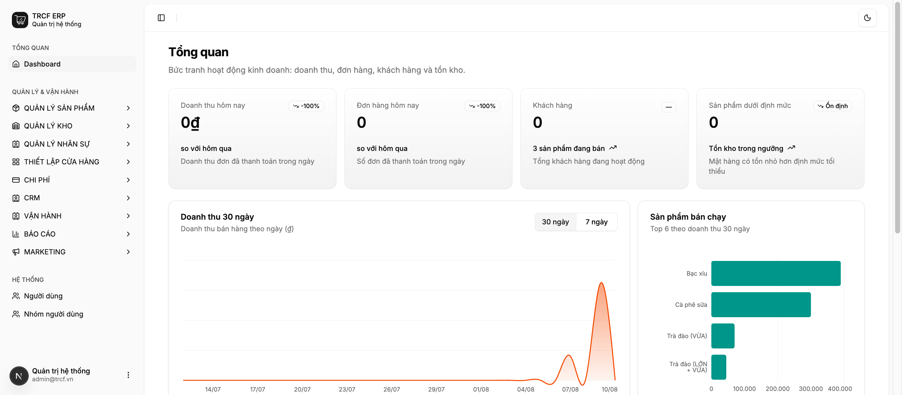
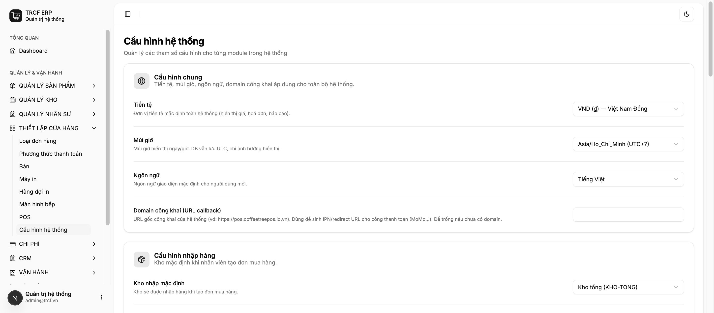

# Chương 1 — Cấu hình hệ thống

[← Về mục lục](./README.md) · [Chương 2 →](./chuong-02-kho-va-don-vi-tinh.md)

---

## 1.1 Làm quen giao diện và cấu hình thông tin ban đầu

### Đăng nhập

Mở trình duyệt vào địa chỉ hệ thống của quán, nhập email và mật khẩu được cấp rồi
bấm **Đăng nhập**.

Nếu quên mật khẩu, bấm **Quên mật khẩu?** để nhận đường dẫn đặt lại qua email.
Đường dẫn này chỉ dùng được **một lần**; bấm lại lần hai sẽ báo hết hạn — khi đó
xin gửi lại từ đầu.

### Ba vùng của màn hình

| Vùng | Ở đâu | Dùng để làm gì |
|---|---|---|
| **Thanh bên trái** | Cạnh trái, nền xám | Đi tới các màn nghiệp vụ. Bấm vào tên nhóm (VD *QUẢN LÝ KHO*) để mở danh sách màn con. |
| **Thanh trên** | Cạnh trên nội dung | Nút thu gọn thanh bên và nút chuyển sáng/tối. |
| **Vùng nội dung** | Phần giữa | Nội dung màn đang mở. |

Góc dưới bên trái là tên và email tài khoản đang đăng nhập. Bấm vào đó để **Đăng
xuất** hoặc mở trang cá nhân.

> **Thanh bên chỉ hiện những gì bạn được phép dùng.** Hai người ở hai vai khác
> nhau sẽ thấy số mục khác nhau — đó là bình thường, không phải lỗi. Nhân viên
> phục vụ thấy khoảng 4 nhóm, quản lý thấy gần như đủ.

### Màn Tổng quan nói gì

Bốn ô trên cùng là bốn con số của **hôm nay**:

- **Doanh thu hôm nay** — chỉ tính đơn đã thanh toán. Đơn đang treo chưa vào đây.
- **Đơn hàng hôm nay** — số đơn đã thanh toán.
- **Khách hàng** — tổng khách đang hoạt động (không phải khách hôm nay).
- **Sản phẩm dưới định mức** — số mặt hàng có tồn thấp hơn định mức tối thiểu đã
  khai. Con số này khác 0 là tín hiệu cần đặt hàng.

Bên dưới là biểu đồ doanh thu 30 ngày và danh sách sản phẩm bán chạy.

### Khai báo thông số nền

Vào *Thiết lập cửa hàng → Cấu hình hệ thống*.

Trang này chia thành các nhóm thẻ. Sửa xong nhớ bấm **Lưu cấu hình** ở cuối
trang — không tự lưu.

#### Làm từng bước

1. **Cấu hình chung** — chọn *Tiền tệ* (mặc định VND), *Múi giờ*
   (Asia/Ho_Chi_Minh), *Ngôn ngữ*. Ô *Domain công khai* để trống nếu quán chưa
   dùng cổng thanh toán online.
2. **Cấu hình nhập hàng** — chọn *Kho nhập mặc định*. Đây là kho hệ thống tự điền
   khi nhân viên tạo đơn mua hàng. Bật *Cho phép nhân viên chọn kho nhập* nếu
   quán có nhiều kho và nhân viên được quyền đổi.
3. **Cấu hình chuyển kho** — *Kho nguồn* và *Kho đích* mặc định cho phiếu chuyển.
4. **Cấu hình chế biến** — *Kho trừ nguyên liệu* và *Kho nhập thành phẩm*.
5. **Cấu hình bán hàng** — *Kho bán hàng* (kho bị trừ khi bán), *Loại đơn hàng mặc
   định*, và ***Phương thức tiền mặt***.
6. **Cấu hình huỷ hàng** — kho ghi nhận hàng hỏng/huỷ.
7. **Tài chính / Thuế** — bật *Giá bán đã bao gồm VAT* nếu giá niêm yết của quán
   đã gồm thuế.
8. **Hoá đơn điện tử (Minvoice)** — chỉ điền khi quán có hợp đồng xuất hoá đơn
   GTGT. Xem [mục 5.5](./chuong-05-ban-hang-tai-quay.md#55-cấu-hình-và-xuất-hoá-đơn-vat).
9. Bấm **Lưu cấu hình**.

### Lưu ý nghiệp vụ

⚠️ **Ô *Phương thức tiền mặt* là ô quan trọng nhất trang này.** Hệ thống dựa vào
nó để biết đâu là tiền mặt trong két. Bỏ trống thì mở ca và đóng ca **vẫn chạy
bình thường nhưng không sinh bút toán quỹ nào** — sổ quỹ đứng im mà không hề báo
lỗi, tới cuối tháng đối chiếu mới phát hiện. Hãy kiểm tra ô này ngay sau khi cài
đặt.

⚠️ **Các ô "kho mặc định" không phải để cho đẹp.** Nếu chưa khai, nhân viên tạo
phiếu sẽ nhận thông báo lỗi "chưa cấu hình kho" và không lập được phiếu. Khai đủ
6 ô kho trước khi cho nhân viên dùng.

💡 Quán chỉ có một kho vẫn nên khai đủ: chọn cùng một kho cho tất cả các ô.

💡 Trang Cấu hình hệ thống chỉ **chủ quán (tài khoản superuser)** mở được. Đây là
cố ý: trang này chứa khoá kết nối hoá đơn điện tử và cổng thanh toán.

### Sau khi cài đặt xong, quán đã có sẵn gì

Lần đầu khởi động, hệ thống tự nạp một bộ dữ liệu tối thiểu để bán được ngay:

| Loại | Có sẵn |
|---|---|
| Kho | Kho tổng (KHO-TONG), Kho quầy (KHO-QUAY) |
| Phương thức thanh toán | Tiền mặt (CASH), Chuyển khoản (BANK), Thẻ (CARD) |
| Quầy POS | Quầy chính, đã gắn 3 phương thức trên |
| Phòng ban | Vận hành |
| Nhân viên | Hồ sơ "Quản lý" gắn với tài khoản chủ quán |

Bộ này **chỉ nạp khi bảng còn trống**. Nếu bạn xoá bớt (ví dụ xoá phương thức
Thẻ vì quán không dùng), khởi động lại hệ thống sẽ **không** hồi sinh nó — hệ
thống tôn trọng việc bạn đã xoá.

---

[← Về mục lục](./README.md) · [Chương 2 — Thiết lập kho hàng, sản phẩm →](./chuong-02-kho-va-don-vi-tinh.md)
