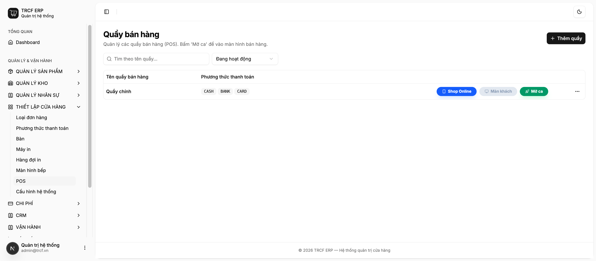
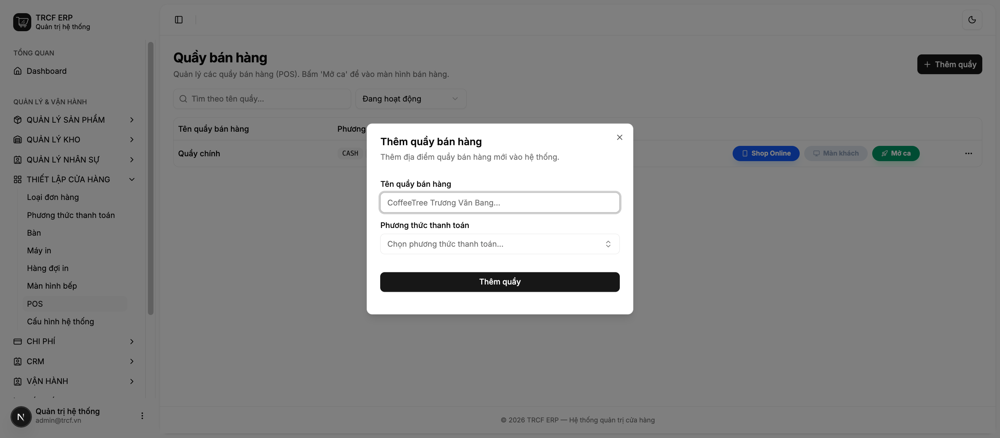
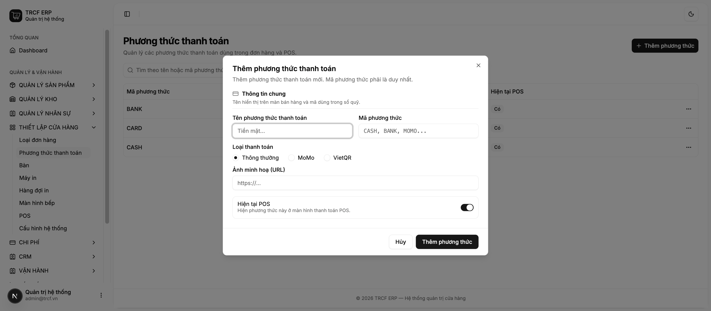
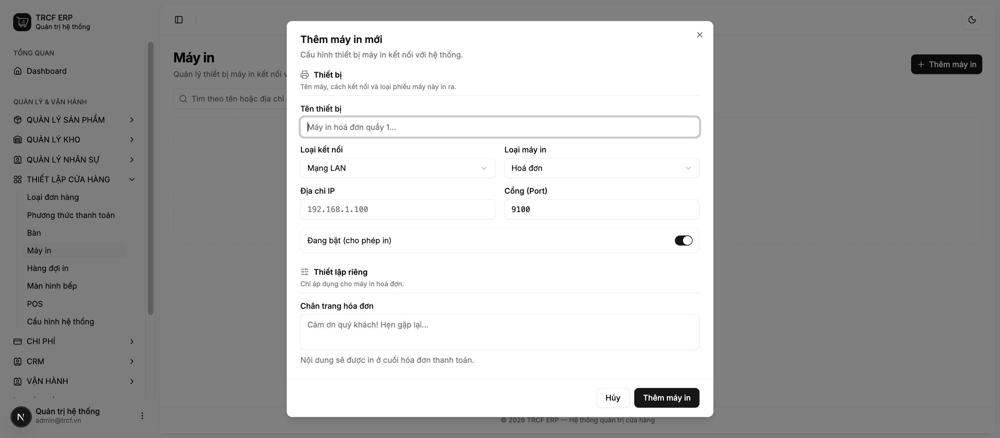
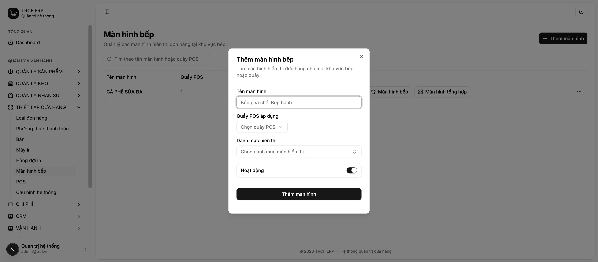

# Chương 4 — Thiết lập POS

[← Chương 3](./chuong-03-quan-ly-san-pham.md) · [Về mục lục](./README.md) · [Chương 5 →](./chuong-05-ban-hang-tai-quay.md)

Chương này dựng chỗ đứng bán hàng. Làm xong bốn mục dưới đây là quán bán được.

---

## 4.1 Tạo cửa hàng POS

*Thiết lập cửa hàng → POS*

Một **quầy POS** là một điểm bán: một máy tính/máy tính bảng có người đứng thu
tiền. Quán một quầy thì khai một; có quầy trong nhà và quầy mang đi thì khai hai.

### Làm từng bước

1. Bấm **Thêm quầy**.
2. Điền **Tên quầy bán hàng** (VD "Quầy chính", "Quầy sân vườn").
3. Chọn **Phương thức thanh toán** áp dụng cho quầy này — chọn nhiều được.
4. Bấm **Lưu**.

### Ba nút trên mỗi dòng quầy

| Nút | Mở ra gì |
|---|---|
| **Mở ca** | Vào màn bán hàng của quầy đó. Xem [mục 5.1](./chuong-05-ban-hang-tai-quay.md#51-hướng-dẫn-mở-phiên-và-bán-hàng). |
| **Màn khách** | Màn hình hướng về phía khách, hiện giỏ hàng và mã QR thanh toán. |
| **Shop Online** | Đường dẫn đặt hàng online của quán. |

### Lưu ý nghiệp vụ

⚠️ **Danh sách phương thức thanh toán chọn ở đây quyết định thu ngân thấy gì khi
thanh toán.** Quên gắn "Chuyển khoản" thì thu ngân không chọn được, dù phương
thức đó vẫn tồn tại trong hệ thống.

⚠️ Quầy đã phát sinh đơn hàng, phiếu chi, ca bán hoặc bút toán quỹ thì **không
xoá được**. Lý do: mọi bút toán trong sổ quỹ đều gắn với quầy; xoá quầy sẽ làm
việc đối chiếu ca cũ mất căn cứ. Ngừng dùng thì **lưu trữ**.

💡 Sửa danh sách phương thức thanh toán là **thay thế**, không phải cộng thêm:
danh sách sau khi lưu đúng bằng những gì đang tick.

---

## 4.2 Cấu hình phương thức thanh toán

*Thiết lập cửa hàng → Phương thức thanh toán*

### Làm từng bước

1. Bấm **Thêm phương thức**.
2. Nhóm **Thông tin chung**:

   | Trường | Điền gì |
   |---|---|
   | **Tên phương thức** | Chữ thu ngân nhìn thấy. VD "Tiền mặt", "Chuyển khoản VCB". |
   | **Mã phương thức** | Viết hoa, không trùng. VD `CASH`, `BANK`, `MOMO`. |
   | **Loại thanh toán** | *Thông thường* / *MoMo* / *VietQR*. |
   | **Hiện tại POS** | Bật thì thu ngân chọn được khi thanh toán. |

3. Nếu chọn **MoMo** hoặc **VietQR**, form hiện thêm nhóm khai báo kết nối
   (Partner Code, Access Key, Secret Key với MoMo; mã ngân hàng, số tài khoản,
   tên chủ tài khoản với VietQR).
4. Bấm **Lưu**.

### Lưu ý nghiệp vụ

⚠️ **Khoá bí mật (Secret Key, Access Key) không bao giờ hiện lại sau khi lưu.**
Mở lại form Sửa, các ô đó trống và ghi "Để trống nếu không đổi". Để trống là
**giữ nguyên khoá cũ**; chỉ điền khi thật sự muốn thay khoá mới. Đây là cách bảo
vệ khoá ký giao dịch — người xem được màn cấu hình không đọc trộm được khoá.

⚠️ **Phương thức đã dùng trong sổ quỹ, phiếu chi, đơn mua, đơn bán hoặc đối soát
ca thì không xoá được.** Muốn ngừng dùng thì tắt *Hiện tại POS*.

⚠️ Nhớ quay lại *Cấu hình hệ thống* chọn phương thức nào là **tiền mặt**
(mục 1.1). Không có bước này thì két không được ghi sổ.

💡 Mã phương thức không phân biệt hoa thường — đã có `CASH` thì không tạo `cash`.

---

## 4.3 Cấu hình máy in POS

*Thiết lập cửa hàng → Máy in*

### Làm từng bước

1. Bấm **Thêm máy in**.
2. Nhóm **Thiết bị**:

   | Trường | Điền gì |
   |---|---|
   | **Tên thiết bị** | VD "Máy in bill quầy 1". |
   | **Loại kết nối** | *Mạng LAN* (có IP) hoặc *USB* (cắm trực tiếp). |
   | **Loại máy in** | Hoá đơn / Nhãn dán / Phiếu yêu cầu món (KOT) / Phiếu đóng ca. |
   | **Địa chỉ IP**, **Cổng** | Chỉ hiện khi chọn LAN. Cổng thường là 9100. |
   | **Đang bật** | Tắt = tạm ngừng in ra máy này. |

3. Nhóm **Thiết lập riêng** đổi theo loại máy vừa chọn:

   | Loại máy | Khai thêm |
   |---|---|
   | Hoá đơn | *Chân trang hoá đơn* — câu in ở cuối bill. |
   | Nhãn dán | *Bề rộng / Chiều cao tem* (mm) và *Nguồn in* (loại đơn hàng nào thì in tem). |
   | Phiếu bếp (KOT) | *Danh mục sản phẩm* — máy chỉ in món thuộc danh mục đã chọn. Để trống = in mọi món. |
   | Phiếu đóng ca | Không cần khai thêm. |

4. Bấm **Lưu**.

### Chia máy in theo khu vực làm việc

Cách bố trí phổ biến:

- **Máy in bill** ở quầy thu ngân — loại *Hoá đơn*.
- **Máy in phiếu bếp** ở khu pha chế — loại *KOT*, chọn danh mục Cà phê/Trà.
- **Máy in phiếu bếp thứ hai** ở khu bếp nóng — loại *KOT*, chọn danh mục Đồ ăn.

Nhờ chọn danh mục, mỗi khu chỉ nhận phiếu của phần việc mình làm.

### Lưu ý nghiệp vụ

⚠️ **Chiều cao tem phải đo con tem, không đo cuộn.** Khai sai thì máy nhả giấy
đi tìm khe cắt và ra tem trắng.

⚠️ Máy in nhiệt phổ thông (POS-80) **không có sẵn bảng mã tiếng Việt**, nên hệ
thống in tiếng Việt bằng cách vẽ ảnh. Nếu bill in ra bị mất dấu, kiểm tra lại
loại máy đã khai.

💡 Máy in USB trên máy Linux có thể bị dịch vụ in của hệ điều hành (CUPS) chiếm
mất. Khi máy im lặng dù đã khai đúng, kiểm tra điều này trước.

---

## 4.4 Cấu hình màn hình bếp và hiển thị công thức

*Thiết lập cửa hàng → Màn hình bếp*

Màn hình bếp là màn hình đặt ở khu pha chế, tự hiện món cần làm ngay khi thu
ngân lên đơn — **không cần bấm tải lại**.

### Làm từng bước

1. Bấm **Thêm màn hình**.
2. Điền:

   | Trường | Điền gì |
   |---|---|
   | **Tên màn hình** | VD "Bếp pha chế", "Bếp nóng". |
   | **Quầy POS áp dụng** | Màn này chỉ nhận đơn của quầy đó. |
   | **Danh mục hiển thị** | Chọn nhóm món màn này phụ trách. Để trống = nhận mọi món. |
   | **Hoạt động** | Tắt = ngừng dùng màn này. |

3. Bấm **Lưu**.
4. Mở màn hình đó trên thiết bị ở khu pha chế (bấm vào dòng vừa tạo để lấy đường
   dẫn), để nguyên cả ngày.

### Món hiện gì trên màn bếp

Mỗi món hiện: tên món (kèm ghi chú pha chế trong ngoặc, VD *Trà đào (VỪA + ÍT
ĐÁ)*), số lượng, ghi chú của khách, và **Ghi chú công thức ⚡** đã khai ở
[mục 3.2](./chuong-03-quan-ly-san-pham.md#32-thêm-sản-phẩm-mới).

Bạn pha chế làm xong thì bấm vào món để đánh dấu hoàn thành — món biến khỏi màn.

### Lưu ý nghiệp vụ

💡 **Ghi chú công thức là chỗ đặt công thức rút gọn cho người mới.** VD "30ml
espresso + 150ml sữa + đá đầy ly". Nhân viên mới không cần nhớ, không cần hỏi.

💡 Đơn bị huỷ hoặc đã hoàn sẽ **tự biến khỏi màn bếp** — bạn pha chế không làm
nhầm món của đơn đã huỷ.

💡 Màn hình bếp chỉ hiển thị và đánh dấu xong. Mọi thao tác đụng tiền và kho đều
phải làm ở màn bán hàng — đây là ranh giới an toàn cố ý.

---

[← Chương 3](./chuong-03-quan-ly-san-pham.md) · [Về mục lục](./README.md) · [Chương 5 — Quy trình bán hàng tại quầy →](./chuong-05-ban-hang-tai-quay.md)
