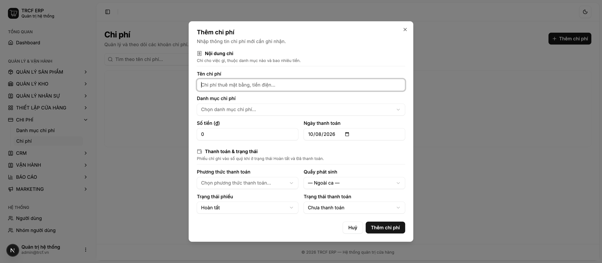
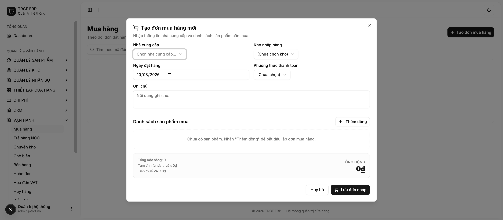
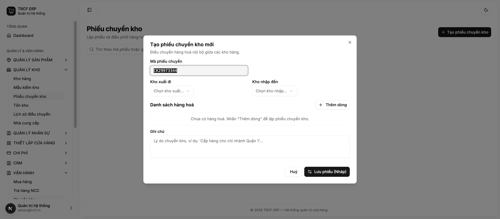
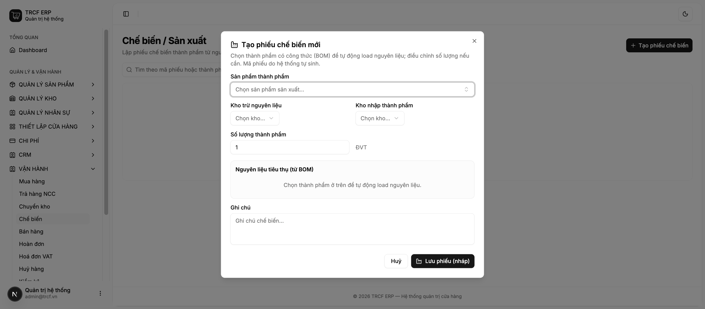
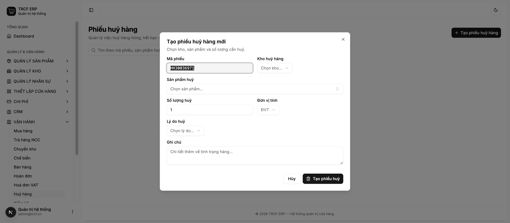
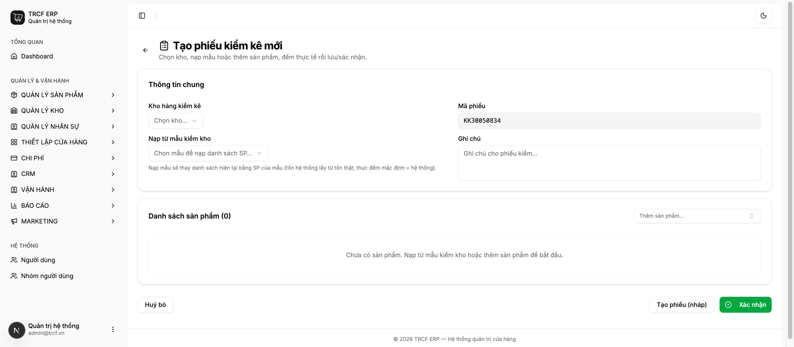

# Chương 6 — Chi tiết các nghiệp vụ kho

[← Chương 5](./chuong-05-ban-hang-tai-quay.md) · [Về mục lục](./README.md) · [Chương 7 →](./chuong-07-ca-lam-va-cham-cong.md)

Mọi phiếu trong chương này đều theo **cùng một luật**:

> **Nháp thì chưa đụng gì. Xác nhận rồi thì không sửa được.**
>
> Phiếu mới tạo là *Nháp* — kho và tiền chưa thay đổi, xoá thoải mái. Bấm xác
> nhận là hệ thống ghi vào kho/sổ quỹ **ngay lập tức và không thể quay lui**.
> Sai thì lập phiếu ngược lại chứ không sửa phiếu cũ.

Vào các phiếu này bằng hai đường: từ menu bên trái, hoặc nhanh hơn là nút
**VẬN HÀNH** trên màn bán hàng.

---

## 6.1 Nhập chi phí

*Chi phí → Chi phí* · hoặc *Vận hành → Chi phí*

Dùng cho mọi khoản chi **không phải mua hàng hoá**: tiền điện, tiền nước, tiền
ship, thuê mặt bằng, mua chổi lau nhà.

### Làm từng bước

1. Bấm **Thêm chi phí**.
2. Nhóm **Nội dung chi**:
   - *Tên chi phí* — mô tả ngắn: "Tiền điện tháng 8".
   - *Danh mục chi phí* — chọn nhóm để báo cáo lãi lỗ gom đúng chỗ.
   - *Số tiền* và *Ngày thanh toán*.
3. Nhóm **Thanh toán & trạng thái**:
   - *Phương thức thanh toán* — tiền mặt hay chuyển khoản.
   - *Quầy phát sinh* — chọn quầy nếu chi từ két của quầy; để *Ngoài ca* nếu chi
     từ tài khoản công ty.
   - *Trạng thái phiếu*: **Nháp** hay **Hoàn tất**.
   - *Trạng thái thanh toán*: **Chưa thanh toán** hay **Đã thanh toán**.
4. Bấm **Thêm chi phí**.

### Khi nào tiền thật sự vào sổ quỹ

Chỉ khi phiếu ở **Hoàn tất** **và** **Đã thanh toán**. Thiếu một trong hai thì
phiếu chỉ là ghi nhớ, chưa động vào quỹ.

### Lưu ý nghiệp vụ

⚠️ **Chi tiền mặt lấy từ két thì bắt buộc chọn đúng quầy.** Không chọn thì khi
đóng ca, số tiền chi đó không được trừ khỏi số dự kiến trong két → cuối ca hiện
thiếu tiền mà không rõ lý do.

⚠️ **Không được gỡ trạng thái "Đã thanh toán" rồi bật lại.** Hệ thống chặn và
báo lỗi, đề nghị lập phiếu chi mới. Lý do: bút toán trong sổ quỹ là bản ghi vĩnh
viễn — gỡ thanh toán sẽ sinh bút toán đảo, và khi bật lại thì tiền **biến mất**
khỏi sổ mà không ai thấy. Trả tiền điện lần nữa thì lập phiếu chi mới cho lần đó.

💡 Khai danh mục chi phí gọn gàng ngay từ đầu (*Chi phí → Danh mục chi phí*) thì
báo cáo lãi lỗ ở chương 8 đọc mới có nghĩa.

---

## 6.2 Nhập hàng từ nhà cung cấp

*Vận hành → Mua hàng* · hoặc *Vận hành → Nhập hàng* trên màn bán hàng

### Làm từng bước

1. Bấm **Tạo đơn mua hàng**.
2. Chọn *Nhà cung cấp*, *Kho nhập hàng*, *Ngày đặt hàng*, *Phương thức thanh
   toán*.
3. Bấm **Thêm dòng** cho từng mặt hàng: chọn sản phẩm, số lượng, đơn vị, đơn giá,
   VAT. Tổng tiền tự tính ở dưới.
4. Bấm **Lưu đơn nháp**.
5. Kiểm tra lại rồi bấm **Xác nhận**.
6. Khi hàng về tới quán, bấm **Nhận hàng** → hệ thống **cộng hàng vào kho** và
   ghi tiền vào sổ quỹ nếu đơn đã đánh dấu thanh toán.

Ba trạng thái: **Nháp → Đã xác nhận → Đã nhập kho**.

### Giá vốn tự cập nhật

Mỗi lần nhận hàng, hệ thống lấy đơn giá trên phiếu để cập nhật **giá vốn** của
sản phẩm. Đây là nguồn giá vốn cho công thức và cho báo cáo lãi lỗ.

Sản phẩm có bật *Sản xuất* thì **bỏ qua** — giá vốn của nó do công thức tính
(xem [mục 3.5](./chuong-03-quan-ly-san-pham.md#35-cấu-hình-công-thức-pha-chế-và-biến-thể)).

### Lưu ý nghiệp vụ

⚠️ **Nhận hàng chỉ bấm được một lần.** Bấm hai lần thì lần sau bị chặn — nếu
không, kho sẽ cộng gấp đôi.

⚠️ **Đơn đã nhập kho thì không sửa dòng hàng, không xoá.** Nhập nhầm số lượng
thì lập **phiếu trả hàng NCC** (*Vận hành → Trả hàng NCC*) cho phần dư.

⚠️ Đơn đã thanh toán rồi gỡ thanh toán rồi bật lại cũng bị chặn — cùng lý do với
phiếu chi ở mục 6.1.

💡 Nhập theo đơn vị lớn được: mua 5 *Kg* cà phê trong khi kho quản lý theo
*Gram*, hệ thống tự quy ra 5000 g.

---

## 6.3 Chuyển kho nội bộ

*Vận hành → Chuyển kho*

Dùng khi lấy hàng từ kho tổng ra kho quầy, hoặc điều hàng giữa hai chi nhánh.

### Làm từng bước

1. Bấm **Tạo phiếu chuyển kho**.
2. Chọn *Kho xuất đi* và *Kho nhập đến* — **hai kho phải khác nhau**.
3. Thêm từng dòng hàng: sản phẩm, số lượng, đơn vị.
4. **Lưu nháp**, kiểm tra, rồi **Xác nhận chuyển**.

Khi xác nhận, hệ thống ghi **hai bút toán kho cùng lúc**: trừ kho nguồn và cộng
kho đích — không có chuyện hàng "biến mất giữa đường".

### Lưu ý nghiệp vụ

⚠️ Chọn cùng một kho cho cả hai ô sẽ bị chặn ngay khi lưu.

⚠️ Phiếu đã xác nhận không sửa, không xoá. Chuyển nhầm thì lập phiếu chuyển
ngược lại.

💡 Hàng bê ra quầy mà không lập phiếu thì kho tổng trên hệ thống vẫn đầy trong
khi kệ đã trống — tới lúc kiểm kho mới lòi ra chênh lệch lớn không truy được.

---

## 6.4 Chế biến bán thành phẩm

*Vận hành → Chế biến*

Dùng khi quán tự làm ra thứ gì đó: ủ cà phê cốt, nấu syrup, làm sốt.

### Làm từng bước

1. Bấm **Tạo phiếu chế biến**.
2. Chọn *Sản phẩm thành phẩm* — thứ làm ra. Hệ thống **tự nạp danh sách nguyên
   liệu từ công thức (BOM)** của nó.
3. Chọn *Kho trừ nguyên liệu* và *Kho nhập thành phẩm*.
4. Nhập *Số lượng thành phẩm* làm được. Danh sách nguyên liệu tự nhân lên theo.
5. Chỉnh lại số lượng nguyên liệu nếu thực tế dùng khác định mức.
6. **Lưu nháp** → **Xác nhận chế biến**.

Khi xác nhận: **trừ nguyên liệu** và **cộng thành phẩm** vào kho trong cùng một
lần.

### Lưu ý nghiệp vụ

⚠️ **Số lượng trên phiếu là nguồn sự thật, không phải công thức.** Công thức chỉ
điền sẵn cho nhanh. Hôm nay dùng nhiều nguyên liệu hơn định mức thì cứ sửa số
trên phiếu — hệ thống trừ đúng số bạn khai.

⚠️ **Đã xác nhận thì không xác nhận lại được.** Hệ thống khoá lại để tránh trừ
kho hai lần khi hai người cùng bấm.

💡 Chế biến **không đụng tới tiền** — chỉ chuyển giá trị từ nguyên liệu sang bán
thành phẩm. Đây là phiếu nhẹ nhất trong chương này.

💡 Chưa có công thức cho món đó thì phiếu không tự nạp nguyên liệu được. Tạo
công thức trước ở [mục 3.5](./chuong-03-quan-ly-san-pham.md#35-cấu-hình-công-thức-pha-chế-và-biến-thể).

---

## 6.5 Nhập liệu hỏng huỷ

*Vận hành → Huỷ hàng*

Dùng khi hàng hỏng, hết hạn, rơi vỡ, pha hỏng phải bỏ.

### Làm từng bước

1. Bấm **Tạo phiếu huỷ hàng**.
2. Chọn *Kho huỷ hàng*, *Sản phẩm huỷ*, *Số lượng*, *Đơn vị tính*.
3. Ghi *Lý do huỷ* — càng cụ thể càng dễ truy sau này: "hết hạn 09/08", "làm rơi
   khi bưng".
4. **Lưu nháp** → **Xác nhận huỷ**.

Mỗi phiếu huỷ **một mặt hàng**. Huỷ ba thứ thì lập ba phiếu.

### Huỷ món pha sẵn

Huỷ một món có công thức dạng *Kit* (VD ly trà đã pha hỏng) thì hệ thống **trừ
nguyên liệu theo công thức**, không trừ "ly trà" — vì trong kho không có mặt
hàng "ly trà đã pha".

### Lưu ý nghiệp vụ

⚠️ Đã xác nhận thì không sửa, không xoá.

💡 **Ghi lý do tử tế là phần có giá trị nhất của phiếu huỷ.** Cuối tháng nhìn lại
sẽ thấy hao hụt nằm ở đâu: hết hạn (mua nhiều quá), rơi vỡ (thao tác), hay pha
hỏng (đào tạo).

💡 Đừng gộp hao hụt vào phiếu kiểm kho. Kiểm kho chỉ nói "thiếu 2 kg", phiếu huỷ
nói "thiếu vì sao".

---

## 6.6 Kiểm kê tồn kho

*Quản lý kho → Kiểm kê* · hoặc *Vận hành → Kiểm tồn*

Đếm hàng thật rồi chỉnh số trên hệ thống cho khớp.

### Làm từng bước

1. Bấm **Tạo phiếu kiểm kê**. Mã phiếu tự sinh.
2. Chọn *Kho hàng kiểm kê*.
3. Nạp danh sách hàng cần đếm theo một trong hai cách:
   - **Nạp từ mẫu kiểm kho** — dùng mẫu đã dựng sẵn (*Quản lý kho → Mẫu kiểm
     kho*). Nhanh và không sót mặt hàng.
   - **Thêm sản phẩm** từng món một.
4. Cột *Hệ thống* hiện tồn hiện tại. Đi đếm thật rồi nhập vào cột **Thực đếm**.
   Cột *Chênh lệch* tự tính.
5. **Tạo phiếu (nháp)** nếu chưa đếm xong — quay lại làm tiếp sau.
6. Đếm xong hết thì bấm **Xác nhận** → hệ thống **chỉnh tồn kho về đúng số bạn
   đếm**.

### Lưu ý nghiệp vụ

⚠️ **Xác nhận là ghi đè tồn kho.** Đếm sai một con số thì tồn kho sai theo, và
phải kiểm lại lần nữa mới sửa được. Đếm xong nên rà lại những dòng chênh lệch lớn
trước khi bấm.

⚠️ Phiếu đã hoàn thành không sửa, không xoá.

💡 **Dựng mẫu kiểm kho theo khu vực** (*Quản lý kho → Mẫu kiểm kho*): mẫu "Quầy
pha chế", mẫu "Kho khô", mẫu "Tủ đông". Đếm theo khu thì nhanh hơn và ít sót hơn
đếm theo danh sách toàn quán.

💡 Lịch kiểm kê hợp lý cho quán cà phê: hàng dễ hỏng đếm **hằng ngày cuối ca**,
hàng khô đếm **hằng tuần**, kiểm toàn bộ **cuối tháng**.

💡 Chênh lệch lặp lại ở cùng một mặt hàng thường không phải do đếm sai, mà do
thiếu phiếu huỷ hoặc thiếu phiếu chuyển kho ở khâu trước.

---

[← Chương 5](./chuong-05-ban-hang-tai-quay.md) · [Về mục lục](./README.md) · [Chương 7 — Quản lý ca làm và chấm công →](./chuong-07-ca-lam-va-cham-cong.md)
