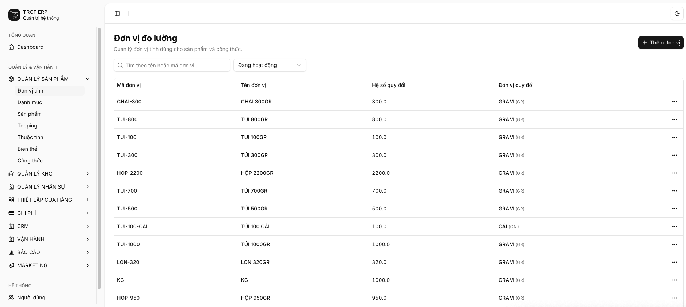
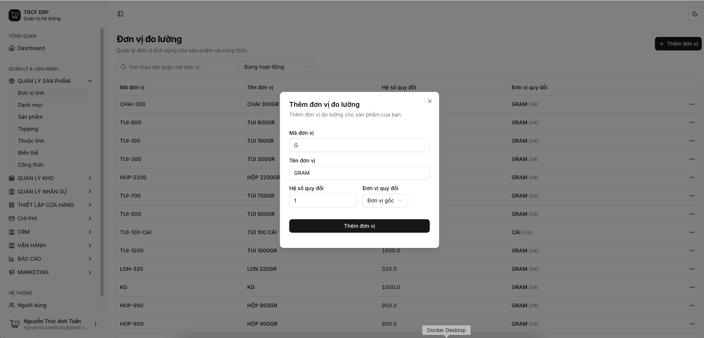
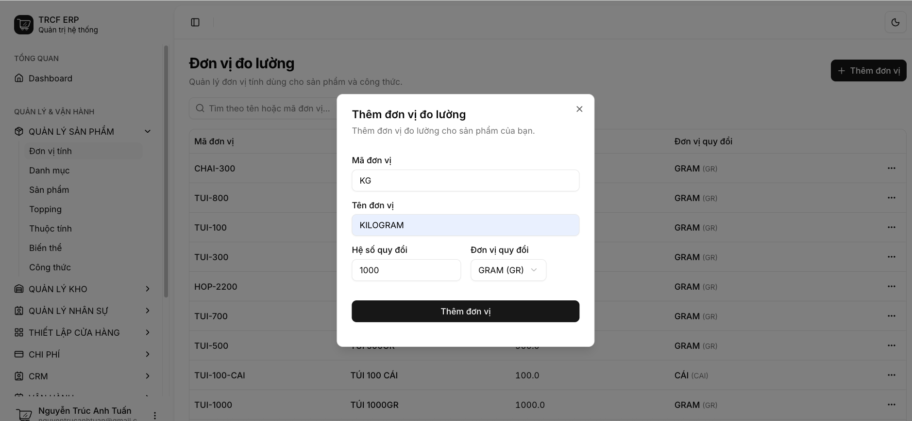

# 1.1 Thiết lập đơn vị tính (UOM)

## 1. Đường dẫn vào chức năng

Menu trái: ==Quản lý sản phẩm → Đơn vị tính== (địa chỉ `/uoms`).

## 2. Ví dụ nền và các bước thực hiện

> **Ví dụ:** quán nhập cà phê theo kg, pha chế trừ theo gram.
>
> - Đơn vị gốc: "G" (Gram), hệ số 1.
> - Đơn vị lớn hơn: "KG" (Kilogam) = 1000 Gram.
> - Nhập 5 KG → hệ thống ghi tồn 5000 G.

### Bước 1: Mở trang Đơn vị tính

- Bấm **Quản lý sản phẩm** ở menu trái.
- Chọn **Đơn vị tính**.
- Xem danh sách đơn vị hiện có.

### Bước 2: Thêm đơn vị gốc trước

- Bấm **Thêm đơn vị**.
- **Mã đơn vị**: nhập "G".
- **Tên đơn vị**: nhập "Gram".
- **Hệ số quy đổi**: giữ "1".
- **Đơn vị quy đổi**: giữ "Đơn vị gốc".
- Bấm nút **Thêm đơn vị** trong hộp thoại.

### Bước 3: Thêm đơn vị lớn hơn

- Bấm **Thêm đơn vị**.
- **Mã đơn vị**: nhập "KG".
- **Tên đơn vị**: nhập "Kilogam".
- **Hệ số quy đổi**: nhập "1000".
- **Đơn vị quy đổi**: chọn "GRAM (G)".
- Bấm nút **Thêm đơn vị** trong hộp thoại.

## 3. Giải thích các trường

| Trường         | Điền gì                                                                                | Bắt buộc |
| -------------- | -------------------------------------------------------------------------------------- | -------- |
| Mã đơn vị      | Ngắn, viết hoa. Ví dụ: `LY`, `KG`, `G`, `TUI-1000`, `CHAI-900`, `HOP-500`              | ✅        |
| Tên đơn vị     | Ví dụ: "LY", "KILOGAM", "GRAM", "TÚI 1000G", "CHAI 900G", "HỘP 500G"                   | ✅        |
| Hệ số quy đổi  | Bằng bao nhiêu đơn vị gốc. Nếu là đơn vị gốc thì điền **1**                            | ✅        |
| Đơn vị quy đổi | Nếu là KG thì đơn vị gốc là GRAM, Nếu là "Thùng (Chứa 30 Lon)" thì đơn vị gốc là "Lon" | —        |

## Hiểu trước khi điền

| Khái niệm          | Nghĩa                                              | Khai thế nào                     |
| ------------------ | -------------------------------------------------- | -------------------------------- |
| **Đơn vị gốc**     | Đơn vị nhỏ nhất dùng lưu tồn. VD **GRAM**, **Cái** | Hệ số 1, để "Đơn vị gốc"         |
| **Đơn vị quy đổi** | Đơn vị to hơn. VD **KG = 1000 GRAM**               | Hệ số 1000, chọn quy đổi về GRAM |

## Bộ đơn vị mẫu cho quán

| Mã             | Tên          | Hệ số | Quy đổi về |
| -------------- | ------------ | ----- | ---------- |
| `LY`           | Ly           | 1     | *(gốc)*    |
| `G`            | Gram         | 1     | *(gốc)*    |
| `KG`           | Kilogam      | 1000  | Gram       |
| `TUI-1000`     | TÚI 1000G    | 1000  | Gram       |
| `CHAI-900`     | CHAI 900G    | 900   | Gram       |
| `HOP-500`      | HỘP 500G     | 500   | Gram       |
| `CAI`          | CÁI          | 1     | *(gốc)*    |
| `THUNG-30-CAI` | THÙNG 30 CÁI | 30    | CÁI        |

## 4. Lưu ý quan trọng

> [!CAUTION]
> **Hệ số bị khoá khi đơn vị đã được dùng.**
>
> - Đã gắn sản phẩm hoặc công thức: không sửa được.
> - Sửa hệ số làm tồn kho và giá vốn cũ bị sai.
> - Cần đơn vị khác: tạo mới, lưu trữ cái cũ.

> [!WARNING]
> **Hệ số phải lớn hơn 0.**
>
> - Hệ số 0 làm mất sạch số lượng khi quy đổi.

> [!WARNING]
> Xoá đơn vị là xoá vĩnh viễn. Không dùng nữa thì chọn **Lưu trữ**.

> [!TIP]
> Mã đơn vị không phân biệt hoa thường: đã có "KG" thì không tạo thêm "kg".

> [!TIP]
> Chỉ khai đơn vị quán thật sự dùng, danh sách dài dễ chọn nhầm.

## Kiểm tra đã đúng

- [ ] Đã có đơn vị gốc (hệ số 1, hiện *Đơn vị gốc*)
- [ ] Đơn vị lớn hơn quy đổi về đúng đơn vị gốc, đúng hệ số
