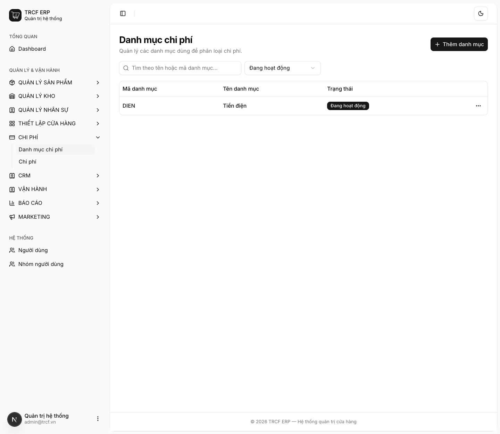
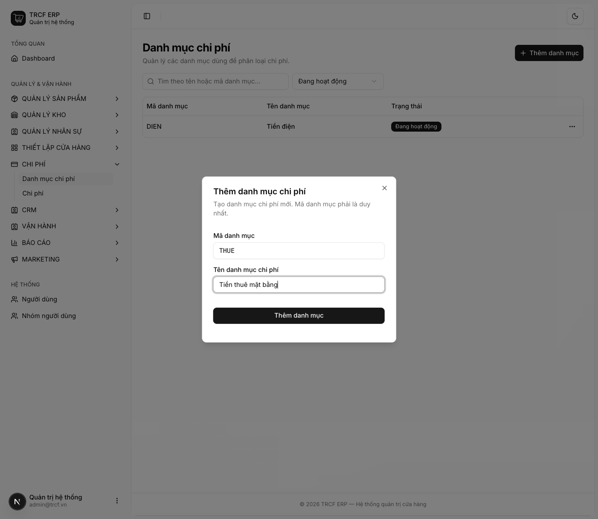
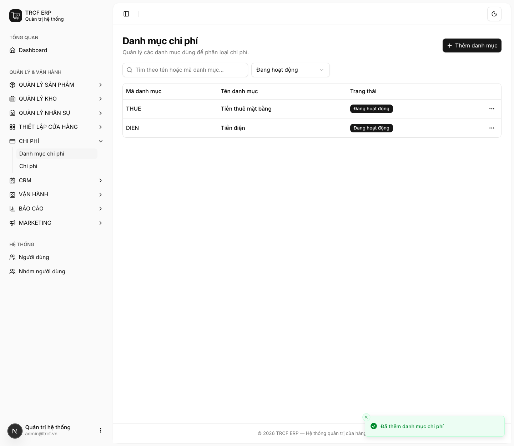

# 10.1 Danh mục chi phí

## 1. Đường dẫn vào chức năng

Menu trái: ==Chi phí → Danh mục chi phí== (địa chỉ `/expense-categories`).

## 2. Ví dụ nền và các bước thực hiện

> **Ví dụ:** khai danh mục cho tiền thuê mặt bằng.
>
> - Mã danh mục: "THUE". Tên: "Tiền thuê mặt bằng".
> - Danh mục để gom các khoản chi cùng loại khi xem báo cáo lãi lỗ.

### Bước 1: Mở trang Danh mục chi phí

- Bấm **Chi phí** ở menu trái.
- Chọn **Danh mục chi phí**.
- Bấm **Thêm danh mục**.

### Bước 2: Khai danh mục

- **Mã danh mục**: nhập "THUE".
- **Tên danh mục chi phí**: nhập "Tiền thuê mặt bằng".
- Bấm nút **Thêm danh mục** trong hộp thoại.

### Bước 3: Kiểm tra trong danh sách

- Thấy thông báo *“Đã thêm danh mục chi phí”*.
- Danh mục hiện trong danh sách, trạng thái **Đang hoạt động**.
- Bấm nút **…** cuối dòng: có **Sửa**, **Lưu trữ**, **Xoá**.

## 3. Giải thích các trường

| Trường | Điền gì | Bắt buộc |
| --- | --- | --- |
| Mã danh mục | Ngắn, viết hoa, **không trùng**. VD "THUE", "DIEN" | ✅ |
| Tên danh mục chi phí | Tên hiện khi chọn ở phiếu chi và trên báo cáo | ✅ |

## 4. Lưu ý quan trọng

> [!WARNING]
> **Mã danh mục phải là duy nhất.**
>
> - Trùng mã thì hệ thống không cho thêm.

> [!WARNING]
> **Danh mục đã dùng cho phiếu chi thì không xoá được.**
>
> - Muốn ẩn khỏi danh sách chọn: chọn **Lưu trữ**.

> [!TIP]
> Khai danh mục gọn gàng từ đầu thì báo cáo lãi lỗ ([bài 12.2](12-2-bao-cao-lai-lo.md)) mới đọc có nghĩa.

## Kiểm tra đã đúng

- [ ] Danh mục hiện trong danh sách, trạng thái đang hoạt động
- [ ] Mã danh mục ngắn gọn, không trùng
