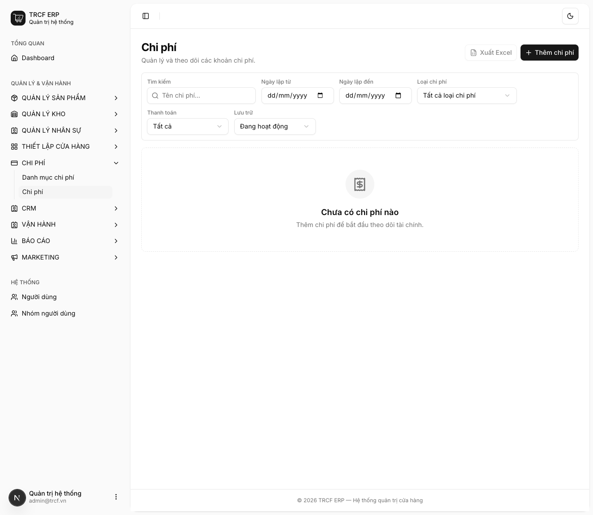
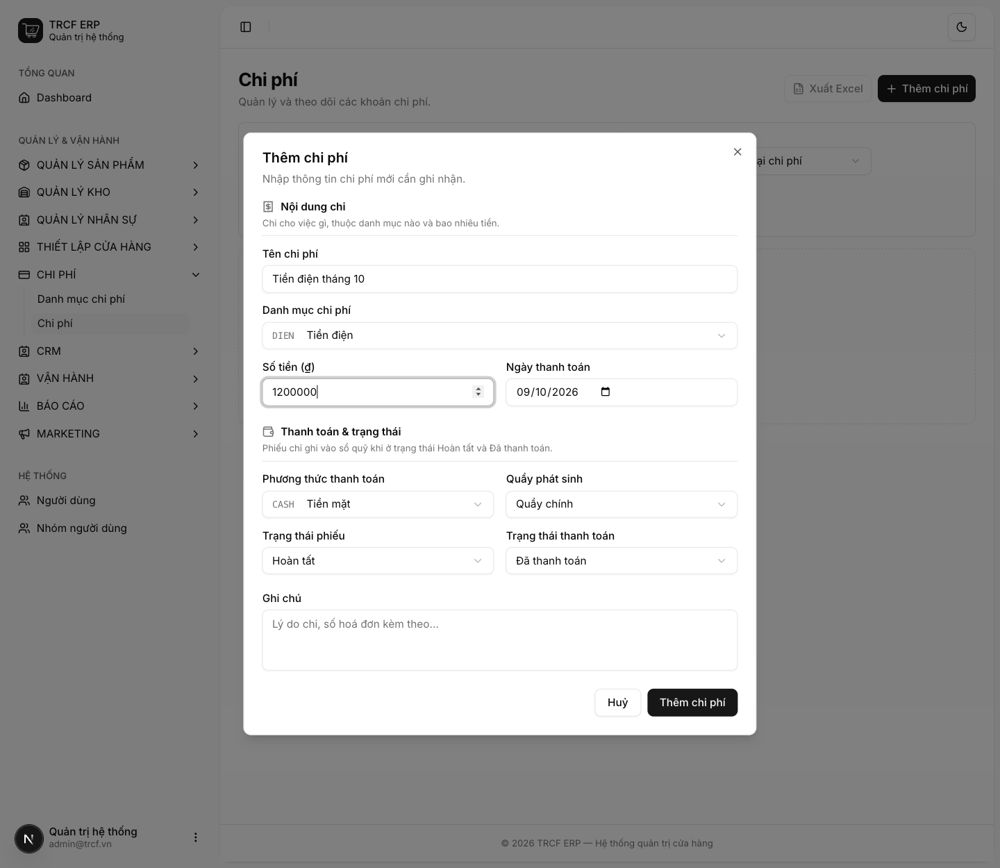
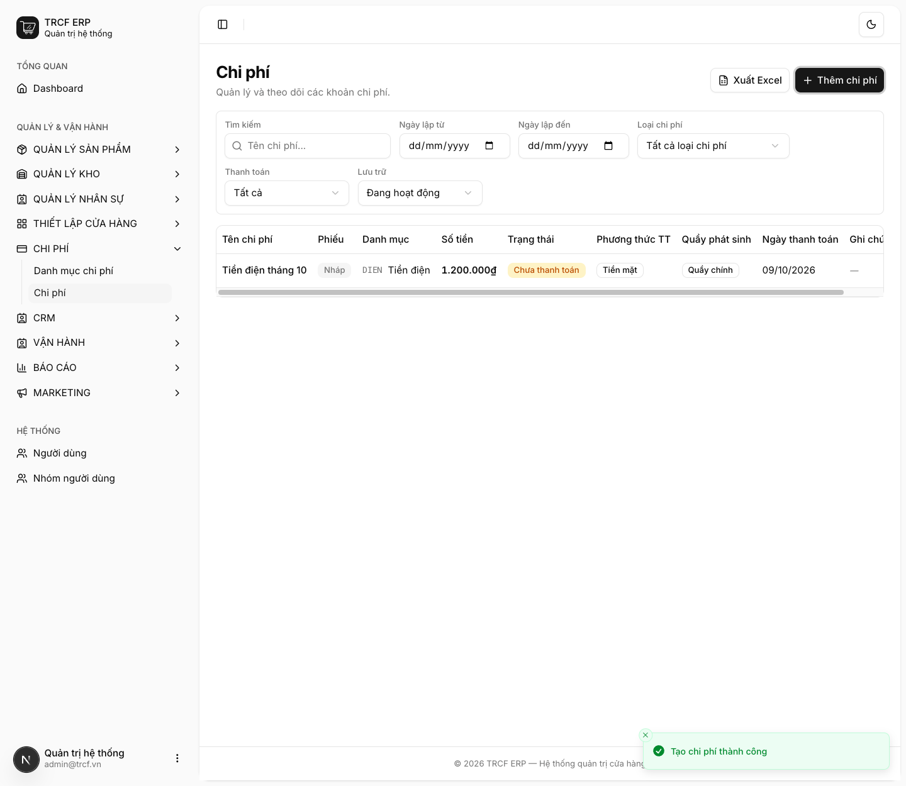

# 10.2 Tạo chi phí

## 1. Đường dẫn vào chức năng

Menu trái: ==Chi phí → Chi phí== (địa chỉ `/expenses`).

hoặc ==Vận hành → Chi phí== (ở màn bán hàng).

- Dùng cho mọi khoản chi **không phải mua hàng hoá**: tiền điện, nước, ship, thuê mặt bằng, mua chổi lau nhà.
- Cần có trước: danh mục chi phí ([bài 10.1 Danh mục chi phí](10-1-danh-muc-chi-phi.md)).

## 2. Ví dụ nền và các bước thực hiện

> **Ví dụ:** trả tiền điện tháng 10 bằng tiền mặt lấy từ két "Quầy chính".
>
> - Tên chi phí: "Tiền điện tháng 10". Danh mục: "Tiền điện".
> - Số tiền: "1200000". Phương thức: "Tiền mặt". Quầy phát sinh: "Quầy chính".
> - Trạng thái phiếu: "Hoàn tất". Trạng thái thanh toán: "Đã thanh toán".

### Bước 1: Mở trang Chi phí

- Bấm **Chi phí** ở menu trái, chọn **Chi phí**.
- Bấm **Thêm chi phí**.

### Bước 2: Khai nội dung và thanh toán

- **Tên chi phí**: nhập "Tiền điện tháng 10".
- **Danh mục chi phí**: chọn "Tiền điện".
- **Số tiền (₫)**: nhập "1200000".
- **Ngày thanh toán**: giữ ngày hôm nay (hoặc chọn ngày trả thật).
- **Phương thức thanh toán**: chọn "Tiền mặt".
- **Quầy phát sinh**: chọn "Quầy chính" (chi từ két quầy).
- **Trạng thái phiếu**: chọn "Hoàn tất".
- **Trạng thái thanh toán**: chọn "Đã thanh toán".
- Bấm nút **Thêm chi phí** trong hộp thoại.

### Bước 3: Kiểm tra trong danh sách

- Phiếu hiện trong danh sách: tên, danh mục, số tiền, quầy phát sinh.
- Cột **Phiếu**: Nháp / Hoàn tất / Đã huỷ.
- Cột **Trạng thái**: Chưa thanh toán / Đã thanh toán.
- Bấm nút **…** cuối dòng: có **Hoàn tất**, **Sửa**, **Lưu trữ**, **Huỷ phiếu**.

## 3. Giải thích các trường

### Nội dung chi

| Trường | Điền gì | Bắt buộc |
| --- | --- | --- |
| Tên chi phí | Mô tả ngắn: "Tiền điện tháng 10" | ✅ |
| Danh mục chi phí | Nhóm để báo cáo lãi lỗ gom đúng chỗ | ✅ |
| Số tiền (₫) | Số tiền chi | ✅ |
| Ngày thanh toán | Ngày trả tiền thật | ✅ |

### Thanh toán & trạng thái

| Trường | Điền gì |
| --- | --- |
| Phương thức thanh toán | Tiền mặt hay chuyển khoản |
| Quầy phát sinh | Chọn quầy nếu chi **từ két của quầy**. Để *— Ngoài ca —* nếu chi từ tài khoản công ty |
| Trạng thái phiếu | **Nháp** hay **Hoàn tất** |
| Trạng thái thanh toán | **Chưa thanh toán** hay **Đã thanh toán** |
| Ghi chú | Ghi thêm (không bắt buộc) |

### Khi nào tiền thật sự vào sổ quỹ

- Chỉ khi phiếu ở **Hoàn tất** **VÀ** **Đã thanh toán**.
- Thiếu một trong hai: phiếu chỉ là ghi nhớ, chưa động vào quỹ.

## 4. Lưu ý quan trọng

> [!CAUTION]
> **Chi tiền mặt lấy từ két thì bắt buộc chọn đúng quầy.**
>
> - Không chọn thì lúc đóng ca, khoản chi không được trừ khỏi số dự kiến trong két.
> - Cuối ca hiện thiếu tiền mà không rõ lý do.

> [!CAUTION]
> **Không được gỡ "Đã thanh toán" rồi bật lại.**
>
> - Hệ thống chặn và đề nghị lập phiếu mới.
> - Bút toán sổ quỹ là bản ghi vĩnh viễn.
> - Gỡ thanh toán sinh bút toán đảo, bật lại thì tiền biến mất khỏi sổ mà không ai thấy.

> [!WARNING]
> **Phiếu chi không xoá được, chỉ *Huỷ phiếu*.**
>
> - Phiếu đã huỷ không sửa lại được.
> - Sai thì tạo phiếu mới.

> [!TIP]
> Khai danh mục chi phí gọn gàng từ đầu thì báo cáo lãi lỗ ([mục 12.2](12-2-bao-cao-lai-lo.md)) mới đọc có nghĩa.

## Kiểm tra đã đúng

- [ ] Chi từ két quầy: đã chọn đúng **Quầy phát sinh**
- [ ] Phiếu ở *Hoàn tất* + *Đã thanh toán* nếu tiền đã trả
- [ ] Số dư sổ quỹ đã giảm đúng số tiền
