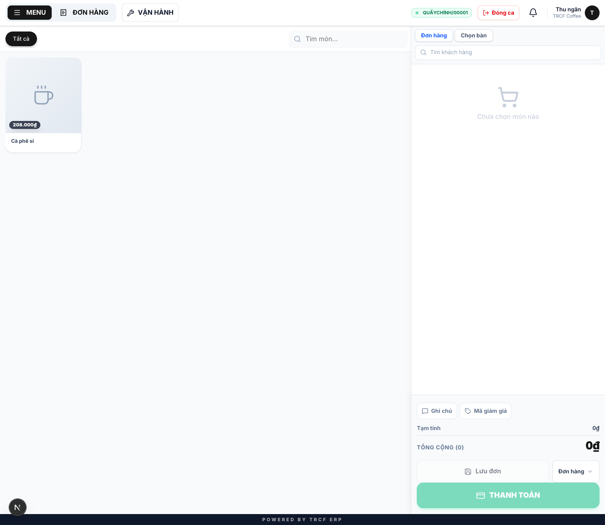
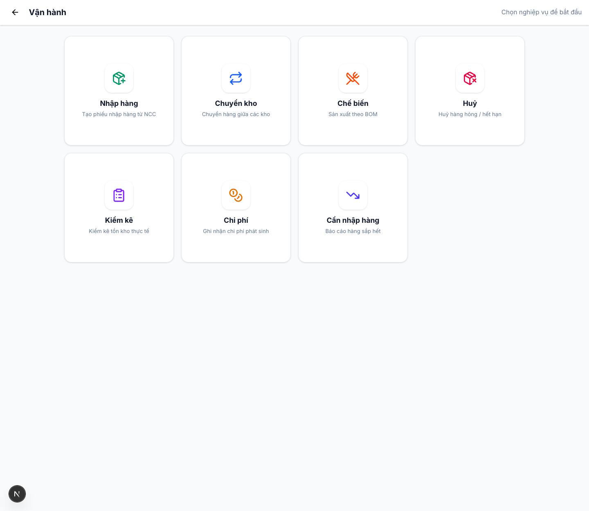

# 11.1 Tổng quan quy trình kho

## 1. Đường dẫn vào chức năng

Menu trái: ==Màn bán hàng → nút **VẬN HÀNH**== (địa chỉ `/pos-operations?pos=1`).

- Dùng để: tra nhanh xem tình huống đang gặp thì lập phiếu gì.
- Cần có: ca đang mở trên màn bán hàng.

## 2. Ví dụ nền và các bước thực hiện

> **Ví dụ:** nhà cung cấp vừa giao 5 kg cà phê hạt tới quán.
>
> - Mở **VẬN HÀNH**, chọn ô **Nhập hàng**.
> - Lập phiếu, bấm **Xác nhận**: kho được cộng 5 kg.

### Bước 1: Mở VẬN HÀNH từ màn bán hàng

- Đang ở màn bán hàng của ca đã mở.
- Bấm nút **VẬN HÀNH** (thanh trên cùng).
- Trang **Vận hành** mở ra ở tab mới.

### Bước 2: Chọn nghiệp vụ cần làm

- Trang hiện 7 ô: **Nhập hàng**, **Chuyển kho**, **Chế biến**, **Huỷ**, **Kiểm kê**, **Chi phí**, **Cần nhập hàng**.
- Bấm ô đúng với tình huống (xem bảng tra nhanh bên dưới).
- Mỗi ô dẫn tới form lập phiếu, chi tiết ở chương 6.

## 3. Giải thích các trường

### Bảng tra nhanh

| Ô | Dùng khi | Kho bị ảnh hưởng | Chi tiết |
| --- | --- | --- | --- |
| **Nhập hàng** | Nhà cung cấp giao hàng tới quán | Cộng vào kho | [11.2](11-2-nhap-hang.md) |
| **Chuyển kho** | Lấy hàng từ kho tổng ra quầy | Trừ kho nguồn, cộng kho đích | [11.3](11-3-chuyen-kho.md) |
| **Chế biến** | Ủ cà phê cốt, nấu syrup | Trừ nguyên liệu, cộng bán thành phẩm | [11.4](11-4-che-bien.md) |
| **Huỷ** | Hàng hỏng, hết hạn, làm rơi | Trừ kho | [11.5](11-5-huy-hang.md) |
| **Kiểm kê** | Đếm thực tế, chỉnh cho khớp | Điều chỉnh về đúng số đếm | [11.6](11-6-kiem-kho.md) |
| **Chi phí** | Trả tiền điện, tiền ship, mua đồ lặt vặt | Không đụng kho, ghi sổ quỹ | [10.2](10-2-tao-chi-phi.md) |
| **Cần nhập hàng** | Xem nhanh hàng nào sắp hết | Chỉ xem | [11.7](11-7-de-xuat-nhap-hang.md) |

### Sai thì sửa bằng phiếu ngược lại

| Sai gì | Sửa bằng |
| --- | --- |
| Nhập nhầm | Phiếu trả hàng nhà cung cấp |
| Xuất nhầm | Phiếu nhập bù |
| Số lệch không rõ nguyên nhân | Phiếu kiểm kho |

## 4. Lưu ý quan trọng

> [!TIP]
> **1. Phiếu mới tạo ở trạng thái Nháp.**
>
> - Chưa đụng gì tới kho.
> - Tạo nhầm thì xoá thoải mái.

> [!WARNING]
> **2. Kho chỉ thay đổi khi bấm Xác nhận.**
>
> - Hoặc *Nhận hàng* / *Hoàn thành* tuỳ loại phiếu.

> [!CAUTION]
> **3. Phiếu đã xác nhận không sửa, không xoá được.**
>
> - Sai thì lập phiếu ngược lại.

## Kiểm tra đã đúng

- [ ] Biết tình huống nào dùng ô nào
- [ ] Phiếu mới tạo vẫn ở trạng thái Nháp cho tới khi bấm Xác nhận
