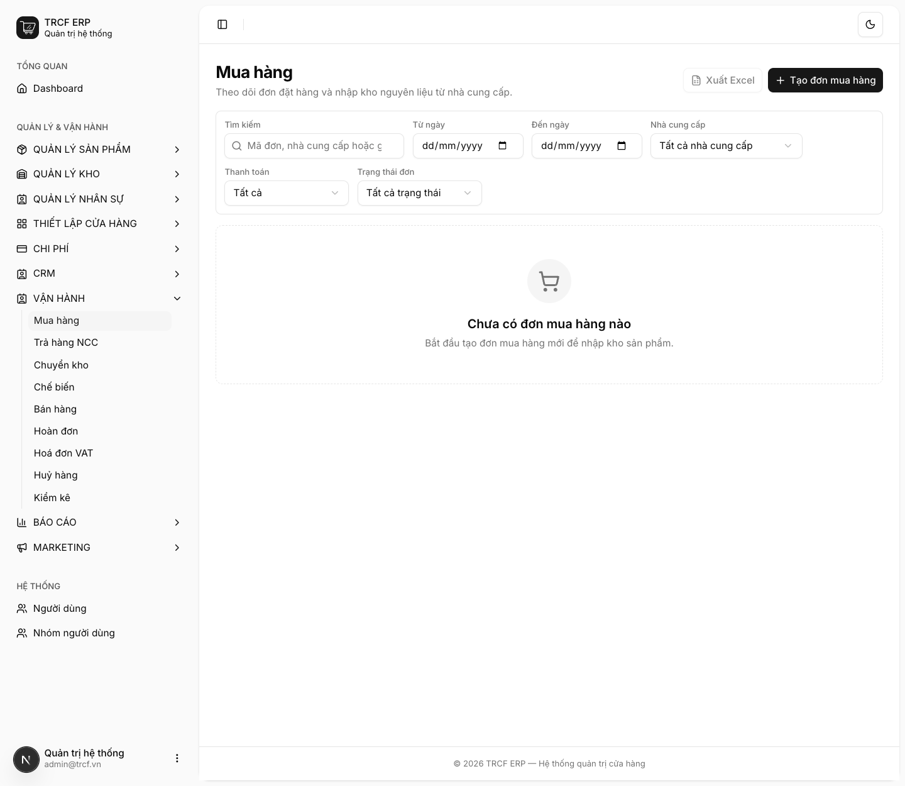
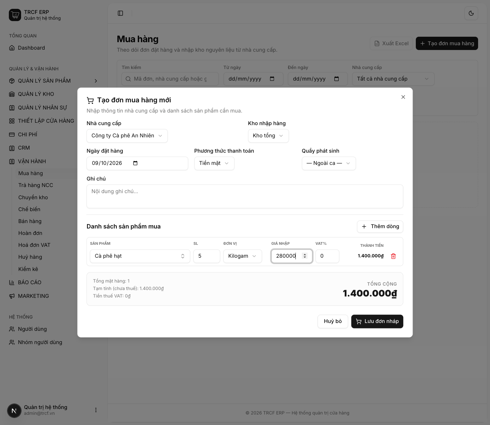
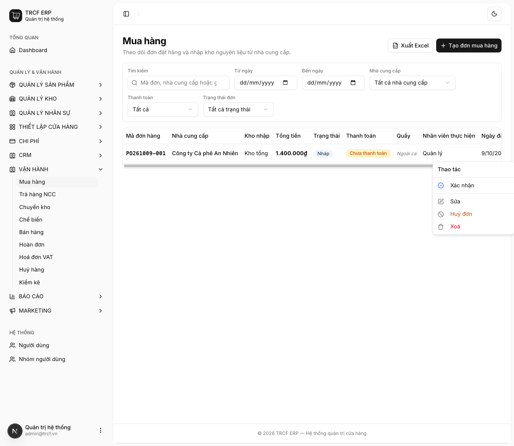

# 11.2 Nhập hàng

## 1. Đường dẫn vào chức năng

Menu trái: ==Vận hành → Mua hàng== (địa chỉ `/purchases`).

hoặc ==Vận hành → Nhập hàng== trên màn bán hàng.

- Ba trạng thái: **Nháp → Đã xác nhận → Đã nhập kho**.
- Cần có trước: nhà cung cấp, sản phẩm bật **Có thể mua** ([mục 2.2](2-2-thanh-pham.md)).

## 2. Ví dụ nền và các bước thực hiện

> **Ví dụ:** nhà cung cấp "Công ty Cà phê An Nhiên" giao 5 kg "Cà phê hạt", đơn giá 280.000₫/kg.
>
> - Kho nhập: "Kho tổng". Phương thức thanh toán: "Tiền mặt".
> - Dòng hàng: "Cà phê hạt", SL "5", đơn vị "Kilogam", giá nhập "280000".
> - Tổng cộng: 5 × 280.000 = **1.400.000₫**.

### Bước 1: Mở trang Mua hàng

- Bấm **Vận hành** ở menu trái, chọn **Mua hàng**.
- Bấm **Tạo đơn mua hàng**.

### Bước 2: Khai đầu phiếu và dòng hàng

- **Nhà cung cấp**: chọn "Công ty Cà phê An Nhiên".
- **Kho nhập hàng**: chọn "Kho tổng".
- **Ngày đặt hàng**: giữ ngày hôm nay.
- **Phương thức thanh toán**: chọn "Tiền mặt".
- Bấm **Thêm dòng**.
- **SẢN PHẨM**: chọn "Cà phê hạt".
- **SL**: nhập "5". **ĐƠN VỊ**: chọn "Kilogam".
- **GIÁ NHẬP**: nhập "280000". **VAT%**: nhập thuế suất trên hoá đơn NCC (nếu có).
- Kiểm tra **TỔNG CỘNG** tự tính, rồi bấm **Lưu đơn nháp**.

### Bước 3: Xác nhận rồi nhận hàng

- Đơn mới có mã dạng "PO261009-001", trạng thái **Nháp**.
- Bấm nút **…** cuối dòng.
- Menu đơn nháp: **Xác nhận**, **Sửa**, **Huỷ đơn**, **Xoá**.
- Kiểm tra lại, chọn **Xác nhận**.
- Khi hàng về tới quán, chọn **Nhận hàng** trên cùng menu.

## 3. Giải thích các trường

### Đầu phiếu

| Trường | Điền gì | Bắt buộc |
| --- | --- | --- |
| Nhà cung cấp | Bên giao hàng | ✅ |
| Kho nhập hàng | Kho nhận hàng về | ✅ |
| Ngày đặt hàng | Ngày đặt | ✅ |
| Phương thức thanh toán | Tiền mặt / chuyển khoản | ✅ |
| Quầy phát sinh | Chọn quầy nếu trả bằng tiền két quầy. Để *— Ngoài ca —* nếu không | — |
| Ghi chú | Ghi thêm (không bắt buộc) | — |

### Từng dòng hàng

| Trường | Điền gì |
| --- | --- |
| Sản phẩm | Hàng mua (chỉ hiện hàng đã bật *Có thể mua*) |
| SL, Đơn vị | Nhập theo đơn vị lớn được: mua 5 *Kilogam*, hệ thống quy ra 5000 g. Đơn vị lớn phải khai ở *Đơn vị tính phụ* của sản phẩm |
| Giá nhập, VAT% | Giá và thuế suất trên hoá đơn NCC |

### Nhận hàng làm gì

Bấm **Nhận hàng**, hệ thống đồng thời:

- **Cộng hàng vào kho**.
- **Ghi tiền vào sổ quỹ** (nếu đơn đã đánh dấu thanh toán).
- **Cập nhật giá vốn** sản phẩm theo đơn giá trên phiếu.

Sản phẩm bật *Sản xuất* thì **bỏ qua bước cập nhật giá vốn**: giá vốn của nó do công thức tính ([mục 3.2](3-2-cong-thuc-thanh-pham.md)).

## 4. Lưu ý quan trọng

> [!CAUTION]
> **Nhận hàng chỉ bấm được một lần.**
>
> - Bấm lần hai bị chặn.
> - Nếu không, kho sẽ cộng gấp đôi.

> [!CAUTION]
> **Đơn đã nhập kho thì không sửa dòng hàng, không xoá.**
>
> - Nhập nhầm số lượng: lập **phiếu trả hàng NCC** cho phần dư.
> - Vận hành → Trả hàng NCC.

> [!WARNING]
> **Đơn đã thanh toán rồi gỡ rồi bật lại cũng bị chặn.**
>
> - Cùng lý do với phiếu chi ([mục 10.2](10-2-tao-chi-phi.md)).

> [!TIP]
> Đơn ở trạng thái **Nháp** chưa đụng gì tới kho, xoá thoải mái.

## Kiểm tra đã đúng

- [ ] Đơn ở trạng thái **Đã nhập kho**
- [ ] Tồn kho đã tăng đúng số lượng
- [ ] Giá vốn nguyên liệu đã cập nhật (nếu là hàng thường)
