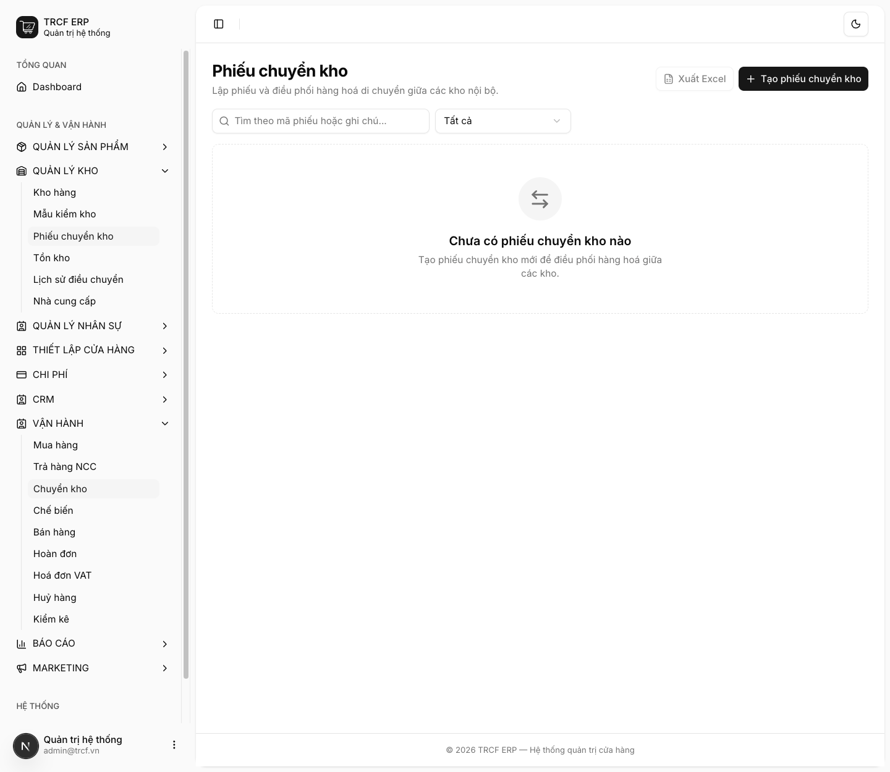
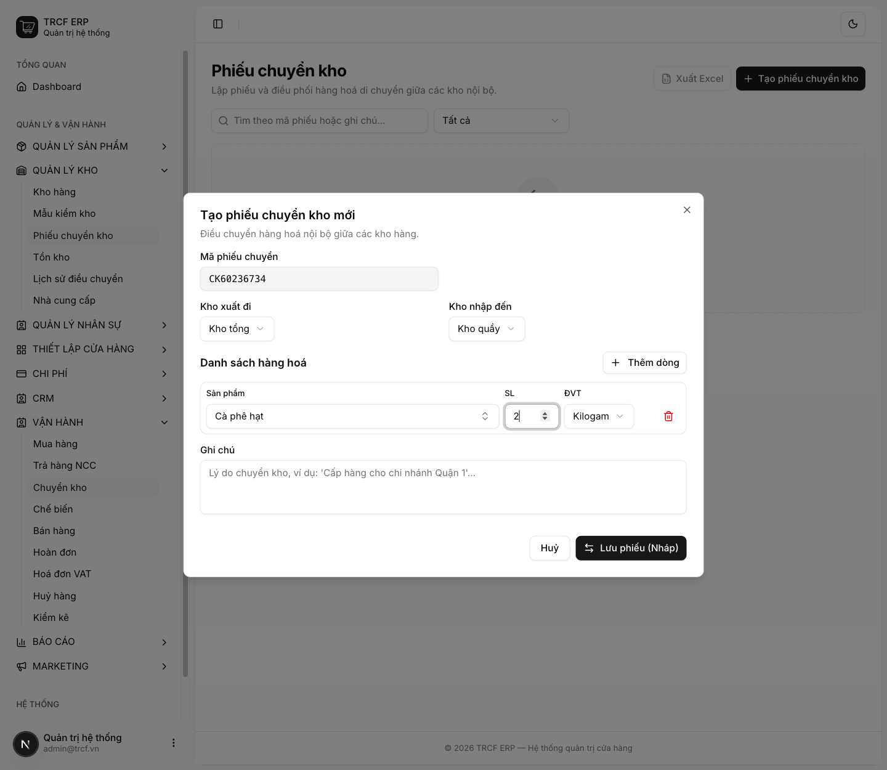
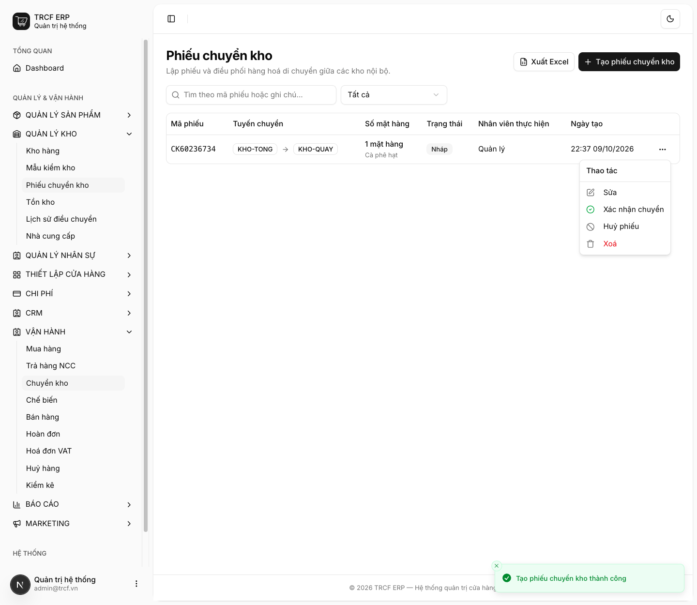

# 11.3 Chuyển kho

## 1. Đường dẫn vào chức năng

Menu trái: ==Vận hành → Chuyển kho== (địa chỉ `/stock-transfers`).

- Dùng khi: lấy hàng từ kho tổng ra kho quầy, hoặc điều hàng giữa hai chi nhánh.
- Cần có trước: hai kho khác nhau (khai ở **Quản lý kho → Kho hàng**).

## 2. Ví dụ nền và các bước thực hiện

> **Ví dụ:** chuyển 2 kg "Cà phê hạt" từ "Kho tổng" ra "Kho quầy".
>
> - Kho xuất đi: "Kho tổng". Kho nhập đến: "Kho quầy".
> - Dòng hàng: "Cà phê hạt", SL "2", đơn vị "Kilogam".

### Bước 1: Mở trang Phiếu chuyển kho

- Bấm **Vận hành** ở menu trái, chọn **Chuyển kho**.
- Bấm **Tạo phiếu chuyển kho**.

### Bước 2: Khai phiếu và dòng hàng

- **Mã phiếu chuyển**: hệ thống tự sinh, không sửa.
- **Kho xuất đi**: chọn "Kho tổng".
- **Kho nhập đến**: chọn "Kho quầy".
- Bấm **Thêm dòng**.
- **Sản phẩm**: chọn "Cà phê hạt".
- **SL**: nhập "2". **ĐVT**: chọn "Kilogam".
- **Ghi chú**: nhập nếu cần (tuỳ chọn).
- Bấm **Lưu phiếu (Nháp)**.

### Bước 3: Kiểm tra rồi xác nhận chuyển

- Phiếu hiện trong danh sách: tuyến chuyển "KHO-TONG → KHO-QUAY", trạng thái **Nháp**.
- Bấm nút **…** cuối dòng.
- Menu có: **Sửa**, **Xác nhận chuyển**, **Huỷ phiếu**, **Xoá**.
- Kiểm tra lại, chọn **Xác nhận chuyển**.

## 3. Giải thích các trường

| Trường | Điền gì | Bắt buộc |
| --- | --- | --- |
| Kho xuất đi | Kho lấy hàng ra | ✅ |
| Kho nhập đến | Kho nhận hàng. **Phải khác kho xuất** | ✅ |
| Sản phẩm / SL / ĐVT | Từng dòng hàng chuyển. Chọn đơn vị lớn được (hệ thống tự quy đổi) | ✅ |
| Ghi chú | Ghi thêm (không bắt buộc) | — |

### Xác nhận làm gì

- Ghi **hai bút toán kho cùng lúc**: trừ kho nguồn + cộng kho đích.
- Không có chuyện hàng biến mất giữa đường.

## 4. Lưu ý quan trọng

> [!CAUTION]
> **Phiếu đã xác nhận không sửa, không xoá.**
>
> - Chuyển nhầm: lập phiếu chuyển ngược lại.

> [!WARNING]
> **Chọn cùng một kho cho cả hai ô sẽ bị chặn ngay khi lưu.**

> [!TIP]
> **Bê hàng ra quầy mà không lập phiếu** thì kho tổng trên hệ thống vẫn đầy trong khi kệ đã trống.
>
> - Tới lúc kiểm kho mới lòi ra chênh lệch lớn không truy được.

> [!TIP]
> Phiếu **Nháp** chưa đụng gì tới kho, xoá thoải mái.

## Kiểm tra đã đúng

- [ ] Tồn kho nguồn giảm đúng số
- [ ] Tồn kho đích tăng đúng số
