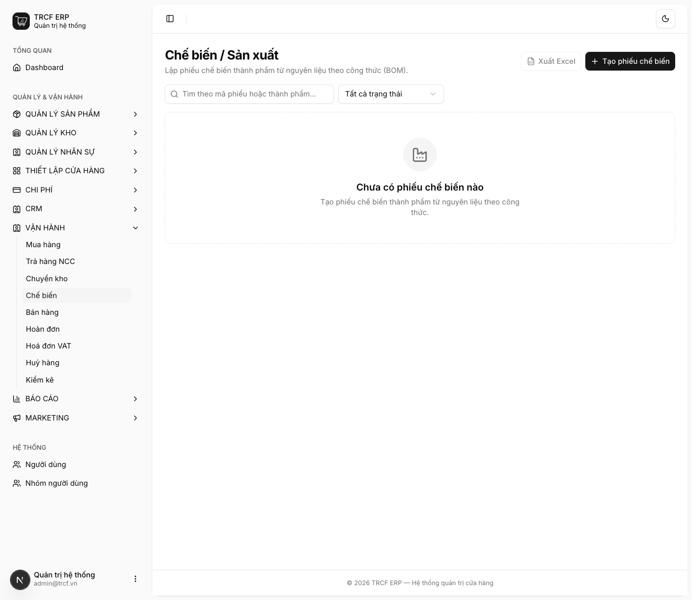
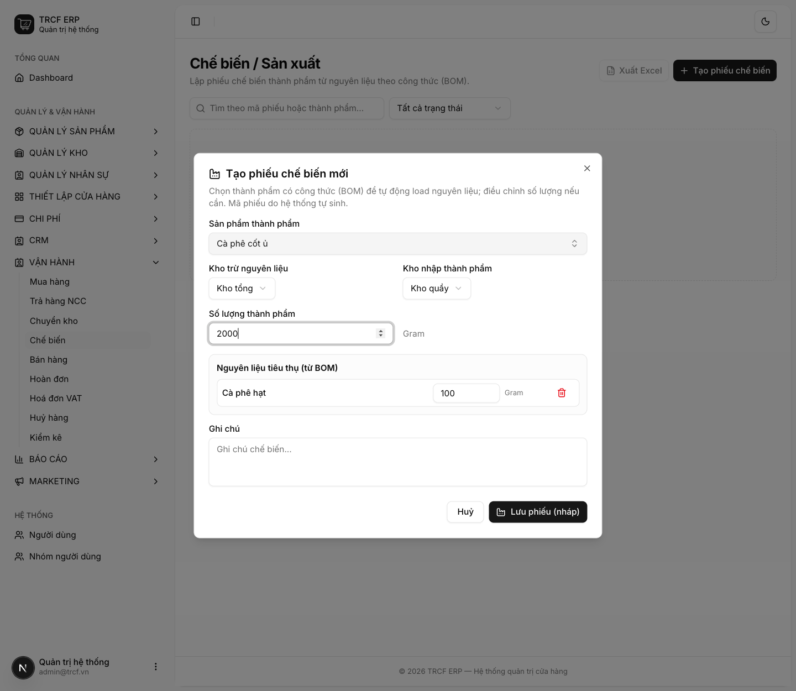
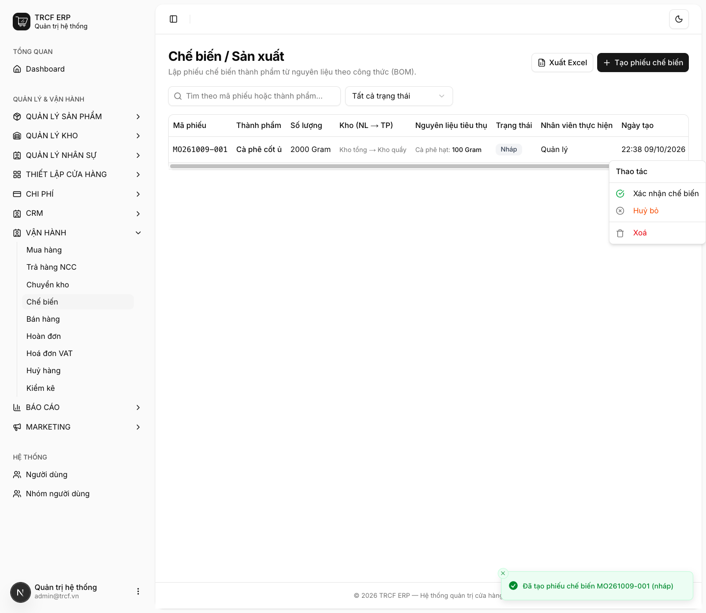

# 11.4 Chế biến

## 1. Đường dẫn vào chức năng

Menu trái: ==Vận hành → Chế biến== (địa chỉ `/manufacturing`).

- Dùng khi: quán tự làm ra thứ gì đó (ủ cà phê cốt, nấu syrup, làm sốt).
- Cần có trước: công thức (BOM) của thành phẩm ([mục 3.2](3-2-cong-thuc-thanh-pham.md)).

## 2. Ví dụ nền và các bước thực hiện

> **Ví dụ:** ủ "Cà phê cốt ủ", công thức dùng "Cà phê hạt".
>
> - Công thức: 100 g "Cà phê hạt" làm ra 1000 g "Cà phê cốt ủ".
> - Kho trừ nguyên liệu: "Kho tổng". Kho nhập thành phẩm: "Kho quầy".
> - Hôm nay ủ 2000 g → cần dùng **200 g** cà phê hạt.

### Bước 1: Mở trang Chế biến

- Bấm **Vận hành** ở menu trái, chọn **Chế biến**.
- Bấm **Tạo phiếu chế biến**.

### Bước 2: Khai phiếu chế biến

- **Sản phẩm thành phẩm**: chọn "Cà phê cốt ủ". Hệ thống **tự nạp nguyên liệu từ công thức**.
- **Kho trừ nguyên liệu**: chọn "Kho tổng". **Kho nhập thành phẩm**: chọn "Kho quầy".
- **Số lượng thành phẩm**: nhập "2000".
- Mục **Nguyên liệu tiêu thụ (từ BOM)**: **kiểm tra và tự sửa** số lượng cho khớp (ở ví dụ: "Cà phê hạt" = "200").
- Bấm **Lưu phiếu (nháp)**.

### Bước 3: Xác nhận chế biến

- Phiếu hiện trong danh sách, mã dạng "MO261009-001", trạng thái **Nháp**.
- Bấm nút **…** cuối dòng.
- Menu có: **Xác nhận chế biến**, **Huỷ bỏ**, **Xoá**.
- Kiểm tra lại, chọn **Xác nhận chế biến**.

## 3. Giải thích các trường

| Trường | Điền gì | Bắt buộc |
| --- | --- | --- |
| Sản phẩm thành phẩm | Thứ làm ra. Phải có công thức | ✅ |
| Kho trừ nguyên liệu | Kho lấy nguyên liệu | ✅ |
| Kho nhập thành phẩm | Kho nhận thành phẩm | ✅ |
| Số lượng thành phẩm | Số làm được thật | ✅ |
| Nguyên liệu tiêu thụ | Tự nạp từ công thức, **sửa được** | ✅ |
| Ghi chú | Ghi thêm (không bắt buộc) | — |

## 4. Lưu ý quan trọng

> [!CAUTION]
> **Số lượng trên phiếu là nguồn sự thật, không phải công thức.**
>
> - Công thức chỉ điền sẵn cho nhanh.
> - Đổi *Số lượng thành phẩm* thì danh sách nguyên liệu **không tự đổi theo**: sửa tay.
> - Hôm nay dùng nhiều hơn định mức thì cứ sửa số trên phiếu.
> - Hệ thống trừ đúng số bạn khai.

> [!WARNING]
> **Đã xác nhận thì không xác nhận lại được.**
>
> - Hệ thống khoá để tránh trừ kho hai lần khi hai người cùng bấm.

> [!TIP]
> Chế biến **không đụng tới tiền**: chỉ chuyển giá trị từ nguyên liệu sang bán thành phẩm. Phiếu nhẹ nhất chương này.

> [!TIP]
> Chưa có công thức thì phiếu không tự nạp nguyên liệu được. Tạo công thức trước.

## Kiểm tra đã đúng

- [ ] Tồn nguyên liệu giảm đúng số đã khai
- [ ] Tồn bán thành phẩm tăng đúng số làm được
