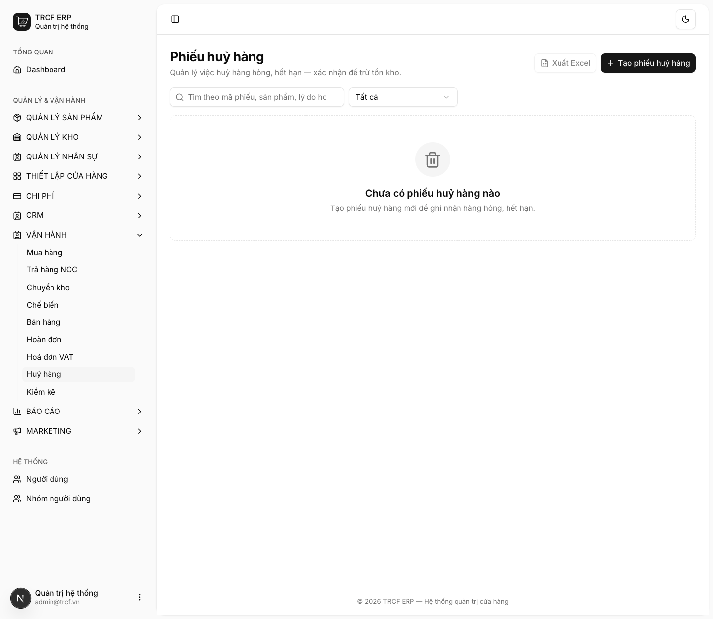
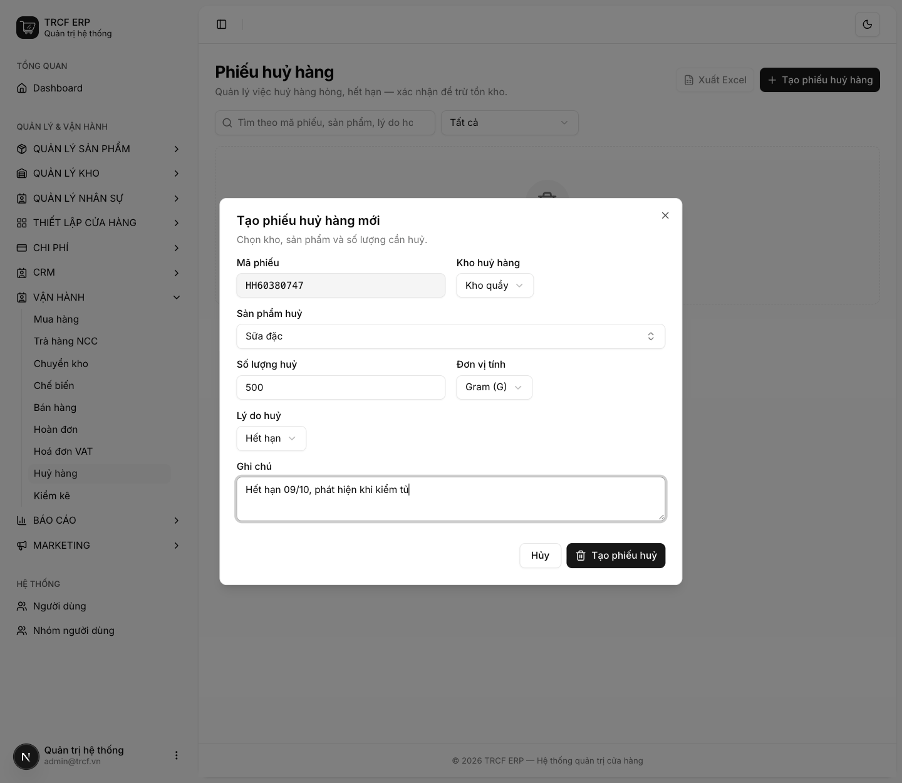
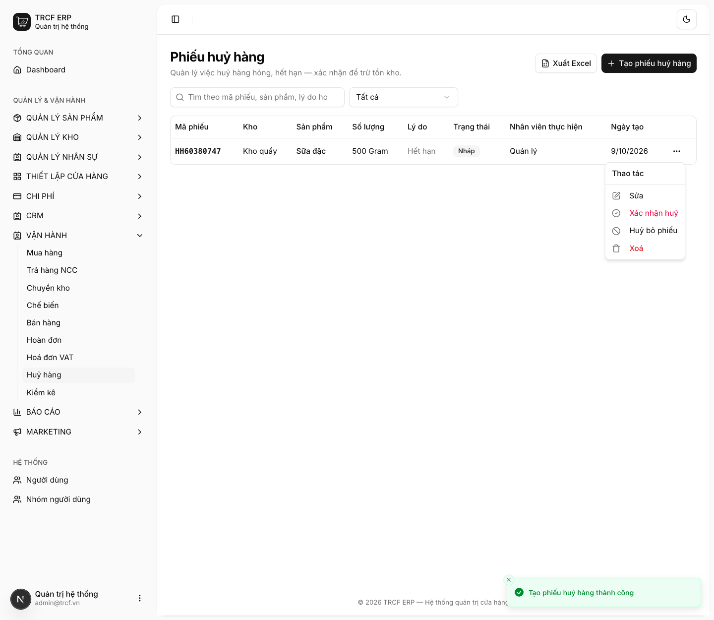

# 11.5 Huỷ hàng

## 1. Đường dẫn vào chức năng

Menu trái: ==Vận hành → Huỷ hàng== (địa chỉ `/scraps`).

- Dùng khi: hàng hỏng, hết hạn, rơi vỡ, pha hỏng phải bỏ.
- Mỗi phiếu **một mặt hàng**. Huỷ ba thứ thì lập ba phiếu.

## 2. Ví dụ nền và các bước thực hiện

> **Ví dụ:** phát hiện 500 g "Sữa đặc" hết hạn trong tủ ở "Kho quầy".
>
> - Sản phẩm: "Sữa đặc". Số lượng: "500" "Gram".
> - Lý do: "Hết hạn". Ghi chú: "Hết hạn 09/10, phát hiện khi kiểm tủ".

### Bước 1: Mở trang Huỷ hàng

- Bấm **Vận hành** ở menu trái, chọn **Huỷ hàng**.
- Bấm **Tạo phiếu huỷ hàng**.

### Bước 2: Khai phiếu huỷ

- **Mã phiếu**: hệ thống tự sinh, không sửa.
- **Kho huỷ hàng**: chọn "Kho quầy".
- **Sản phẩm huỷ**: chọn "Sữa đặc".
- **Số lượng huỷ**: nhập "500". **Đơn vị tính**: chọn "Gram (G)".
- **Lý do huỷ**: chọn "Hết hạn" (có 4 lựa chọn: Hỏng / vỡ, Hết hạn, Thất lạc, Khác).
- **Ghi chú**: nhập "Hết hạn 09/10, phát hiện khi kiểm tủ".
- Bấm nút **Tạo phiếu huỷ**.

### Bước 3: Xác nhận huỷ

- Phiếu hiện trong danh sách, trạng thái **Nháp**.
- Bấm nút **…** cuối dòng.
- Menu có: **Sửa**, **Xác nhận huỷ**, **Huỷ bỏ phiếu**, **Xoá**.
- Kiểm tra lại, chọn **Xác nhận huỷ**.

## 3. Giải thích các trường

| Trường | Điền gì | Bắt buộc |
| --- | --- | --- |
| Kho huỷ hàng | Kho trừ hàng ra | ✅ |
| Sản phẩm huỷ | Mặt hàng bị huỷ | ✅ |
| Số lượng huỷ | Số bị huỷ | ✅ |
| Đơn vị tính | Đơn vị của số lượng | ✅ |
| Lý do huỷ | Chọn: Hỏng / vỡ, Hết hạn, Thất lạc, Khác | ✅ |
| Ghi chú | **Càng cụ thể càng tốt**: "hết hạn 09/08", "làm rơi khi bưng" | — |

### Huỷ món pha sẵn

- Huỷ món có công thức dạng *Kit* (VD ly trà đã pha hỏng): hệ thống **trừ nguyên liệu theo công thức**.
- Không trừ "ly trà", vì trong kho không có mặt hàng "ly trà đã pha".

## 4. Lưu ý quan trọng

> [!CAUTION]
> **Đã xác nhận thì không sửa, không xoá.**

> [!TIP]
> **Ghi lý do tử tế là phần có giá trị nhất của phiếu huỷ.**
>
> - Cuối tháng nhìn lại sẽ thấy hao hụt nằm ở đâu.
> - Hết hạn: mua nhiều quá. Rơi vỡ: thao tác. Pha hỏng: đào tạo.

> [!TIP]
> Đừng gộp hao hụt vào phiếu kiểm kho.
>
> - Kiểm kho chỉ nói "thiếu 2 kg".
> - Phiếu huỷ nói "thiếu **vì sao**".

> [!TIP]
> Phiếu **Nháp** chưa đụng gì tới kho, xoá thoải mái.

## Kiểm tra đã đúng

- [ ] Tồn kho giảm đúng số huỷ
- [ ] Lý do ghi đủ rõ để tháng sau đọc vẫn hiểu
