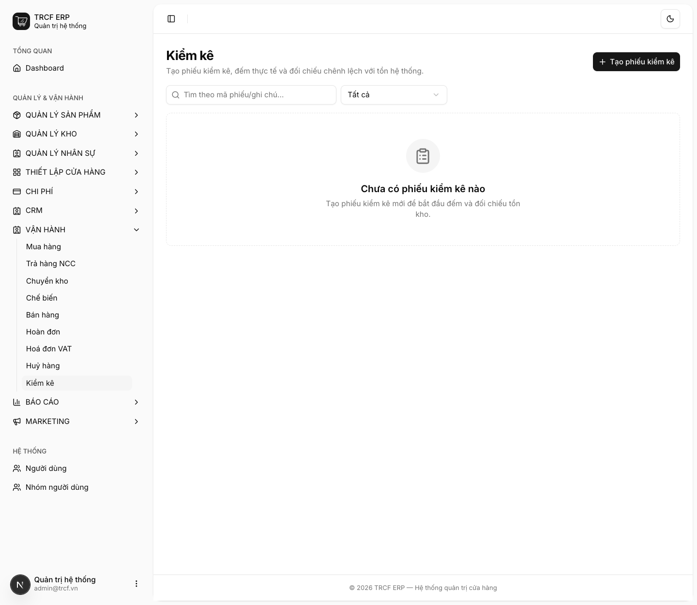
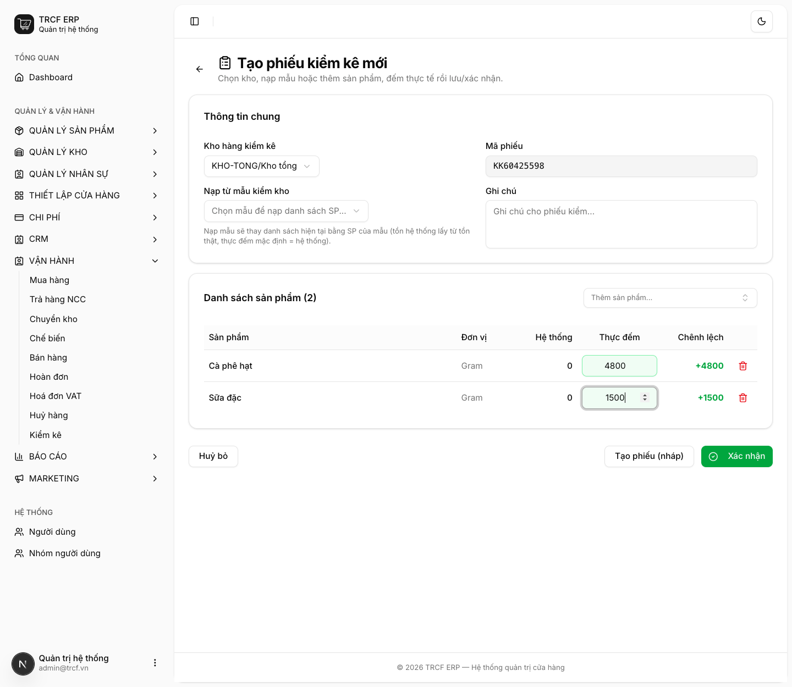
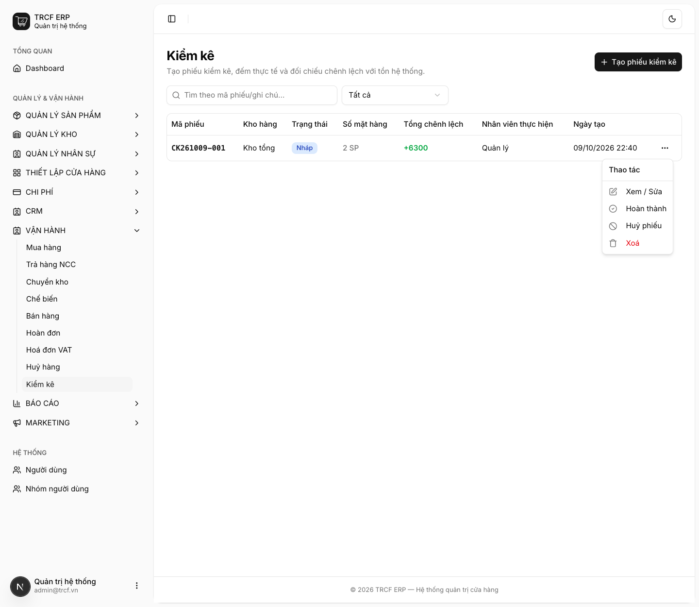

# 11.6 Kiểm kho

## 1. Đường dẫn vào chức năng

Menu trái: ==Vận hành → Kiểm kê== (địa chỉ `/stock-checks`).

Dựng mẫu kiểm kho trước ở [bài 6.1 Tạo mẫu kiểm kho](6-1-tao-mau-kiem-kho.md) (không bắt buộc).

## 2. Ví dụ nền và các bước thực hiện

> **Ví dụ:** kiểm "Kho tổng", đếm 2 mặt hàng.
>
> - "Cà phê hạt": hệ thống 0 g, đếm thật "4800" g.
> - "Sữa đặc": hệ thống 0 g, đếm thật "1500" g.
> - Tổng chênh lệch: +6300.

### Bước 1: Mở trang Kiểm kê

- Bấm **Vận hành** ở menu trái, chọn **Kiểm kê**.
- Bấm **Tạo phiếu kiểm kê** (mã phiếu tự sinh).

### Bước 2: Khai phiếu và đếm hàng

- **Kho hàng kiểm kê**: chọn "KHO-TONG/Kho tổng".
- Nạp danh sách hàng cần đếm (xem 2 cách bên dưới).
- Ở đây: bấm ô **Thêm sản phẩm...**, chọn "Cà phê hạt", rồi "Sữa đặc".
- Đi đếm thật, nhập vào cột **Thực đếm**: "4800" và "1500".
- Cột **Chênh lệch** tự tính.
- Chưa đếm xong: bấm **Tạo phiếu (nháp)**, quay lại làm tiếp sau.

### Bước 3: Hoàn thành phiếu

- Phiếu nháp hiện trong danh sách: số mặt hàng, **Tổng chênh lệch**.
- Bấm nút **…** cuối dòng.
- Menu có: **Xem / Sửa**, **Hoàn thành**, **Huỷ phiếu**, **Xoá**.
- Đếm xong hết: **rà lại dòng chênh lệch lớn**, rồi chọn **Hoàn thành** (hoặc bấm **Xác nhận** ngay trong form).

## 3. Giải thích các trường

### Hai cách nạp danh sách

| Cách | Khi nào dùng |
| --- | --- |
| **Nạp từ mẫu kiểm kho** | Có mẫu dựng sẵn (*Quản lý kho → Mẫu kiểm kho*). Nhanh, không sót mặt hàng. Nạp mẫu **thay** danh sách hiện tại |
| **Thêm sản phẩm** từng món | Kiểm lẻ vài mặt hàng |

### Các cột

| Cột | Nghĩa |
| --- | --- |
| Hệ thống | Tồn hiện tại theo hệ thống |
| Thực đếm | Số bạn đếm được |
| Chênh lệch | Tự tính = Thực đếm − Hệ thống |

### Lịch kiểm kê gợi ý

| Loại hàng | Tần suất |
| --- | --- |
| Hàng dễ hỏng | Hằng ngày, cuối ca |
| Hàng khô | Hằng tuần |
| Toàn bộ | Cuối tháng |

## 4. Lưu ý quan trọng

> [!CAUTION]
> **Xác nhận là ghi đè tồn kho.**
>
> - Đếm sai một con số thì tồn kho sai theo.
> - Phải kiểm lại lần nữa mới sửa được.

> [!WARNING]
> **Phiếu đã hoàn thành không sửa, không xoá.**

> [!TIP]
> **Dựng mẫu kiểm kho theo khu vực**: "Quầy pha chế", "Kho khô", "Tủ đông".
>
> - Đếm theo khu nhanh và ít sót hơn đếm theo danh sách toàn quán.

> [!TIP]
> Chênh lệch lặp lại ở cùng một mặt hàng thường không do đếm sai.
>
> - Mà do **thiếu phiếu huỷ** ([mục 11.5](11-5-huy-hang.md)) hoặc **thiếu phiếu chuyển kho** ([mục 11.3](11-3-chuyen-kho.md)) ở khâu trước.

## Kiểm tra đã đúng

- [ ] Đã rà lại mọi dòng chênh lệch lớn trước khi xác nhận
- [ ] Sau xác nhận, tồn kho bằng đúng số đã đếm
