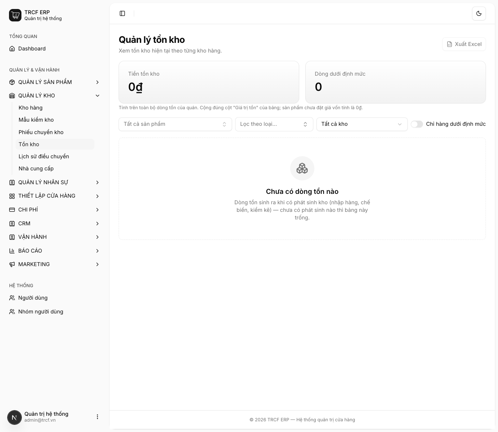
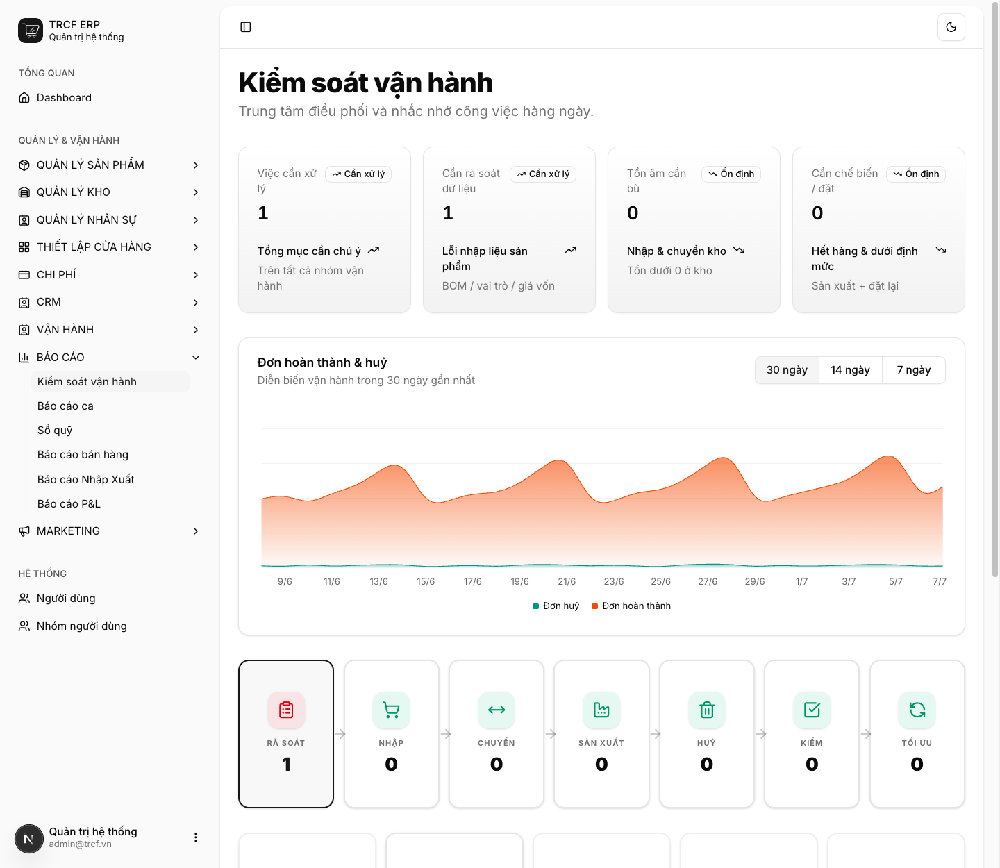
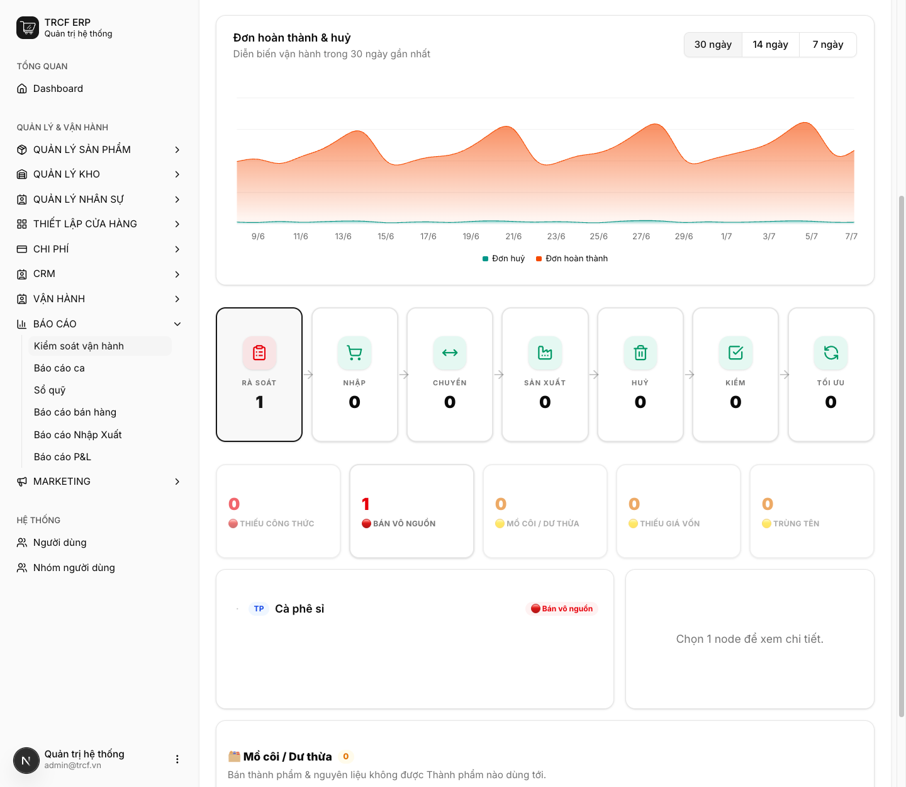

# 11.7 Đề xuất nhập hàng

## 1. Đường dẫn vào chức năng

Ba màn trong mục này:

| Màn | Đường dẫn | Dùng để |
| --- | --- | --- |
| Tồn kho hiện tại | Quản lý kho → Tồn kho (`/stock`) | Khai định mức, xem hàng dưới mức |
| Kiểm soát vận hành | Báo cáo → Kiểm soát vận hành (`/audit_operation`) | Nhắc việc: tồn âm, cần đặt, cần chế biến |
| Rà soát | Cùng màn trên, phần dưới | Bắt lỗi khai báo sản phẩm |

## 2. Ví dụ nền và các bước thực hiện

> **Ví dụ:** chủ quán rà soát cuối tháng.
>
> - Mở **Tồn kho** xem tiền tồn và hàng dưới định mức.
> - Mở **Kiểm soát vận hành** xem việc cần xử lý.
> - Ví dụ trên máy này: "Cà phê sỉ" bán mà chưa có công thức → bị báo **Bán vô nguồn**.

### Bước 1: Xem Tồn kho hiện tại

- Bấm **Quản lý kho → Tồn kho**.
- Đọc 2 ô: **Tiền tồn kho**, **Dòng dưới định mức**.
- Lọc theo sản phẩm, loại, kho, hoặc **Chỉ hàng dưới định mức**.
- Khai định mức: xem [bài 6.2](6-2-dinh-muc-ton-kho.md).

### Bước 2: Mở Kiểm soát vận hành

- Bấm **Báo cáo → Kiểm soát vận hành**.
- Đọc 4 ô nhắc việc: **Việc cần xử lý**, **Cần rà soát dữ liệu**, **Tồn âm cần bù**, **Cần chế biến / đặt**.
- Biểu đồ **Đơn hoàn thành & huỷ**: chọn 30 / 14 / 7 ngày.
- Dải thẻ bên dưới: **RÀ SOÁT**, **NHẬP**, **CHUYỂN**, **SẢN XUẤT**, **HUỶ**, **KIỂM**, **TỐI ƯU**.

### Bước 3: Rà soát cây sản phẩm

- Cuộn xuống phần **RÀ SOÁT**.
- Các bộ lọc lỗi: **Thiếu công thức**, **Bán vô nguồn**, **Mồ côi / Dư thừa**, **Thiếu giá vốn**, **Trùng tên**.
- Bộ lọc nào có số lớn hơn 0 thì bấm vào xem sản phẩm.
- Bấm một nút trên cây để xem chi tiết.
- Sửa lỗi ở màn sản phẩm / công thức rồi mở lại để kiểm tra.

## 3. Giải thích các trường

### Bốn ô nhắc việc

| Ô | Nghĩa |
| --- | --- |
| Việc cần xử lý | Tổng các mục cần chú ý |
| Cần rà soát dữ liệu | Lỗi khai báo sản phẩm: thiếu công thức, sai vai trò, chưa có giá vốn |
| Tồn âm cần bù | Có kho đang âm: cần nhập hoặc chuyển kho gấp |
| Cần chế biến / đặt | Hàng hết hoặc dưới định mức |

Thẻ **TỐI ƯU** / các danh sách bên dưới có **đề xuất nhập hàng**: mặt hàng nào dưới định mức và nên nhập bao nhiêu để về mức tối đa.

### Lỗi mà phần Rà soát bắt

| Lỗi | Hậu quả |
| --- | --- |
| Món **bán mà không có công thức** (Bán vô nguồn) | Báo cáo lãi lỗ không tính được giá vốn |
| Nguyên liệu **chưa có giá vốn** | Giá vốn món tính ra bị thiếu |
| Nguyên liệu **mồ côi** | Khai vào hệ thống nhưng không món nào dùng tới |
| **Trùng tên** | Hai sản phẩm gần giống tên, dễ chọn nhầm |

### Lịch xem báo cáo gợi ý

| Tần suất | Xem gì | Tìm điều gì |
| --- | --- | --- |
| Cuối mỗi ca | Báo cáo ca | Chênh lệch tiền mặt |
| Hằng ngày | Tổng quan | Doanh thu, số đơn, sản phẩm dưới định mức |
| Hằng tuần | Báo cáo bán hàng ([12.1](12-1-bao-cao-ban-hang.md)), Tồn kho | Giá trị TB/đơn, hàng cần đặt |
| Hằng tháng | P&L ([12.2](12-2-bao-cao-lai-lo.md)), Kiểm soát vận hành | Tỷ lệ chi phí, lỗi khai báo |

## 4. Lưu ý quan trọng

> [!CAUTION]
> **Khai định mức trước thì cảnh báo mới có tác dụng.**
>
> - Chưa khai thì không có gì để so (xem [bài 6.2](6-2-dinh-muc-ton-kho.md)).

> [!WARNING]
> **Tồn âm là dấu hiệu thiếu phiếu ở khâu trước, không phải lỗi hệ thống.**
>
> - Hệ thống cố ý cho bán khi tồn về 0, để không chặn thu ngân giữa giờ cao điểm.
> - Kiểm 3 nguyên nhân theo thứ tự: quên phiếu **nhập** ([11.2](11-2-nhap-hang.md)); quên phiếu **chuyển kho** ([11.3](11-3-chuyen-kho.md)); công thức khai sai định mức ([3.2](3-2-cong-thuc-thanh-pham.md)).
> - Xử lý: tìm phiếu thiếu và lập bù, hoặc chỉnh bằng **kiểm kê** ([11.6](11-6-kiem-kho.md)).

> [!TIP]
> Mặt hàng dưới định mức được đánh dấu **"Dưới định mức"** và đếm vào ô *Sản phẩm dưới định mức* ở màn Tổng quan.

> [!TIP]
> Rà màn Rà soát **một lần mỗi tháng** là đủ.
>
> - Không phải báo cáo xem hằng ngày.
> - Là bộ lọc bắt lỗi khai báo tích tụ dần.

## Kiểm tra đã đúng

- [ ] Đã khai định mức tối thiểu / tối đa cho hàng quan trọng
- [ ] Không còn mục nào ở thẻ **Tồn âm cần bù**
- [ ] Các bộ lọc Rà soát đều về 0 hoặc đã biết lý do
