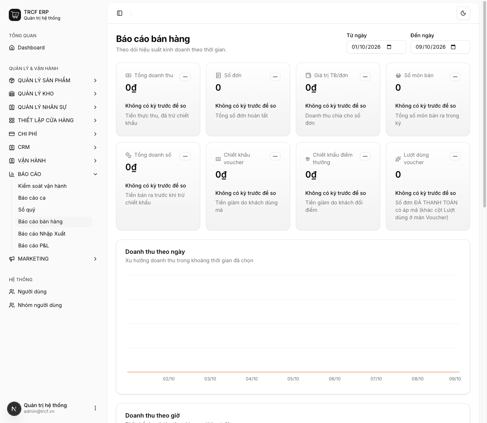
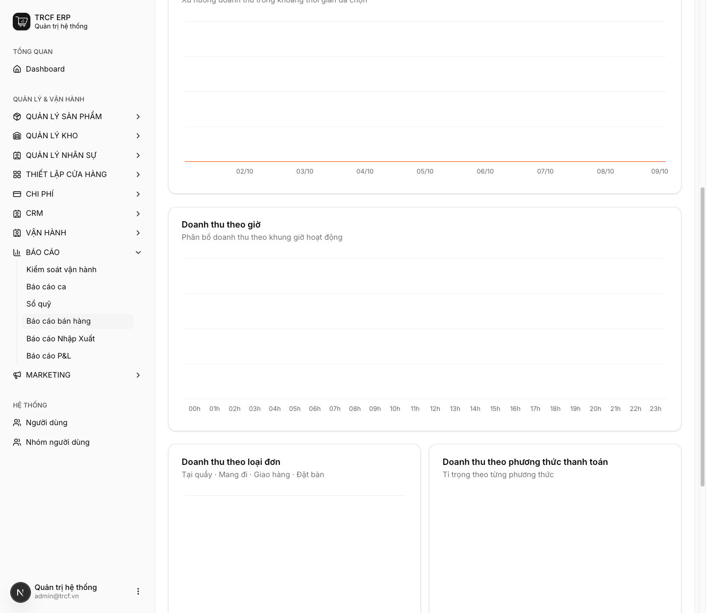

# 12.1 Báo cáo bán hàng

## 1. Đường dẫn vào chức năng

Menu trái: ==Báo cáo → Báo cáo bán hàng== (địa chỉ `/sales-report`).

- Dành cho: quản lý và chủ quán.

## 2. Ví dụ nền và các bước thực hiện

> **Ví dụ:** quản lý xem hiệu suất bán hàng 8 ngày gần nhất (02/10 – 09/10).
>
> - Chọn khoảng ngày bằng **Từ ngày**, **Đến ngày** ở đầu trang.
> - Đọc các ô tổng, rồi đọc biểu đồ và bảng xếp hạng.

### Bước 1: Chọn kỳ và đọc các ô tổng

- Vào **Báo cáo → Báo cáo bán hàng**.
- Chọn **Từ ngày**, **Đến ngày**.
- Đọc các ô: **Tổng doanh thu**, **Số đơn**, **Giá trị TB/đơn**, **Số món bán**.
- Đọc tiếp: **Tổng doanh số**, **Chiết khấu voucher**, **Chiết khấu điểm thưởng**, **Lượt dùng voucher**.
- Mỗi ô có dòng so với **kỳ trước** (nếu có).

### Bước 2: Đọc biểu đồ và bảng bên dưới

- Cuộn xuống: **Doanh thu theo ngày**, **Doanh thu theo giờ**.
- **Doanh thu theo loại đơn**, **theo phương thức thanh toán**.
- **Top 10 sản phẩm bán chạy**: hạng, sản phẩm, số lượng, doanh thu.

## 3. Giải thích các trường

### Các ô tổng trên cùng

| Ô | Nghĩa | Dùng để |
| --- | --- | --- |
| Tổng doanh thu | Tiền thực thu từ đơn đã thanh toán, đã trừ chiết khấu | Con số quen thuộc nhất, ít giá trị nhất khi đứng một mình |
| Số đơn | Số lượt khách trả tiền | So sánh giữa các ngày để biết ngày nào đông |
| **Giá trị TB/đơn** | Doanh thu ÷ số đơn | **Con số đáng theo dõi nhất** |
| Số món bán | Tổng số ly/món bán ra | Chia cho số đơn ra "mỗi khách gọi mấy món" |
| Tổng doanh số | Tiền bán ra trước khi trừ chiết khấu | Đối chiếu với doanh thu để thấy khuyến mãi tốn bao nhiêu |
| Chiết khấu voucher / điểm thưởng | Tiền giảm do khách dùng mã / đổi điểm | Đo hiệu quả và chi phí khuyến mãi |
| Lượt dùng voucher | Số đơn đã thanh toán có áp mã | Khác cột *Lượt dùng* ở màn Voucher |

### Đọc Giá trị TB/đơn

| Dấu hiệu | Nghĩa | Việc cần làm |
| --- | --- | --- |
| Số đơn tăng, TB/đơn không đổi | Đông khách hơn | Tăng năng lực phục vụ, chuẩn bị đủ hàng |
| Số đơn không đổi, TB/đơn tăng | Mỗi khách mua nhiều hơn | Kết quả của bán thêm, combo, topping |

### Biểu đồ và bảng bên dưới

| Phần | Nhìn ra gì |
| --- | --- |
| Doanh thu theo ngày | Ngày nào trong tuần yếu: lên khuyến mãi |
| Doanh thu theo giờ | Dùng để xếp ca cho khớp giờ đông |
| Theo loại đơn / phương thức thanh toán | Tỷ trọng tại quầy, mang đi, giao hàng, tiền mặt, chuyển khoản |
| Top 10 sản phẩm bán chạy | Món nào kéo doanh thu |

### Hai màn cho hai câu hỏi khác nhau

| Câu hỏi | Xem ở đâu |
| --- | --- |
| "Hôm nay quầy bán ra bao nhiêu?" | Báo cáo bán hàng |
| "Kỳ này quán thực lãi bao nhiêu?" | Báo cáo P&L ([mục 12.2](12-2-bao-cao-lai-lo.md)) |

## 4. Lưu ý quan trọng

> [!CAUTION]
> **Chỉ tính đơn ĐÃ THANH TOÁN.**
>
> - Đơn treo trên bàn, đơn đã lưu chưa thu tiền: không nằm trong báo cáo.
> - Thấy doanh thu thấp hơn cảm nhận: kiểm đơn chưa thu tiền trước khi nghi ngờ số liệu.

> [!WARNING]
> **Muốn doanh thu đã trừ hàng hoàn, đọc báo cáo P&L.**
>
> - Đó mới là con số dùng để tính lãi ([mục 12.2](12-2-bao-cao-lai-lo.md)).

> [!TIP]
> Đối chiếu doanh thu theo giờ với lịch ca (chương 7).
>
> - Giờ cao điểm mà chỉ một người đứng quầy: đó là **doanh thu đang bị bỏ lỡ**, không phải "quán vắng".

> [!TIP]
> Hai con số lệch nhau nhiều là dấu hiệu cần xem lại chất lượng phục vụ hoặc quy trình lên đơn.
>
> - Kiểm *Vận hành → Hoàn đơn* để biết hoàn vì lý do gì.

## Kiểm tra đã đúng

- [ ] Đã chọn đúng khoảng ngày cần xem
- [ ] Đã nhìn **Giá trị TB/đơn** và so với kỳ trước
- [ ] Đã đối chiếu doanh thu theo giờ với lịch ca
