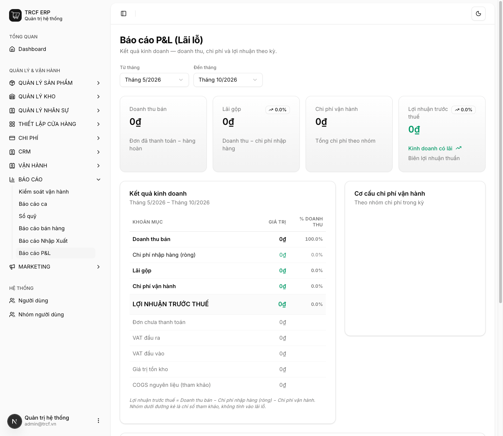
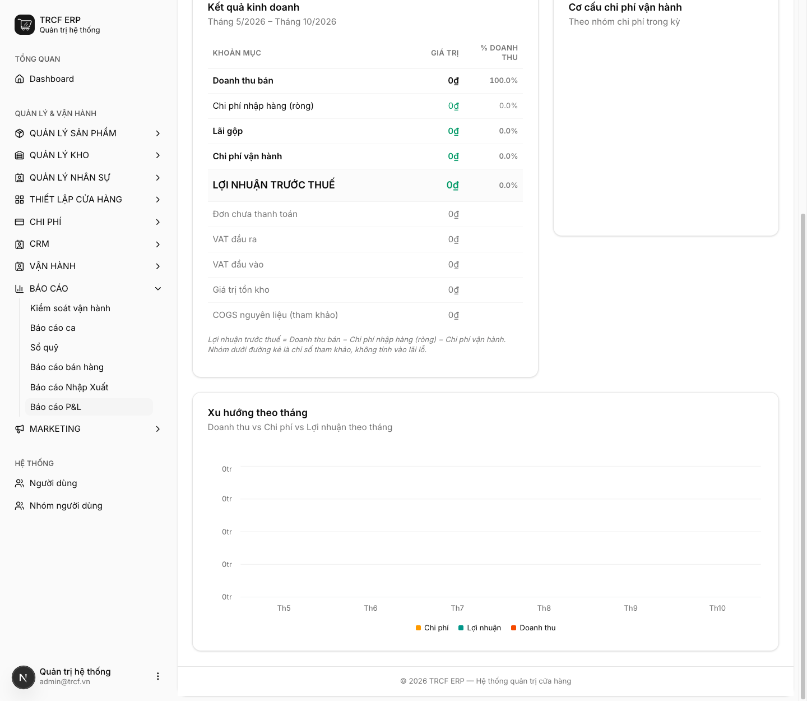

# 12.2 Báo cáo lãi lỗ (P&L)

## 1. Đường dẫn vào chức năng

Menu trái: ==Báo cáo → Báo cáo P&L== (địa chỉ `/pnl-report`).

- Chọn kỳ: **Từ tháng** – **Đến tháng** ở đầu trang.
- Dành cho: quản lý và chủ quán.

## 2. Ví dụ nền và các bước thực hiện

> **Ví dụ:** chủ quán xem kết quả kinh doanh từ tháng 5/2026 đến tháng 10/2026.
>
> - Đọc 4 ô tổng ở đầu trang.
> - Đọc bảng **Kết quả kinh doanh** và biểu đồ bên dưới.

### Bước 1: Chọn kỳ và đọc 4 ô tổng

- Vào **Báo cáo → Báo cáo P&L**.
- Chọn **Từ tháng**, **Đến tháng**.
- Đọc 4 ô: **Doanh thu bán**, **Lãi gộp**, **Chi phí vận hành**, **Lợi nhuận trước thuế**.
- Đọc bảng **Kết quả kinh doanh**: giá trị và **% doanh thu** từng khoản mục.
- Nhóm dưới đường kẻ (Đơn chưa thanh toán, VAT, Giá trị tồn kho, COGS) là chỉ số tham khảo, không tính vào lãi lỗ.



### Bước 2: Đọc biểu đồ

- Cuộn xuống: **Cơ cấu chi phí vận hành** theo nhóm, xem khoản nào ăn nhiều nhất.
- **Xu hướng theo tháng**: doanh thu, chi phí, lợi nhuận từng tháng.



## 3. Giải thích các trường

### Bốn ô tổng nối với nhau

```
Doanh thu bán            (đơn đã thanh toán − hàng hoàn)
  −  Chi phí nhập hàng (ròng)   (tiền mua hàng − tiền trả lại NCC)
  =  Lãi gộp
  −  Chi phí vận hành           (tổng phiếu chi theo nhóm)
  =  Lợi nhuận trước thuế
```

### Từng ô lấy số từ đâu

| Ô | Nguồn |
| --- | --- |
| Doanh thu bán | Đơn bán đã thanh toán, **trừ hàng hoàn** |
| Chi phí nhập hàng (ròng) | Đơn mua đã thanh toán, trừ tiền trả lại nhà cung cấp |
| Lãi gộp | Doanh thu − chi phí nhập hàng |
| Chi phí vận hành | Phiếu chi **đã hoàn tất và đã thanh toán**, gom theo danh mục ([mục 10.2](10-2-tao-chi-phi.md)) |
| Lợi nhuận trước thuế | Lãi gộp − chi phí vận hành |

## 4. Lưu ý quan trọng

> [!CAUTION]
> **"Chi phí nhập hàng" là tiền đã chi mua hàng trong kỳ, không phải giá vốn của hàng đã bán.**
>
> - Tháng nhập nhiều để trữ: lãi gộp thấp giả tạo.
> - Tháng sau bán hàng tồn đó: lãi gộp cao giả tạo.
> - Muốn đánh giá đúng: **xem theo quý** hoặc đối chiếu thêm với giá trị tồn kho.

> [!CAUTION]
> **Chỉ khoản chi có phiếu mới vào báo cáo.**
>
> - Trả tiền điện bằng tiền túi mà không lập phiếu chi: lợi nhuận trên báo cáo cao hơn thực tế.

> [!WARNING]
> **Chưa trừ lương nhân viên** nếu quán không lập phiếu chi cho lương.
>
> - Muốn P&L đủ: tạo danh mục chi phí "Lương".
> - Lập phiếu chi hằng tháng.

> [!TIP]
> Nhìn **% doanh thu** ở cột bên phải bảng thay vì con số tuyệt đối.
>
> - Tỷ lệ chi phí nhập hàng trên doanh thu là chỉ số ổn định để so giữa các tháng.
> - Kể cả khi quy mô thay đổi.

## Kiểm tra đã đúng

- [ ] Đã chọn đúng kỳ
- [ ] Đã hiểu mỗi ô lấy số từ đâu
- [ ] Đã lập đủ phiếu chi (kể cả lương) trước khi tin vào lợi nhuận
