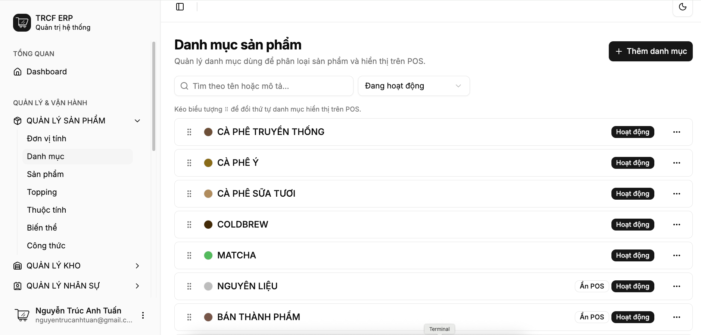
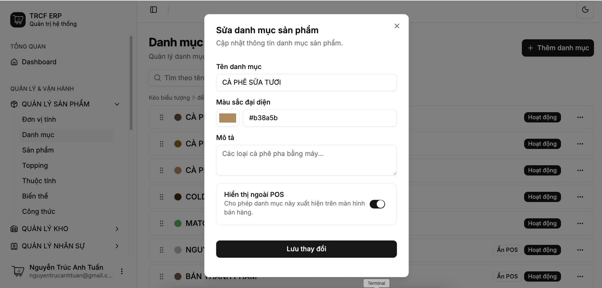
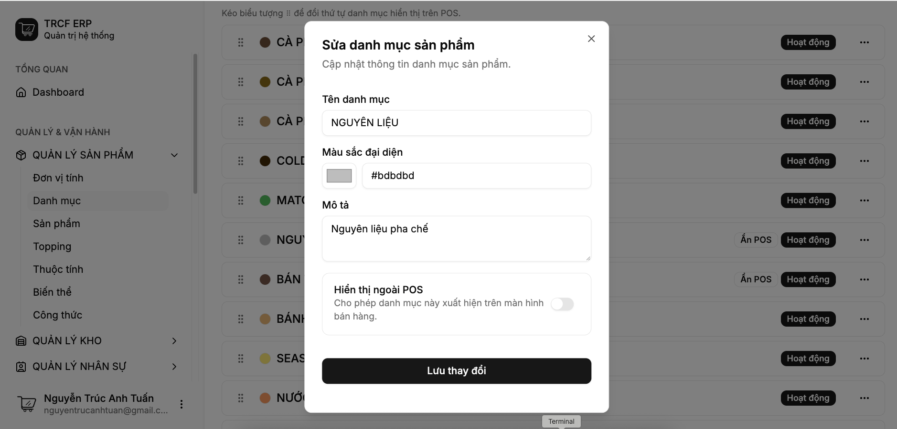

# 2.1 Danh mục sản phẩm

## 1. Đường dẫn vào chức năng

Menu trái: ==Quản lý sản phẩm → Danh mục== (địa chỉ `/product-categories`).

## 2. Ví dụ nền và các bước thực hiện

> **Ví dụ:** quán tạo 2 danh mục.
>
> - "Cà phê": nhóm món bán, hiện trên màn bán hàng.
> - "Nguyên liệu": cà phê hạt, sữa, đường — chỉ dùng nội bộ, ẩn khỏi màn bán hàng.

### Bước 1: Mở trang Danh mục

- Bấm **Quản lý sản phẩm** ở menu trái.
- Chọn **Danh mục**.
- Danh sách trống nếu chưa có danh mục nào.

### Bước 2: Thêm danh mục hiện trên POS

- Bấm **Thêm danh mục**.
- **Tên danh mục**: nhập "Cà phê".
- **Màu sắc đại diện**: nhập "#6F4E37" hoặc bấm ô màu để chọn.
- **Mô tả**: nhập "Các món cà phê pha máy và pha phin."
- **Hiển thị ngoài POS**: để **bật**.
- Bấm nút **Thêm danh mục** trong hộp thoại.

### Bước 3: Thêm danh mục chỉ dùng nội bộ

- Bấm **Thêm danh mục**.
- **Tên danh mục**: nhập "Nguyên liệu".
- **Màu sắc đại diện**: nhập "#8A8A8A".
- **Mô tả**: nhập "Cà phê hạt, sữa, đường — chỉ dùng nội bộ."
- **Hiển thị ngoài POS**: gạt sang **tắt**.
- Bấm nút **Thêm danh mục** trong hộp thoại.

### Bước 4: Kiểm tra và xếp thứ tự

- Thấy thông báo *“Đã thêm danh mục sản phẩm”*.
- Danh mục tắt hiển thị có nhãn **Ẩn POS**.
- Kéo biểu tượng **⠿** bên trái để đổi thứ tự.
- Xếp nhóm bán chạy lên đầu.

## 3. Giải thích các trường

| Trường             | Điền gì                                                   | Bắt buộc |
| ------------------ | --------------------------------------------------------- | -------- |
| Tên danh mục       | VD "Cà phê", "Trà trái cây"                               | ✅        |
| Màu sắc đại diện   | Màu nút trên màn bán hàng, giúp thu ngân nhận diện nhanh  | —        |
| Mô tả              | Ghi chú nội bộ                                            | —        |
| Hiển thị ngoài POS | **Bật**: hiện trên màn bán hàng. **Tắt**: chỉ dùng nội bộ | —        |

## 4. Lưu ý quan trọng

> [!CAUTION]
> **Danh mục đang gắn sản phẩm thì không xoá được.**
>
> - Muốn ẩn khỏi POS: tắt **Hiển thị ngoài POS**.
> - Đừng xoá.

> [!TIP]
> **Gom nguyên liệu vào một danh mục riêng và tắt hiển thị.**
>
> - Quản lý vẫn lọc được.
> - Thu ngân không thấy nguyên liệu trên màn bán hàng.

## Kiểm tra đã đúng

- [ ] Danh mục hiện trong danh sách, trạng thái **Hoạt động**
- [ ] Danh mục nguyên liệu có nhãn **Ẩn POS**
- [ ] Nhóm bán chạy đã kéo lên đầu danh sách
