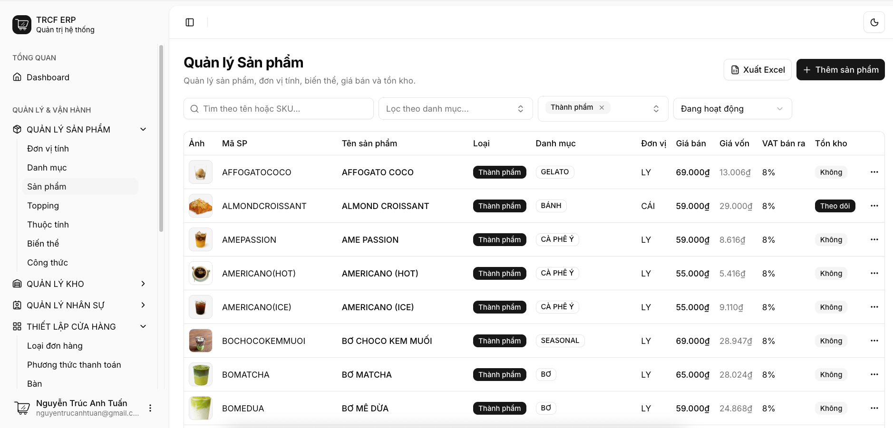
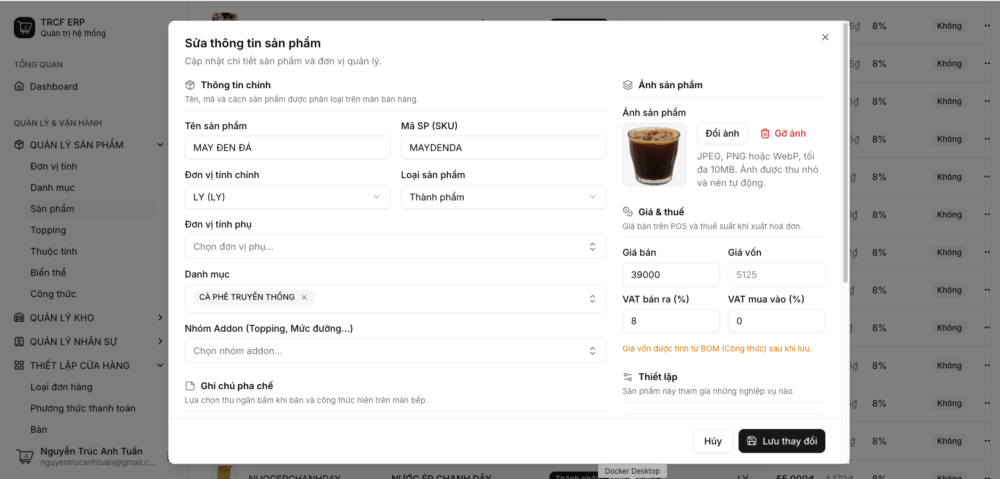
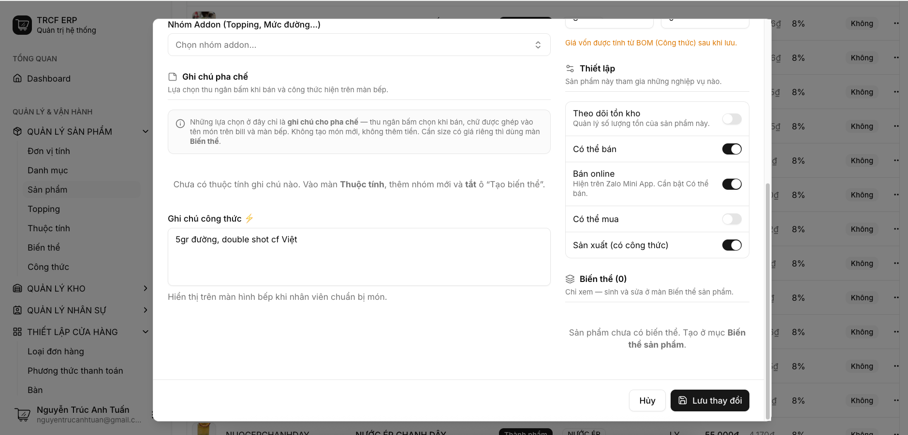

# 2.2 Thành phẩm

## 1. Đường dẫn vào chức năng

Menu trái: ==Quản lý sản phẩm → Sản phẩm → Thêm sản phẩm== (địa chỉ `/products`).

- Cần có trước: đơn vị tính ([mục 1.1](1-1-thiet-lap-don-vi-tinh.md)).
- Nên có trước: danh mục ([mục 2.1](2-1-danh-muc-san-pham.md)).

### Ba loại sản phẩm thường gặp

| Loại hàng                               | Tồn kho | Có thể bán | Có thể mua | Sản xuất (Có công thức) |
| --------------------------------------- | ------- | ---------- | ---------- | ----------------------- |
| CÀ PHÊ SỮA (THÀNH PHẨM - ĐƯỢC PHA CHẾ)) | ❌       | ✅          | ❌          | ✅                       |
| CÀ PHÊ HẠT (NGUYÊN LIỆU)                | ✅       | ❌          | ✅          | ❌                       |
| CỐT TRÀ LÀI PHA SẴN (BÁN THÀNH PHẨM)    | ✅       | ❌          | ❌          | ✅                       |
| BÁNH (THÀNH PHẨM - MUA SẴN BÁN LẠI)     | ✅       | ✅          | ✅          | ❌                       |

## 2. Ví dụ nền và các bước thực hiện

> **Ví dụ:** thêm món "MAY ĐEN ĐÁ".
>
> - Mã SP: "MAYDENDA". Đơn vị: "LY". Loại: "THÀNH PHẨM".
> - Giá bán: "39000".
> - Bán cho khách: bật **Có thể bán**
> - Pha chế từ nguyên liệu: bật **Sản xuất**.

### Bước 1: Mở trang Sản phẩm

- Bấm **Quản lý sản phẩm** ở menu trái.
- Chọn **Sản phẩm**.
- Bấm **Thêm sản phẩm** (góc phải trên).

### Bước 2: Khai thông tin chính và giá

- **Tên sản phẩm**: nhập "MAY ĐEN ĐÁ".
- **Mã SP (SKU)**: nhập "MAYDENDA".
- **Đơn vị tính chính**: chọn "LY".
- **Loại sản phẩm**: chọn "THÀNH PHẨM".
- **Danh mục**: chọn danh mục đã tạo ở mục 2.1.
- **Giá bán**: nhập "39000".

### Bước 3: Gạt các công tắc

- Cuộn xuống khung **Thiết lập** (cột phải).
- Giữ **Có thể bán**: bật.
- Gạt **Sản xuất (có công thức)**: bật.
- Để tắt: **Theo dõi tồn kho**, **Có thể mua**.
- Ô **Giá vốn** xám lại: bình thường.
- **Ghi chú công thức ⚡** (tuỳ chọn): nhập "Pha phin 25g cà phê, thêm 30ml sữa đặc, đá viên."

## 3. Giải thích các trường

### Cột trái — Thông tin chính

| Trường              | Điền gì                                                                                                 | Bắt buộc |
| ------------------- | ------------------------------------------------------------------------------------------------------- | -------- |
| Tên sản phẩm        | Tên hiện trên bill và màn bếp                                                                           | ✅        |
| Mã SP (SKU)         | Mã ngắn để tra cứu. VD `MAYDENDA`                                                                       | —        |
| Đơn vị tính chính   | Đơn vị tính tồn. Đồ uống thì chọn: "LY". Nguyên liệu thì chọn: "GRAM"                                   | ✅        |
| Loại sản phẩm       | Thành phẩm / Bán thành phẩm / Nguyên liệu → xem [2.3](2-3-ban-thanh-pham.md), [2.4](2-4-nguyen-lieu.md) | —        |
| Đơn vị tính phụ     | Đơn vị khác dùng cho hàng này (nhập theo KG, trừ theo GRAM)                                             | —        |
| Danh mục            | Một hoặc nhiều nhóm ở mục 2.1                                                                           | —        |
| Nhóm Addon          | Nhóm topping, mức đường hỏi khi bán món này                                                             | —        |
| Ghi chú pha chế     | Ô chọn (VD Đá: ít/nhiều). Thu ngân bấm khi bán, chữ ghép vào tên món. Không thêm tiền                   | —        |
| Ghi chú công thức ⚡ | Văn bản tự do hiện trên màn bếp khi làm món                                                             | —        |

### Cột phải

| Trường                   | Điền gì                                           |
| ------------------------ | ------------------------------------------------- |
| Ảnh sản phẩm             | JPEG, PNG, WebP, tối đa 10MB. Hệ thống tự nén     |
| Giá bán                  | Giá trên POS                                      |
| Giá vốn                  | Giá nhập. **Bị khoá** nếu bật công tắc *Sản xuất* |
| VAT bán ra / VAT mua vào | Thuế suất (%) áp cho món                          |

### Các công tắc — quyết định hành vi hệ thống

| Công tắc                | Bật khi                                      | Hệ quả                                                      |
| ----------------------- | -------------------------------------------- | ----------------------------------------------------------- |
| Theo dõi tồn kho        | Hàng cần đếm tồn: nguyên liệu, bánh đóng gói | Hiện ở màn Tồn kho, bị cộng/trừ khi nhập, bán, huỷ          |
| Có thể bán              | Món bán cho khách                            | Hiện trên màn bán hàng                                      |
| Bán online              | Bán qua Zalo Mini App (cần bật *Có thể bán*) | Hiện trên Zalo Mini App                                     |
| Có thể mua              | Hàng mua từ nhà cung cấp                     | Chọn được trong phiếu nhập hàng                             |
| Sản xuất (có công thức) | Món pha chế từ nguyên liệu                   | Dùng được công thức; **giá vốn bị khoá**, do công thức tính |

## 4. Lưu ý quan trọng

> [!CAUTION]
> **Bật *Sản xuất* thì ô Giá vốn xám lại.**
>
> - Không phải lỗi.
> - Giá vốn do công thức tính ([mục 3.2](3-2-cong-thuc-thanh-pham.md)).

> [!WARNING]
> **Tên và SKU không được trùng.**
>
> - Kể cả khác hoa thường.
> - Kể cả với sản phẩm đã lưu trữ.

> [!WARNING]
> **Sản phẩm đã phát sinh thì không xoá được.**
>
> - Đã bán, đã nhập, tồn khác 0.
> - Đang là nguyên liệu trong công thức, hoặc đang là topping.
> - Ngừng bán: chọn **Lưu trữ**.

> [!TIP]
> Sản phẩm mới tạo, chưa bán, chưa nhập thì xoá thoải mái.

## Kiểm tra đã đúng

- [ ] Sản phẩm hiện trong danh sách với đúng mã, tên, loại, đơn vị, giá bán
- [ ] Công tắc khớp loại hàng (xem bảng "Ba mẫu thường gặp")
