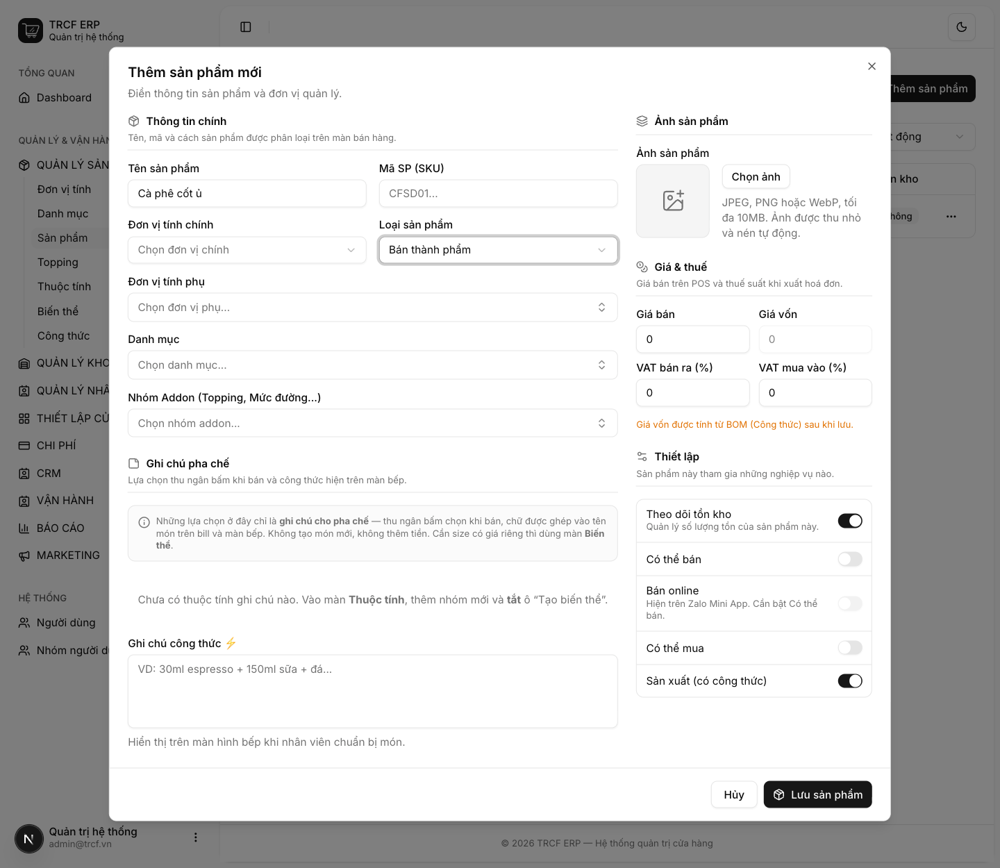

# 2.3 Bán thành phẩm

## 1. Đường dẫn vào chức năng

Menu trái: ==Quản lý sản phẩm → Sản phẩm → Thêm sản phẩm== (địa chỉ `/products`).

- Cần có trước: đơn vị tính ([bài 1.1](1-1-thiet-lap-don-vi-tinh.md)).
- Nên có trước: danh mục ([bài 2.1](2-1-danh-muc-san-pham.md)) và nguyên liệu ([bài 2.4](2-4-nguyen-lieu.md)).

## 2. Ví dụ nền và các bước thực hiện

> **Ví dụ:** quán ủ sẵn cà phê cốt buổi sáng, cả ngày múc ra pha.
>
> - Tên: "Cà phê cốt ủ". Đơn vị: "Gram". Loại: "Bán thành phẩm".
> - Quán tự làm, chưa bán cho khách, là đầu vào của món khác.
> - Bật **Sản xuất** và **Theo dõi tồn kho**.

### Bước 1: Mở form và chọn Loại sản phẩm

- Vào **Quản lý sản phẩm → Sản phẩm**.
- Bấm **Thêm sản phẩm**.
- Bấm ô **Loại sản phẩm**.
- Chọn "Bán thành phẩm".

### Bước 2: Khai bán thành phẩm "Cà phê cốt ủ"

- **Tên sản phẩm**: nhập "Cà phê cốt ủ".
- **Đơn vị tính chính**: chọn "Gram".
- **Loại sản phẩm**: giữ "Bán thành phẩm".
- Bật **Sản xuất (có công thức)**.
- Bật **Theo dõi tồn kho**.
- Để tắt **Có thể bán** và **Có thể mua**.
- Ô **Giá vốn** xám lại: bình thường.
- Bấm **Lưu sản phẩm**.

## 3. Giải thích các trường

### Khai bán thành phẩm

| Trường | Điền gì |
| --- | --- |
| Tên sản phẩm | Tên hiện trên màn bếp và phiếu chế biến. VD "Cà phê cốt ủ" |
| Đơn vị tính chính | Đơn vị tính tồn. Chất lỏng, bột: "Gram" |
| Loại sản phẩm | "Bán thành phẩm" |
| Giá vốn | **Bị khoá**, do công thức tính ([bài 3.1](3-1-cong-thuc-ban-thanh-pham.md)) |
| Sản xuất (có công thức) | **Bật**. Có công thức tạo ra bán thành phẩm |
| Theo dõi tồn kho | **Bật**. Biết bình ủ còn bao nhiêu |
| Có thể bán / Có thể mua | **Tắt**. Không bán trực tiếp, không mua từ nhà cung cấp |

### So sánh ba loại hàng

| Loại | Là gì | Ví dụ | Bật công tắc |
| --- | --- | --- | --- |
| **Nguyên liệu** | Mua để dùng, không bán trực tiếp, dùng làm ra thứ khác | Cà phê hạt, sữa đặc, đường, ly nhựa | Có thể mua · Theo dõi tồn kho |
| **Bán thành phẩm** | Quán tự làm, chưa bán cho khách, là đầu vào của món khác | Cà phê cốt ủ sẵn, trà ủ, syrup tự nấu | Sản xuất · Theo dõi tồn kho |
| **Thành phẩm** | Món bán cho khách | Cà phê sữa đá, trà đào | Có thể bán · Sản xuất |

### Khi nào cần bán thành phẩm

Quán ủ sẵn một bình cà phê cốt buổi sáng, cả ngày múc ra pha. Tách thành 2 bước:

- **Sáng**: lập phiếu chế biến, trừ cà phê hạt, cộng "Cà phê cốt ủ" vào kho ([mục 11.4](11-4-che-bien.md)).
- **Cả ngày**: mỗi ly bán ra trừ "Cà phê cốt ủ" theo công thức.

## 4. Lưu ý quan trọng

> [!WARNING]
> **Loại sản phẩm không tự đổi hành vi hệ thống.**
>
> - Hành vi do các công tắc quyết định.
> - Loại là cách quán tự phân loại.
> - Là căn cứ cho màn *Rà soát vận hành* ([mục 11.7](11-7-de-xuat-nhap-hang.md)).

> [!TIP]
> Tách 2 bước giúp biết bình cốt còn bao nhiêu, và hao hụt nằm ở khâu ủ hay khâu bán.

> [!TIP]
> Quán nhỏ chưa cần chi tiết vậy: bỏ qua bán thành phẩm, cho món bán trừ thẳng nguyên liệu.

## Kiểm tra đã đúng

- [ ] Loại sản phẩm là "Bán thành phẩm"
- [ ] **Sản xuất** và **Theo dõi tồn kho** bật, **Có thể bán** tắt
- [ ] Sản phẩm hiện trong danh sách
