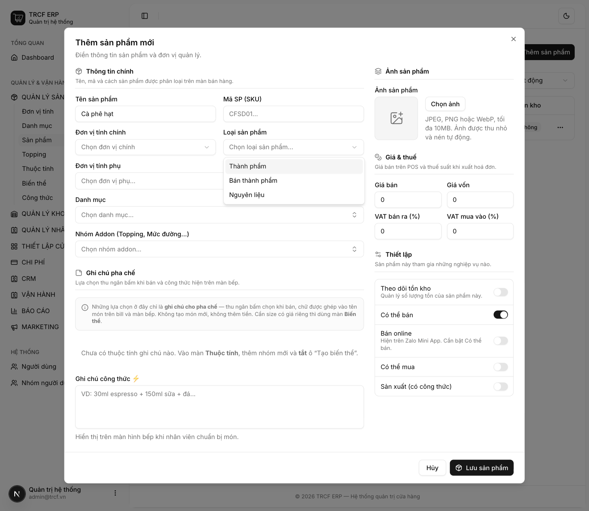
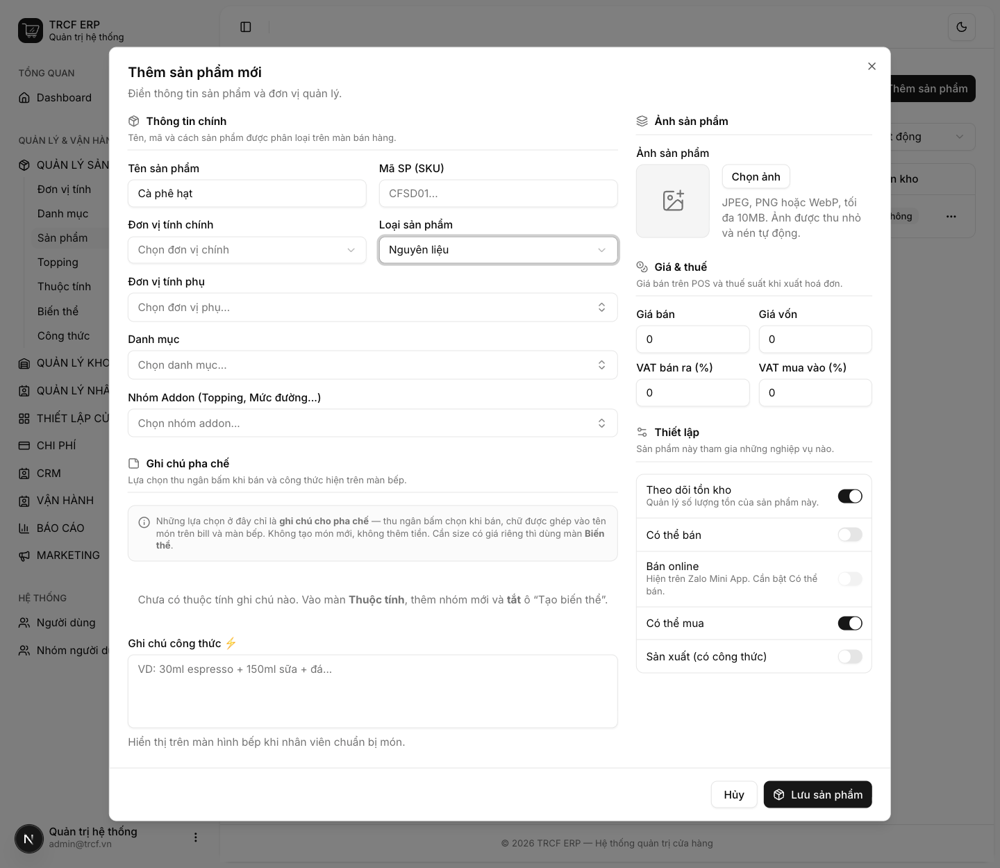

# 2.4 Nguyên liệu

## 1. Đường dẫn vào chức năng

Menu trái: ==Quản lý sản phẩm → Sản phẩm → Thêm sản phẩm== (địa chỉ `/products`).

- Cần có trước: đơn vị tính ([bài 1.1](1-1-thiet-lap-don-vi-tinh.md)).

## 2. Ví dụ nền và các bước thực hiện

> **Cách đặt tên**: NL - TÊN NGUYÊN LIỆU - KHỐI LƯỢNG BÊN TRONG - KHỐI LƯỢNG VỎ.
> **Ví dụ**: NL - CÀ PHÊ HẠT - 1000 - 30. (Túi khối lượng 1000 GRAM và khối lượng vỏ là 30 GRAM), NL - SỮA ĐẶC - 1250 - 90

> **Ví dụ:** thêm nguyên liệu "NL - CÀ PHÊ HẠT".
>
> - Tên: "CÀ PHÊ HẠT". Đơn vị: "GRAM". Loại: "NGUYÊN LIỆU".
> - Mua về, dùng làm ra thứ khác, không bán trực tiếp.
> - Bật **Theo dõi tồn kho** và **Có thể mua**.

### Bước 1: Mở form và chọn Loại sản phẩm

- Vào **Quản lý sản phẩm → Sản phẩm**.
- Bấm **Thêm sản phẩm**.
- Bấm ô **Loại sản phẩm**.
- Chọn "NGUYÊN LIỆU".

### Bước 2: Khai nguyên liệu "CÀ PHÊ HẠT"

- **Tên sản phẩm**: nhập "CÀ PHÊ HẠT".
- **Đơn vị tính chính**: chọn "GRAM".
- **Loại sản phẩm**: giữ "NGUYÊN LIỆU".
- Bật **Theo dõi tồn kho**.
- Bật **Có thể mua**.
- Để tắt **Có thể bán** và **Sản xuất**.
- Bấm **Lưu sản phẩm**.

## 3. Giải thích các trường

### Khai nguyên liệu

| Trường                | Điền gì                                                                 |
| --------------------- | ----------------------------------------------------------------------- |
| Tên sản phẩm          | VD "NL - CÀ PHÊ HẠT", "NL - SỮA ĐẶC", "NL - ĐƯỜNG CÁT"                  |
| Đơn vị tính chính     | Đơn vị nhỏ nhất dùng trừ kho. VD "GRAM"                                 |
| Đơn vị tính phụ       | Đơn vị khác dùng cho hàng này (nhập theo "KG", trừ theo "GRAM")         |
| Loại sản phẩm         | "NGUYÊN LIỆU"                                                           |
| Giá vốn               | Giá nhập. Tự cập nhật mỗi lần nhập hàng ([bài 11.2](11-2-nhap-hang.md)) |
| Theo dõi tồn kho      | **Bật**. Hiện ở màn Tồn kho, bị cộng/trừ khi nhập, chế biến, bán, huỷ   |
| Có thể mua            | **Bật**. Chọn được trong phiếu nhập hàng                                |
| Có thể bán / Sản xuất | **Tắt**                                                                 |

### So sánh ba loại hàng

| Loại               | Là gì                                                    | Ví dụ                                 | Bật công tắc                  |
| ------------------ | -------------------------------------------------------- | ------------------------------------- | ----------------------------- |
| **Nguyên liệu**    | Mua để dùng, không bán trực tiếp, dùng làm ra thứ khác   | Cà phê hạt, sữa đặc, đường, ly nhựa   | Có thể mua · Theo dõi tồn kho |
| **Bán thành phẩm** | Quán tự làm, chưa bán cho khách, là đầu vào của món khác | Cà phê cốt ủ sẵn, trà ủ, syrup tự nấu | Sản xuất · Theo dõi tồn kho   |
| **Thành phẩm**     | Món bán cho khách                                        | Cà phê sữa đá, trà đào                | Có thể bán · Sản xuất         |

## 4. Lưu ý quan trọng

> [!WARNING]
> **Nguyên liệu chưa nhập lần nào thì giá vốn vẫn là 0.**
>
> - Công thức dùng nguyên liệu này sẽ tính giá vốn món thiếu.
> - Nhập hàng một lần để có giá vốn.

> [!TIP]
> Đơn vị trong công thức được phép khác đơn vị tồn kho. Khai 18 gram trong khi kho quản lý theo kg vẫn đúng, hệ thống tự quy đổi.

> [!TIP]
> Nguyên liệu gom vào một danh mục riêng và tắt hiển thị ngoài POS để thu ngân không thấy trên màn bán hàng.

## Kiểm tra đã đúng

- [ ] Loại sản phẩm là "Nguyên liệu"
- [ ] **Theo dõi tồn kho** và **Có thể mua** bật
- [ ] Sản phẩm hiện trong danh sách
