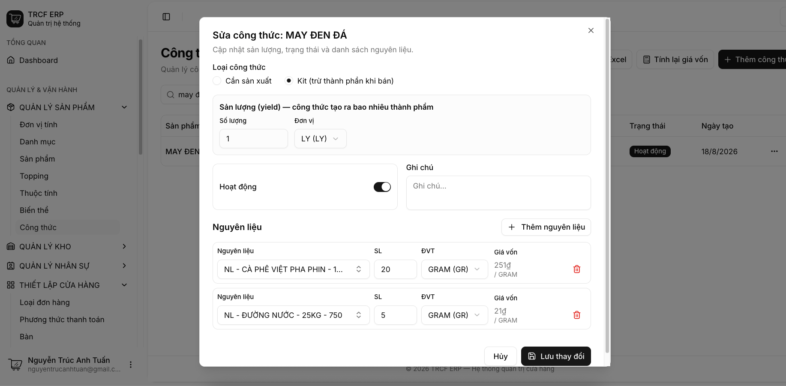
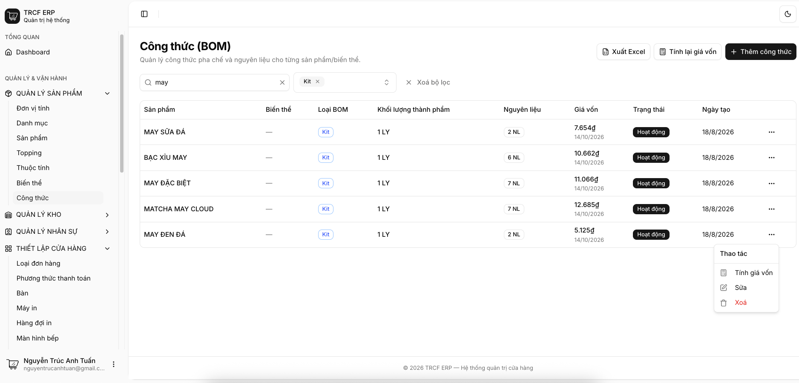
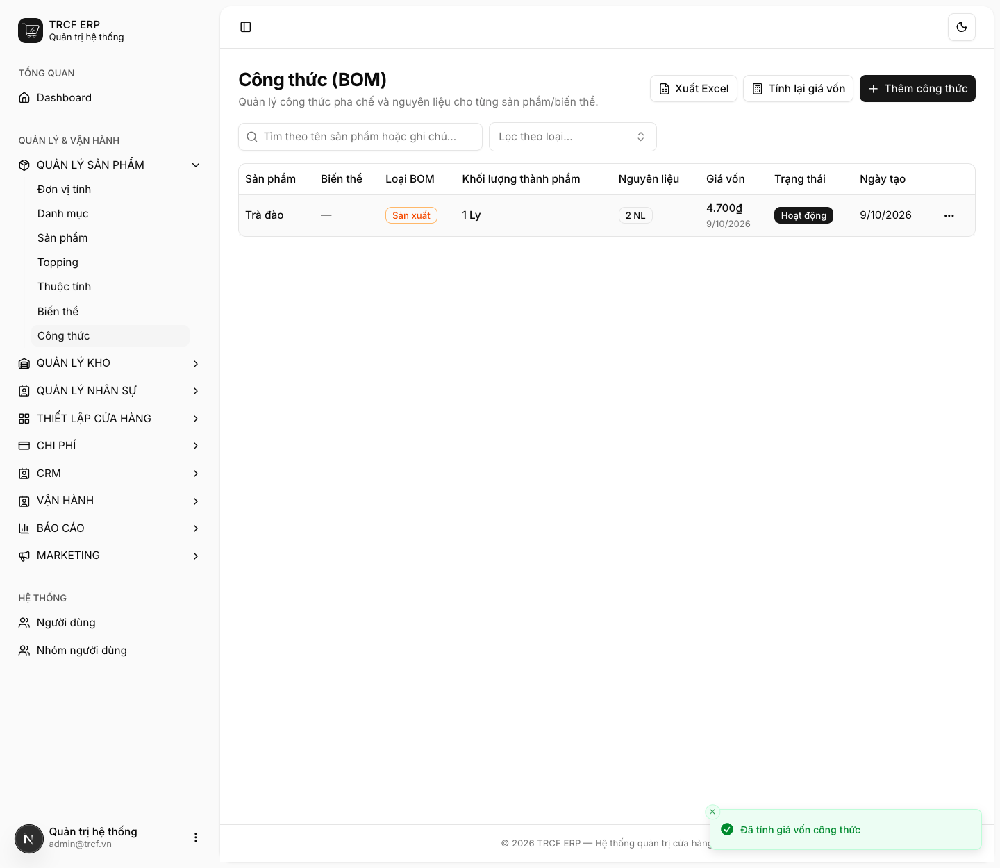

# 3.2 Công thức thành phẩm

## 1. Đường dẫn vào chức năng

Menu trái: ==Quản lý sản phẩm → Công thức== (địa chỉ `/boms`).

- Cần có trước: thành phẩm bật **Sản xuất** ([bài 2.2](2-2-thanh-pham.md)).
- Cần có trước: nguyên liệu, bán thành phẩm đã có giá vốn ([bài 2.4](2-4-nguyen-lieu.md), [bài 3.1](3-1-cong-thuc-ban-thanh-pham.md)).

## 2. Ví dụ nền và các bước thực hiện

> **Ví dụ:** món "Trà đào" giá 40.000.
>
> - Công thức: "Trà đen" 15 g (300đ/g) + "Đường cát" 10 g (20đ/g).
> - Sản lượng 1 ly → giá vốn = 15×300 + 10×20 = **4.700₫**.

### Bước 1: Tạo công thức

- Vào **Quản lý sản phẩm → Công thức**.
- Bấm **Thêm công thức**.
- **Sản phẩm (thành phẩm)**: chọn "Trà đào".
- **Loại công thức**: giữ "Cần sản xuất".
- **Sản lượng (yield)**: giữ "1", đơn vị "Ly".
- Bấm **Thêm nguyên liệu** hai lần.
- Dòng 1: chọn "Trà đen", SL "15", ĐVT "Gram (G)".
- Dòng 2: chọn "Đường cát", SL "10", ĐVT "Gram (G)".
- Bấm nút **Tạo công thức**.

### Bước 2: Mở menu dòng công thức

- Công thức mới có **Giá vốn** "Chưa tính".
- Bấm nút **…** ở cuối dòng.
- Menu có: **Tính giá vốn**, **Sửa**, **Xoá**.

### Bước 3: Tính giá vốn

- Chọn **Tính giá vốn**.
- Thấy thông báo *“Đã tính giá vốn công thức”*.
- Cột **Giá vốn** hiện "4.700₫".
- Tính cả loạt: bấm **Tính lại giá vốn** ở đầu trang.

## 3. Giải thích các trường

### Khai công thức

| Trường | Điền gì | Bắt buộc |
| --- | --- | --- |
| Sản phẩm (thành phẩm) | Món cần công thức. Danh sách **chỉ hiện sản phẩm đã bật *Sản xuất*** | ✅ |
| Biến thể | Bỏ trống: công thức chung mọi size. Chọn size: công thức riêng size đó | — |
| Loại công thức | *Cần sản xuất* hoặc *Kit* (xem bảng dưới) | ✅ |
| Sản lượng (yield) | Công thức làm ra bao nhiêu thành phẩm. Ủ một mẻ được 20 ly: điền 20 | ✅ |
| Hoạt động | Tắt: công thức tạm ngừng dùng | — |
| Nguyên liệu | Hàng + định lượng (SL) + đơn vị (ĐVT) | ✅ |

### Hai loại công thức

| Loại | Trừ kho khi nào | Dùng cho |
| --- | --- | --- |
| Cần sản xuất | Khi lập **phiếu chế biến** ([11.4](11-4-che-bien.md)) | Bán thành phẩm ủ trước: cà phê cốt, trà ủ, syrup |
| Kit | Ngay **lúc bán**, tự trừ thành phần | Combo, món ráp tại chỗ không qua chế biến |

### Cách tính giá vốn

`giá vốn = tổng (giá vốn nguyên liệu × định lượng đã quy đổi) ÷ sản lượng`

- Sản phẩm có nhiều công thức đang hoạt động: lấy **công thức rẻ nhất**.

## 4. Lưu ý quan trọng

> [!CAUTION]
> **Nguyên liệu có giá vốn = 0 làm giá vốn món sai.**
>
> - Sau khi tính, hệ thống cảnh báo tên nguyên liệu chưa có giá.
> - Giá vốn nguyên liệu tự cập nhật mỗi lần nhập hàng.
> - Nguyên liệu chưa nhập lần nào thì vẫn là 0.

> [!WARNING]
> **Công thức nhiều tầng phải bấm tính hai lần.**
>
> - Ví dụ "Trà đào" dùng "trà ủ", "trà ủ" có công thức riêng.
> - Lần 1: tính giá "trà ủ".
> - Lần 2: đưa giá đó vào "Trà đào".

> [!TIP]
> Sửa, tắt hoặc xoá công thức thì giá vốn tự tính lại ngay. Xoá hết công thức đang hoạt động thì giá vốn giữ giá cuối cùng, không tụt về 0.

> [!TIP]
> Đơn vị trong công thức được phép khác đơn vị tồn kho. Khai 18 gram trong khi kho quản lý theo kg vẫn đúng, hệ thống tự quy đổi.

## Kiểm tra đã đúng

- [ ] Công thức có đủ nguyên liệu, đúng định lượng và đơn vị
- [ ] Cột **Giá vốn** của công thức không còn "Chưa tính"
- [ ] Không có cảnh báo nguyên liệu thiếu giá vốn
