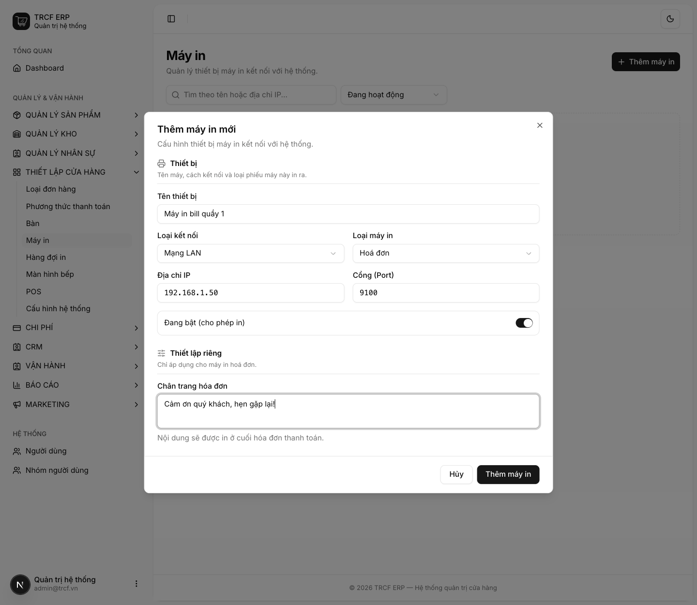

# 4.1 Cài đặt máy in bill

## 1. Đường dẫn vào chức năng

Menu trái: ==Thiết lập cửa hàng → Máy in== (địa chỉ `/printers`).

## 2. Ví dụ nền và các bước thực hiện

> **Ví dụ:** quán có máy in bill ở quầy thu ngân.
>
> - "Máy in bill quầy 1": loại Hoá đơn, mạng LAN, IP "192.168.1.50", cổng "9100".
> - Chân trang bill: "Cảm ơn quý khách, hẹn gặp lại!"

### Bước 1: Mở trang Máy in

- Bấm **Thiết lập cửa hàng** ở menu trái.
- Chọn **Máy in**.
- Bấm **Thêm máy in**.

### Bước 2: Khai máy in hoá đơn

- **Tên thiết bị**: nhập "Máy in bill quầy 1".
- **Loại kết nối**: chọn "Mạng LAN".
- **Loại máy in**: chọn "Hoá đơn".
- **Địa chỉ IP**: nhập "192.168.1.50".
- **Cổng (Port)**: giữ "9100".
- **Chân trang hóa đơn**: nhập "Cảm ơn quý khách, hẹn gặp lại!"
- Bấm nút **Thêm máy in** trong hộp thoại.

## 3. Giải thích các trường

### Thiết bị

| Trường | Điền gì | Bắt buộc |
| --- | --- | --- |
| Tên thiết bị | VD "Máy in bill quầy 1" | ✅ |
| Loại kết nối | *Mạng LAN* (có IP) hoặc *USB* (cắm trực tiếp) | ✅ |
| Loại máy in | Hoá đơn / Nhãn dán / Phiếu yêu cầu món (KOT) / Phiếu đóng ca | ✅ |
| Địa chỉ IP, Cổng (Port) | Chỉ hiện khi chọn LAN. Cổng thường **9100** | ✅ nếu LAN |
| Đang bật (cho phép in) | Tắt: tạm ngừng in ra máy này | — |

### Thiết lập riêng cho máy in hoá đơn

| Trường | Điền gì |
| --- | --- |
| Chân trang hoá đơn | Câu in ở cuối bill |

Sau khi khai máy in, gán máy cho quầy ở **Thiết lập cửa hàng → POS**.

## 4. Lưu ý quan trọng

> [!WARNING]
> **Máy in nhiệt phổ thông (POS-80) không có bảng mã tiếng Việt.**
>
> - Hệ thống in tiếng Việt bằng cách vẽ ảnh.
> - Bill mất dấu: kiểm tra lại loại máy đã khai.

> [!TIP]
> Máy in kết nối LAN: kiểm tra máy in và máy tính cùng một mạng, in thử một bill.

## Kiểm tra đã đúng

- [ ] Máy in hiện trong danh sách, trạng thái đang bật
- [ ] Máy LAN đã khai đúng IP và cổng
- [ ] Máy đã gán cho quầy ở **Thiết lập cửa hàng → POS**
