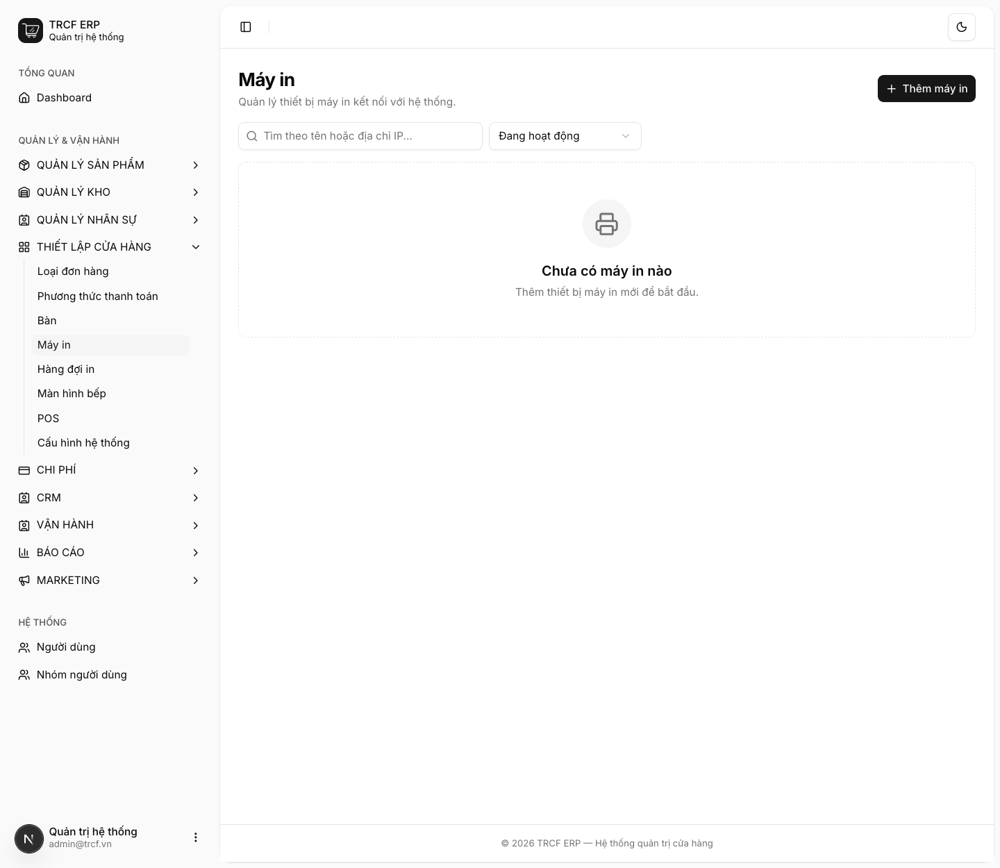
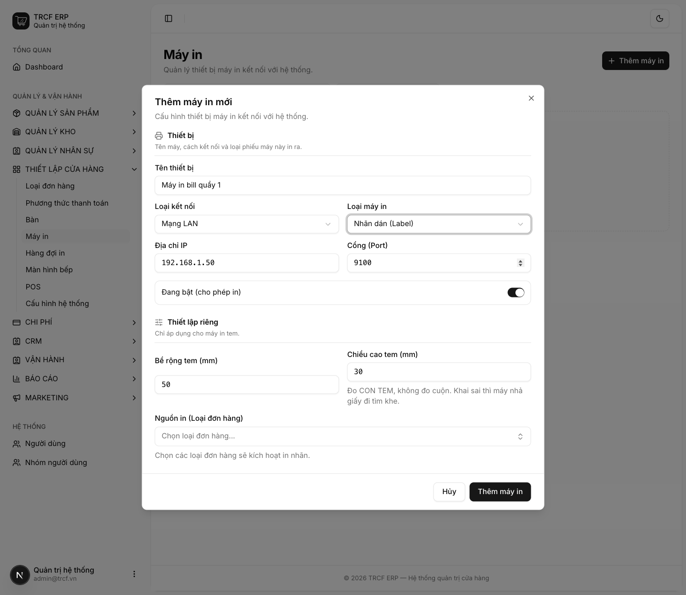

# 4.2 Cài đặt máy in nhãn

## 1. Đường dẫn vào chức năng

Menu trái: ==Thiết lập cửa hàng → Máy in== (địa chỉ `/printers`).

## 2. Ví dụ nền và các bước thực hiện

> **Ví dụ:** quán có máy in tem dán lên ly.
>
> - "Máy tem quầy 1": loại Nhãn dán, mạng LAN, IP "192.168.1.51", cổng "9100".
> - Con tem rộng và cao theo số đo thật của tem.

### Bước 1: Mở trang Máy in

- Bấm **Thiết lập cửa hàng** ở menu trái.
- Chọn **Máy in**.
- Bấm **Thêm máy in**.

### Bước 2: Khai máy in tem (Nhãn dán)

- **Loại máy in**: chọn "Nhãn dán (Label)".
- **Bề rộng tem (mm)**, **Chiều cao tem (mm)**: nhập số đo con tem.
- **Nguồn in (Loại đơn hàng)**: chọn loại đơn nào sẽ in tem.

## 3. Giải thích các trường

### Thiết bị

| Trường | Điền gì | Bắt buộc |
| --- | --- | --- |
| Tên thiết bị | VD "Máy in bill quầy 1" | ✅ |
| Loại kết nối | *Mạng LAN* (có IP) hoặc *USB* (cắm trực tiếp) | ✅ |
| Loại máy in | Hoá đơn / Nhãn dán / Phiếu yêu cầu món (KOT) / Phiếu đóng ca | ✅ |
| Địa chỉ IP, Cổng (Port) | Chỉ hiện khi chọn LAN. Cổng thường **9100** | ✅ nếu LAN |
| Đang bật (cho phép in) | Tắt: tạm ngừng in ra máy này | — |

### Thiết lập riêng cho máy in nhãn

| Trường | Điền gì |
| --- | --- |
| Bề rộng tem (mm) | Đo con tem, không đo cuộn |
| Chiều cao tem (mm) | Đo con tem, không đo cuộn |
| Nguồn in (Loại đơn hàng) | Loại đơn nào thì in tem |

## 4. Lưu ý quan trọng

> [!CAUTION]
> **Chiều cao tem phải đo con tem, không đo cuộn.**
>
> - Khai sai thì máy nhả giấy đi tìm khe cắt.
> - Kết quả là ra tem trắng.

> [!WARNING]
> **Máy in nhiệt phổ thông (POS-80) không có bảng mã tiếng Việt.**
>
> - Hệ thống in tiếng Việt bằng cách vẽ ảnh.
> - Bill mất dấu: kiểm tra lại loại máy đã khai.

## Kiểm tra đã đúng

- [ ] Máy tem hiện trong danh sách, trạng thái đang bật
- [ ] Bề rộng và chiều cao tem khớp con tem thật
- [ ] Đã chọn đúng nguồn in (loại đơn hàng)
