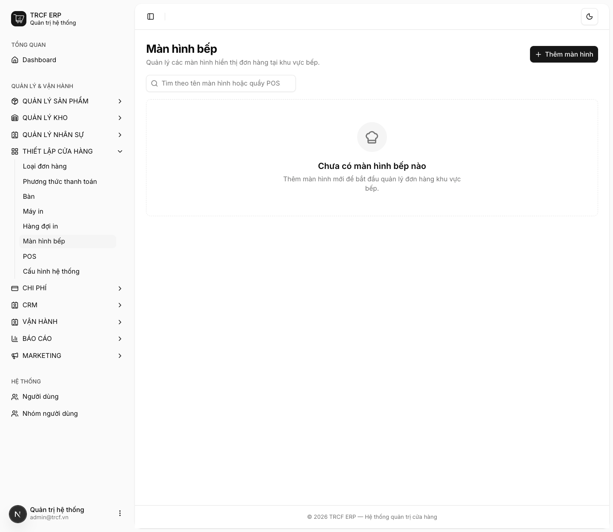
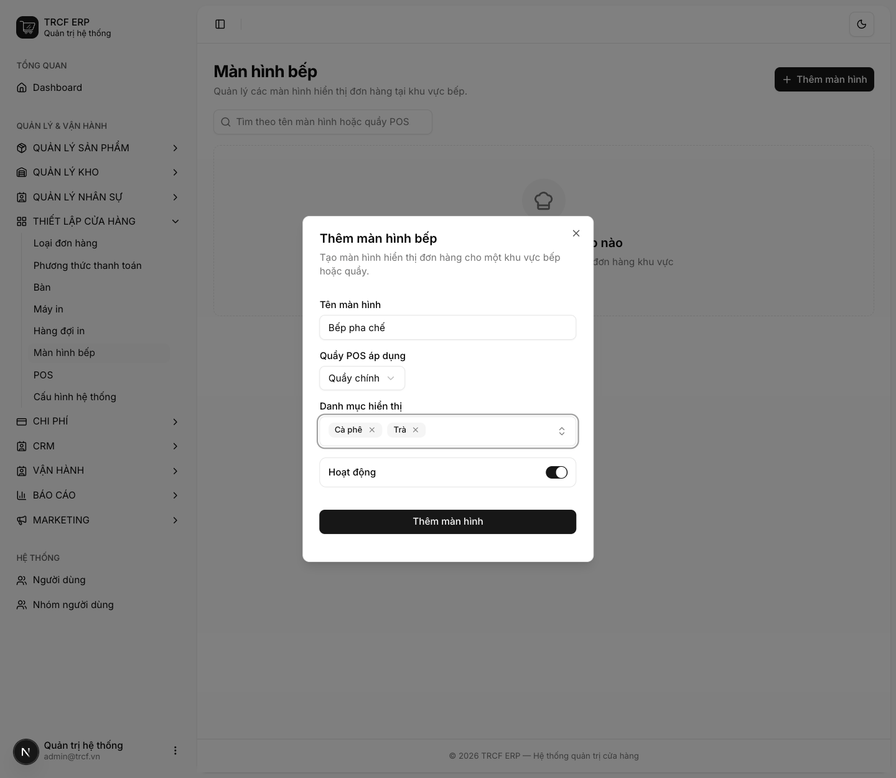
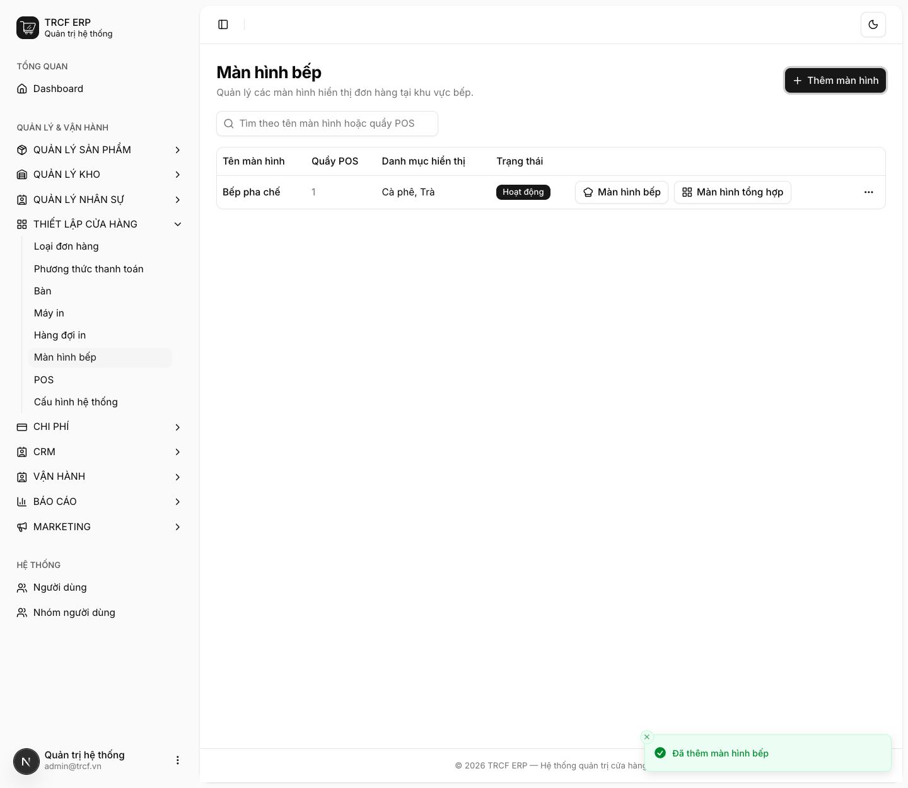
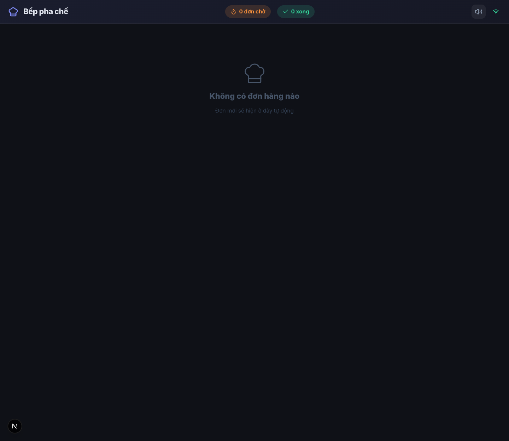

# 5.1 Cài đặt màn hình bếp

## 1. Đường dẫn vào chức năng

Menu trái: ==Thiết lập cửa hàng → Màn hình bếp== (địa chỉ `/kitchen-screens`).

- Cần có trước: quầy POS (khai ở **Thiết lập cửa hàng → POS**), danh mục sản phẩm ([mục 2.1](2-1-danh-muc-san-pham.md)).

## 2. Ví dụ nền và các bước thực hiện

> **Ví dụ:** khu pha chế có 1 màn hình bếp.
>
> - Tên: "Bếp pha chế".
> - Quầy POS áp dụng: "Quầy chính".
> - Danh mục hiển thị: "Cà phê", "Trà".

### Bước 1: Mở trang Màn hình bếp

- Bấm **Thiết lập cửa hàng** ở menu trái.
- Chọn **Màn hình bếp**.
- Bấm **Thêm màn hình**.

### Bước 2: Khai màn hình bếp

- **Tên màn hình**: nhập "Bếp pha chế".
- **Quầy POS áp dụng**: chọn "Quầy chính".
- **Danh mục hiển thị**: chọn "Cà phê", "Trà".
- **Hoạt động**: để bật.
- Bấm nút **Thêm màn hình** trong hộp thoại.

### Bước 3: Kiểm tra kết quả

- Màn hình hiện trong danh sách, trạng thái **Hoạt động**.
- Cột **Mở màn hình** có 2 nút: **Màn hình bếp**, **Màn hình tổng hợp**.

### Bước 4: Mở màn hình bếp trên thiết bị

- Bấm **Màn hình bếp** trên dòng vừa tạo.
- Màn hình mở ở tab mới (địa chỉ dạng `/kitchen/…`).
- Mở trên thiết bị ở khu pha chế, **để nguyên cả ngày**.
- Khi có đơn, món tự hiện lên, không cần tải lại trang.

## 3. Giải thích các trường

| Trường | Điền gì | Bắt buộc |
| --- | --- | --- |
| Tên màn hình | VD "Bếp pha chế", "Bếp nóng" | ✅ |
| Quầy POS áp dụng | Màn này **chỉ nhận đơn của quầy đó** | ✅ |
| Danh mục hiển thị | Nhóm món màn này phụ trách. Để trống: nhận mọi món | — |
| Hoạt động | Tắt: ngừng dùng màn này | — |

### Món hiện gì trên màn bếp

| Thông tin | Từ đâu ra |
| --- | --- |
| Tên món + ghi chú trong ngoặc. VD *Trà đào (VỪA + ÍT ĐÁ)* | Thuộc tính |
| Số lượng | Đơn hàng |
| Ghi chú của khách | Thu ngân nhập lúc bán |
| **Ghi chú công thức ⚡** | Trường khai ở [mục 2.2](2-2-thanh-pham.md) |

Pha chế xong: bấm vào món, món biến khỏi màn.

## 4. Lưu ý quan trọng

> [!TIP]
> **Ghi chú công thức là chỗ đặt công thức rút gọn cho người mới.**
>
> - VD "30ml espresso + 150ml sữa + đá đầy ly".
> - Nhân viên mới không cần nhớ, không cần hỏi.

> [!TIP]
> Đơn bị huỷ hoặc đã hoàn tự biến khỏi màn bếp. Pha chế không làm nhầm món của đơn đã huỷ.

> [!WARNING]
> Mỗi màn hình bếp chỉ nhận đơn của **một quầy**. Quán nhiều quầy thì tạo mỗi quầy một màn hình.

## Kiểm tra đã đúng

- [ ] Màn hình hiện trong danh sách, trạng thái **Hoạt động**
- [ ] Đã chọn đúng quầy và danh mục
- [ ] Mở được màn hình bếp trên thiết bị khu pha chế
