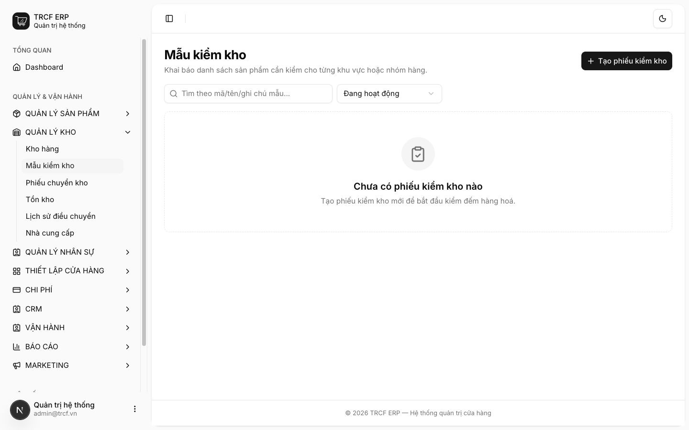
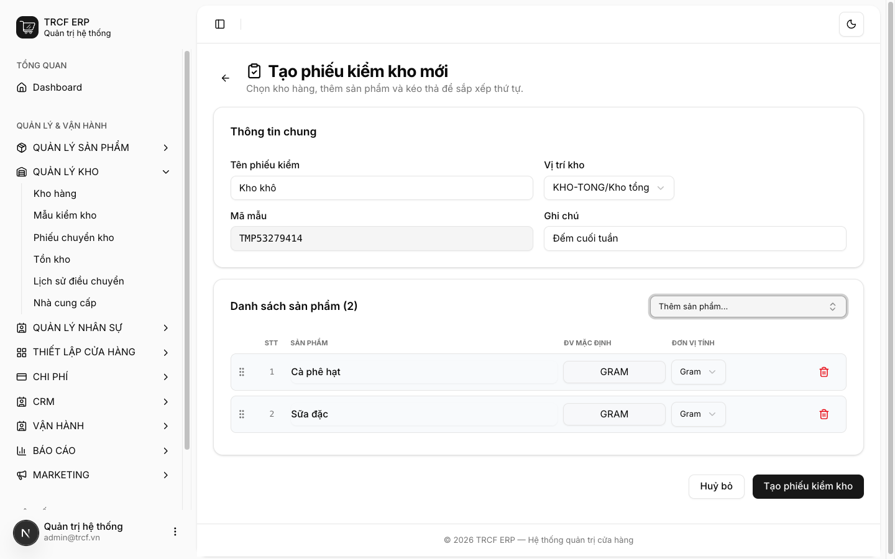
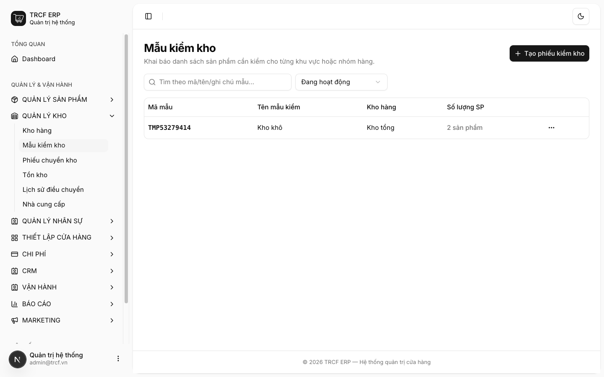

# 6.1 Tạo mẫu kiểm kho

## 1. Đường dẫn vào chức năng

Menu trái: ==Quản lý kho → Mẫu kiểm kho== (địa chỉ `/stock-templates`).

- Cần có trước: kho hàng và sản phẩm đã bật **Theo dõi tồn kho** ([bài 2.4](2-4-nguyen-lieu.md)).
- Mẫu dùng để tạo phiếu kiểm kho nhanh ở [bài 11.6](11-6-kiem-kho.md).

## 2. Ví dụ nền và các bước thực hiện

> **Ví dụ:** mẫu đếm hàng khô cuối tuần cho "Kho tổng".
>
> - Tên: "Kho khô". Kho: "Kho tổng". Ghi chú: "Đếm cuối tuần".
> - Danh sách: "Cà phê hạt", "Sữa đặc".

### Bước 1: Mở trang Mẫu kiểm kho

- Bấm **Quản lý kho** ở menu trái.
- Chọn **Mẫu kiểm kho**.
- Bấm nút **Tạo phiếu kiểm kho** (góc phải trên).
- Nút này tạo **mẫu**. Phiếu đếm hàng tạo ở [bài 11.6](11-6-kiem-kho.md).

### Bước 2: Khai mẫu và thêm sản phẩm

- **Tên phiếu kiểm**: nhập "Kho khô".
- **Vị trí kho**: chọn "KHO-TONG/Kho tổng".
- **Mã mẫu**: hệ thống tự sinh, không sửa.
- **Ghi chú**: nhập "Đếm cuối tuần".
- Bấm ô **Thêm sản phẩm...**, chọn "Cà phê hạt".
- Bấm ô đó lần nữa, chọn "Sữa đặc".
- Kéo biểu tượng ⠿ để đổi thứ tự dòng.
- Cột **Đơn vị tính**: chọn đơn vị đếm.

### Bước 3: Lưu và kiểm tra

- Bấm nút **Tạo phiếu kiểm kho** ở đáy trang.
- Mẫu hiện trong danh sách: mã mẫu, tên, kho, số lượng sản phẩm.
- Mẫu "Kho khô": "2 sản phẩm".

## 3. Giải thích các trường

| Trường | Điền gì | Bắt buộc |
| --- | --- | --- |
| Tên phiếu kiểm | Tên mẫu, đặt theo khu vực. VD "Kho khô", "Quầy pha chế" | ✅ |
| Vị trí kho | Kho sẽ đếm bằng mẫu này | ✅ |
| Mã mẫu | Tự sinh, chỉ đọc | — |
| Ghi chú | Ghi thêm, VD lịch đếm | — |
| Danh sách sản phẩm | Hàng cần đếm. Thêm từng món, kéo ⠿ để xếp thứ tự | ✅ |
| Đơn vị tính (mỗi dòng) | Đơn vị đếm của dòng đó | — |

## 4. Lưu ý quan trọng

> [!WARNING]
> **Nút "Tạo phiếu kiểm kho" ở màn này tạo mẫu, chưa phải phiếu đếm.**
>
> - Mẫu chỉ là danh sách hàng cần đếm.
> - Phiếu đếm hàng thật tạo ở [bài 11.6](11-6-kiem-kho.md).

> [!TIP]
> **Dựng mẫu theo khu vực**: "Quầy pha chế", "Kho khô", "Tủ đông".
>
> - Đếm theo khu nhanh và ít sót hơn đếm theo danh sách toàn quán.

> [!TIP]
> Xếp hàng theo thứ tự đặt trên kệ để người đếm đi một vòng là xong.

## Kiểm tra đã đúng

- [ ] Mẫu hiện trong danh sách với đúng kho
- [ ] Số sản phẩm của mẫu đúng như đã chọn
