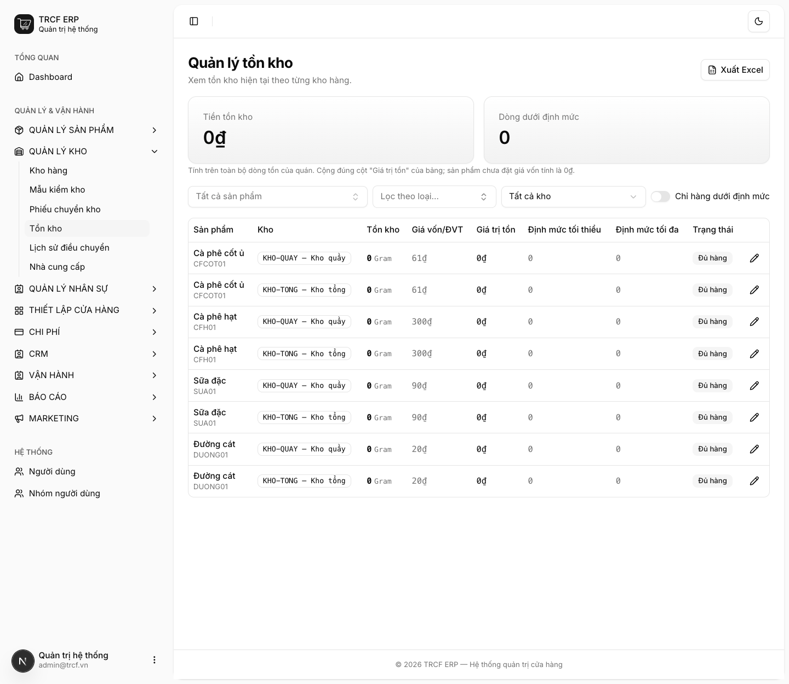
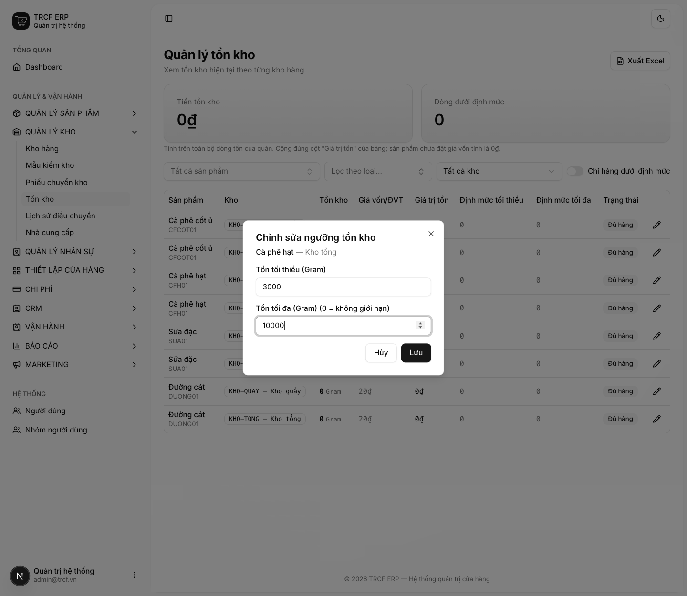
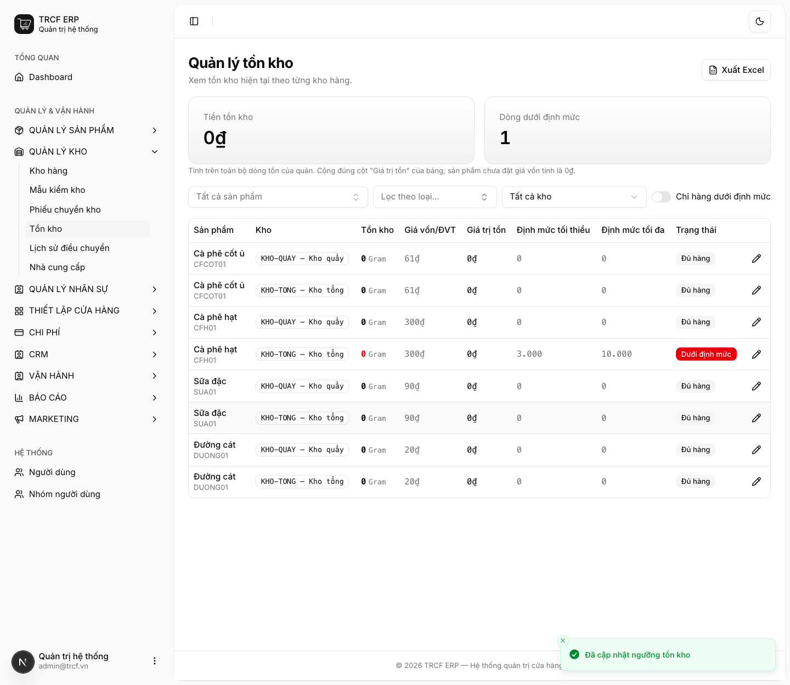

# 6.2 Định mức tối thiểu - tối đa của sản phẩm

## 1. Đường dẫn vào chức năng

Menu trái: ==Quản lý kho → Tồn kho== (địa chỉ `/stock`).

- Cần có trước: sản phẩm bật **Theo dõi tồn kho** ([bài 2.4](2-4-nguyen-lieu.md)).
- Mỗi sản phẩm theo dõi tồn kho có một dòng ở mỗi kho, tồn ban đầu là 0.

## 2. Ví dụ nền và các bước thực hiện

> **Ví dụ:** khai định mức cho "Cà phê hạt" ở "Kho tổng".
>
> - Tồn tối thiểu: "3000" g. Tồn tối đa: "10000" g.
> - Hàng giao trong 2 ngày, mỗi ngày dùng 1,5 kg: tối thiểu là 1,5 × 2 × 1,5 ≈ 4,5 kg.

### Bước 1: Mở trang Tồn kho

- Bấm **Quản lý kho** ở menu trái.
- Chọn **Tồn kho**.
- Đọc 2 ô: **Tiền tồn kho**, **Dòng dưới định mức**.
- Mỗi dòng là một sản phẩm ở một kho: tồn, giá vốn, định mức tối thiểu, định mức tối đa, trạng thái.
- Tìm dòng "Cà phê hạt — Kho tổng".

### Bước 2: Khai định mức

- Bấm biểu tượng bút chì ở cuối dòng.
- Hộp thoại **Chỉnh sửa ngưỡng tồn kho** mở ra.
- **Tồn tối thiểu**: nhập "3000".
- **Tồn tối đa**: nhập "10000".
- Bấm **Lưu**.

### Bước 3: Kiểm tra kết quả

- Thấy thông báo *“Đã cập nhật ngưỡng tồn kho”*.
- Dòng "Cà phê hạt — Kho tổng" hiện "3.000" và "10.000".
- Tồn đang 0, thấp hơn định mức: trạng thái **Dưới định mức** (nhãn đỏ).
- Ô **Dòng dưới định mức** tăng lên "1".

## 3. Giải thích các trường

| Trường | Điền gì |
| --- | --- |
| Tồn tối thiểu | Xuống dưới mức này là phải đặt hàng. Bằng 0: không cảnh báo |
| Tồn tối đa | Mức đầy kho. Hệ thống dùng để gợi ý đặt bao nhiêu. Bằng 0: không giới hạn |

Công thức đặt tồn tối thiểu: `lượng dùng trung bình mỗi ngày × số ngày nhà cung cấp giao hàng × 1,5`. Hàng giao trong 2 ngày, mỗi ngày dùng 1 kg: tối thiểu **3 kg**.

## 4. Lưu ý quan trọng

> [!CAUTION]
> **Khai định mức trước thì cảnh báo nhập hàng mới có tác dụng.**
>
> - Chưa khai thì không có gì để so.

> [!WARNING]
> **Định mức khai theo từng kho.**
>
> - Cùng một sản phẩm ở "Kho tổng" và "Kho quầy" có hai dòng, khai riêng từng dòng.
> - Đơn vị là đơn vị gốc của sản phẩm (VD "Gram").

> [!TIP]
> Mặt hàng dưới định mức được đánh dấu **"Dưới định mức"** và đếm vào ô *Sản phẩm dưới định mức* ở màn Tổng quan.

## Kiểm tra đã đúng

- [ ] Đã khai tồn tối thiểu / tối đa cho hàng quan trọng
- [ ] Dòng đã khai hiện đúng số ở cột định mức
