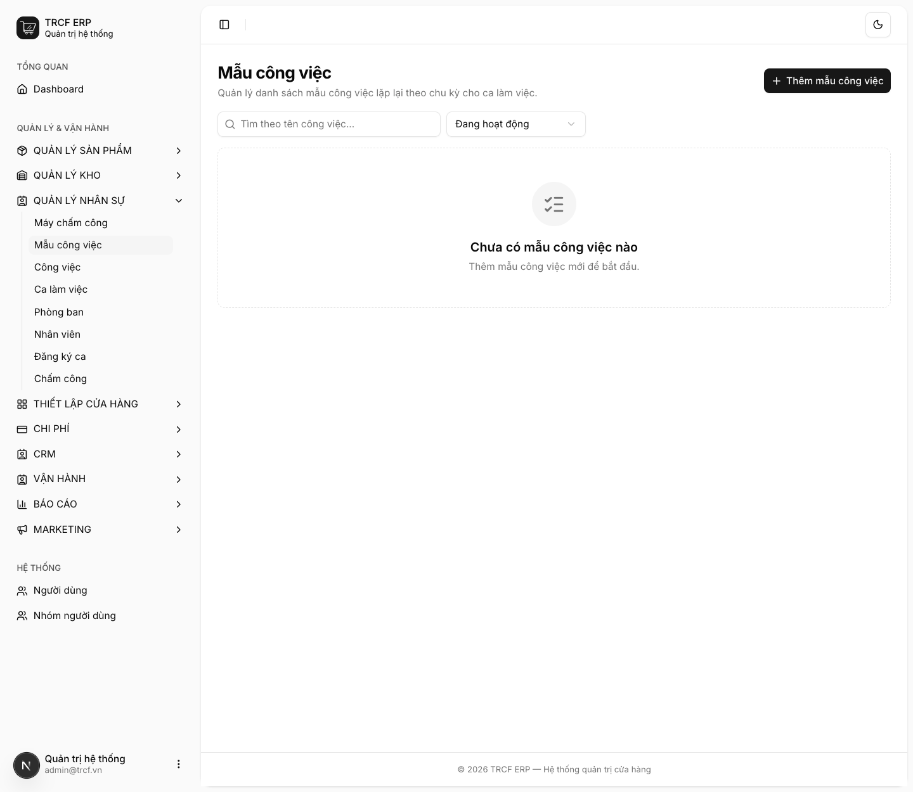
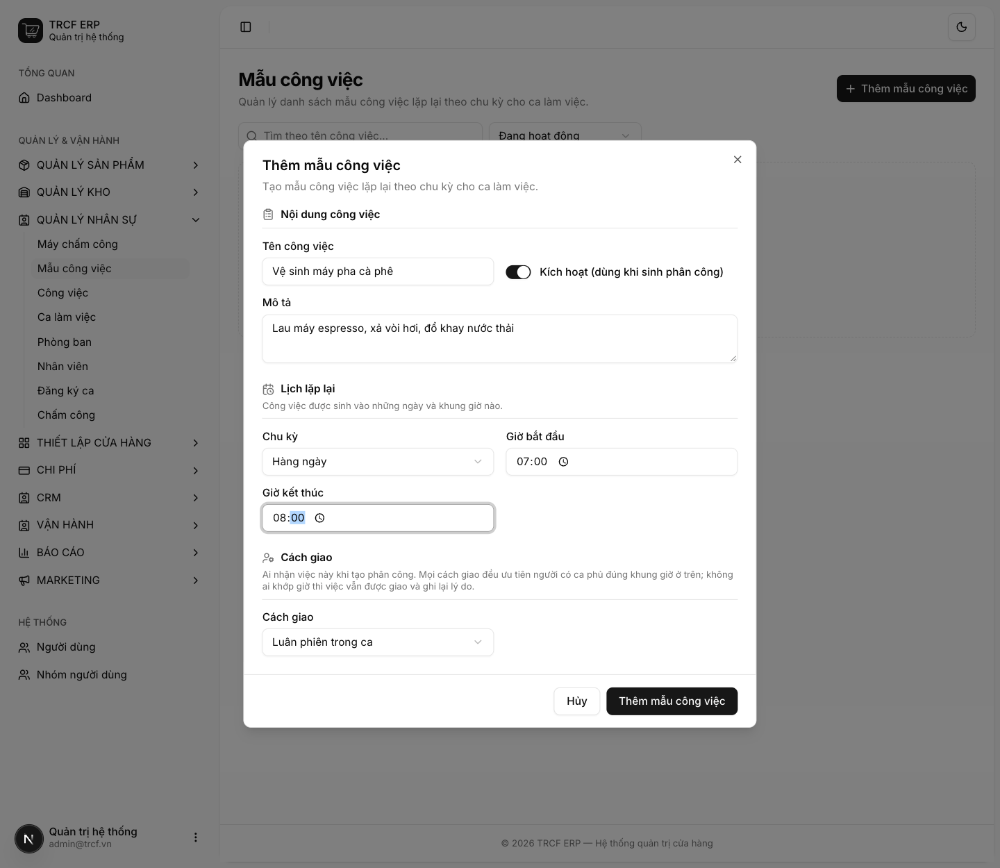
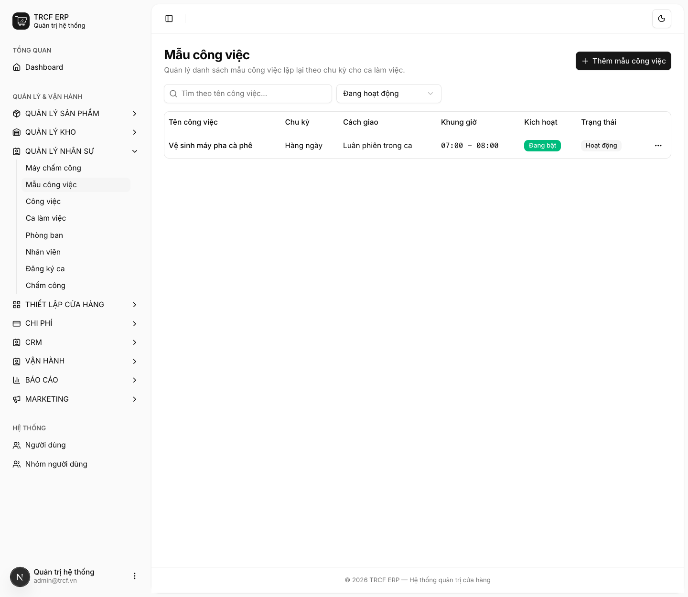

# 7.1 Mẫu công việc

## 1. Đường dẫn vào chức năng

Menu trái: ==Quản lý nhân sự → Mẫu công việc== (địa chỉ `/task-templates`).

## 2. Ví dụ nền và các bước thực hiện

> **Ví dụ:** việc lặp mỗi ngày "Vệ sinh máy pha cà phê" từ 07:00 đến 08:00, giao luân phiên cho người có ca.
>
> - Mẫu: chu kỳ "Hàng ngày", cách giao "Luân phiên trong ca".

### Bước 1: Mở trang Mẫu công việc

- Bấm **Quản lý nhân sự** ở menu trái, chọn **Mẫu công việc**.
- Bấm **Thêm mẫu công việc**.

### Bước 2: Khai mẫu việc lặp

- **Tên công việc**: nhập "Vệ sinh máy pha cà phê".
- **Kích hoạt**: để bật.
- **Mô tả**: nhập "Lau máy espresso, xả vòi hơi, đổ khay nước thải".
- **Chu kỳ**: chọn "Hàng ngày".
- **Giờ bắt đầu**: "07:00". **Giờ kết thúc**: "08:00".
- **Cách giao**: chọn "Luân phiên trong ca".
- Bấm nút **Thêm mẫu công việc**.

### Bước 3: Kiểm tra mẫu

- Mẫu hiện trong danh sách: chu kỳ, cách giao, khung giờ, trạng thái **Đang bật**.

## 3. Giải thích các trường

### Mẫu công việc

| Trường | Điền gì | Bắt buộc |
| --- | --- | --- |
| Tên công việc | VD "Vệ sinh máy pha cà phê" | ✅ |
| Kích hoạt | Tắt: tạm ngừng, không sinh việc nữa | ✅ |
| Mô tả | Hướng dẫn chi tiết cho người làm | — |
| Chu kỳ | *Hàng ngày* / *Thứ trong tuần* / *Hàng tháng* | ✅ |
| Thứ **hoặc** Ngày trong tháng | Chỉ hiện khi chọn chu kỳ tương ứng | ✅ theo chu kỳ |
| Giờ bắt đầu, Giờ kết thúc | Khung giờ nên làm việc này | ✅ |
| Cách giao | Xem bảng dưới | ✅ |

### Ba cách giao

| Cách giao | Ai nhận việc |
| --- | --- |
| Luân phiên trong ca | Chia lần lượt cho những người có ca |
| Giao theo phòng ban | Chỉ chia cho người thuộc phòng ban đã chọn |
| Giao cố định cá nhân | Luôn giao cho một người đã chọn |

Mọi cách giao đều ưu tiên người có ca phủ đúng khung giờ. Không ai khớp giờ thì việc vẫn được giao và ghi lại lý do.

## 4. Lưu ý quan trọng

> [!TIP]
> Bỏ *Kích hoạt* ở mẫu là cách tạm ngừng một việc mà không mất lịch sử.
>
> - Xoá mẫu thì các việc đã sinh vẫn còn.

## Kiểm tra đã đúng

- [ ] Mẫu hiện trong danh sách, trạng thái **Đang bật**
- [ ] Chu kỳ, khung giờ và cách giao đúng như đã khai
