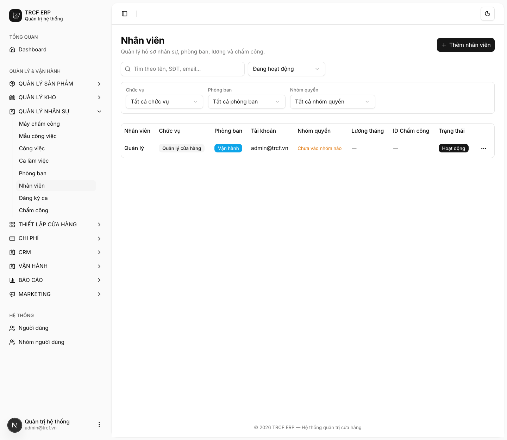
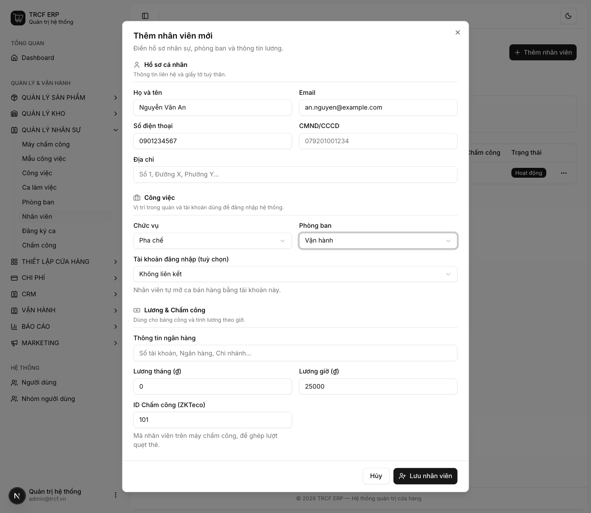
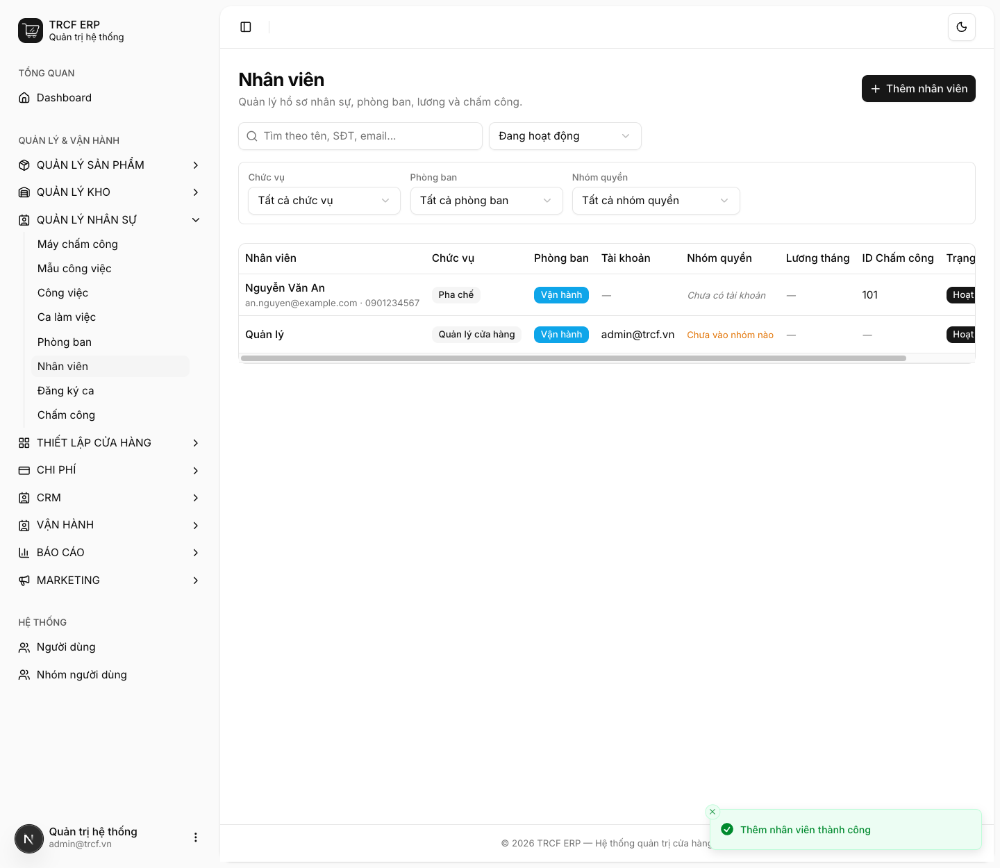

# 8.1 Tạo nhân viên

## 1. Đường dẫn vào chức năng

Menu trái: ==Quản lý nhân sự → Nhân viên → Thêm nhân viên== (địa chỉ `/employees`).

- Cần có trước: phòng ban (*Quản lý nhân sự → Phòng ban*).
- Thứ tự cả chương 7: nhân viên → ca làm việc → đăng ký và duyệt ca → chấm công → công việc.

## 2. Ví dụ nền và các bước thực hiện

> **Ví dụ:** thêm nhân viên pha chế "Nguyễn Văn An".
>
> - Chức vụ: "Pha chế". Phòng ban: "Vận hành".
> - ID Chấm công: "101" (khớp mã trên máy chấm công). Lương giờ: "25000".

### Bước 1: Mở trang Nhân viên

- Bấm **Quản lý nhân sự** ở menu trái, chọn **Nhân viên**.
- Bấm **Thêm nhân viên**.

### Bước 2: Khai hồ sơ

- **Họ và tên**: nhập "Nguyễn Văn An".
- **Email**: nhập "an.nguyen@example.com".
- **Số điện thoại**: nhập "0901234567".
- **Chức vụ**: chọn "Pha chế".
- **Phòng ban**: chọn "Vận hành".
- **Tài khoản đăng nhập**: chọn tài khoản nếu người này đứng quầy, không thì để "Không liên kết".
- **Lương giờ (₫)**: nhập "25000".
- **ID Chấm công (ZKTeco)**: nhập "101".
- Bấm nút **Lưu nhân viên**.

### Bước 3: Kiểm tra kết quả

- Nhân viên hiện trong danh sách, trạng thái **Hoạt động**.
- Cột **ID Chấm công** hiện "101".
- Cột **Tài khoản** "—" nghĩa là chưa gắn tài khoản đăng nhập.

## 3. Giải thích các trường

### Hồ sơ cá nhân

| Trường | Điền gì | Bắt buộc |
| --- | --- | --- |
| Họ và tên | Tên đầy đủ | ✅ |
| Email, Số điện thoại, CMND/CCCD, Địa chỉ | Thông tin liên hệ | — |

### Công việc

| Trường | Điền gì | Bắt buộc |
| --- | --- | --- |
| Chức vụ | Chọn: Pha chế, Thu ngân, Phục vụ, Quản lý, Kho, Marketing | — |
| Phòng ban | Khai trước ở *Phòng ban* | ✅ |
| **Tài khoản đăng nhập** | Gắn hồ sơ với một tài khoản hệ thống. **Không gắn thì không mở ca được** | Bắt buộc nếu người này đứng quầy |

### Lương & Chấm công

| Trường | Điền gì |
| --- | --- |
| Thông tin ngân hàng | Số tài khoản, ngân hàng, chi nhánh |
| Lương tháng (₫) | Lương cố định |
| Lương giờ (₫) | Dùng để tính tiền công theo bảng chấm công |
| **ID Chấm công (ZKTeco)** | Mã nhân viên **trên máy chấm công**. Phải khớp |

## 4. Lưu ý quan trọng

> [!CAUTION]
> **Chưa gắn tài khoản đăng nhập thì người đó không mở được ca.**
>
> - Sẽ nhận thông báo "chưa gắn hồ sơ nhân viên".
> - Nguyên tắc: *ai bán thì người đó mở ca của mình*.

> [!WARNING]
> **ID chấm công sai hoặc bỏ trống** thì lượt quẹt thẻ không ghép được vào ai.
>
> - Khi đồng bộ, hệ thống liệt kê những mã chưa gán để bạn bổ sung ([mục 9.3](9-3-dong-bo-cham-cong.md)).

> [!WARNING]
> **Lương, CCCD và số tài khoản chỉ hiện với người có quyền sửa nhân viên.**
>
> - Người chỉ có quyền xem không thấy các cột lương.
> - Đừng cấp quyền sửa chỉ để ai đó xem được tên.

> [!TIP]
> Nhân viên nghỉ việc thì **xoá được**.
>
> - Hệ thống dọn bản ghi vận hành (chấm công, đăng ký ca, phân công việc).
> - Giữ nguyên chứng từ tiền (đơn hàng, phiếu mua, sổ quỹ, ca bán hàng), chỉ bỏ liên kết tên.
> - Lịch sử tiền không bao giờ mất.

## Kiểm tra đã đúng

- [ ] Người đứng quầy đã gắn **Tài khoản đăng nhập**
- [ ] Người chấm công bằng máy đã có **ID Chấm công** khớp mã trên máy
- [ ] Có **Lương giờ** nếu muốn bảng công tính ra tiền
