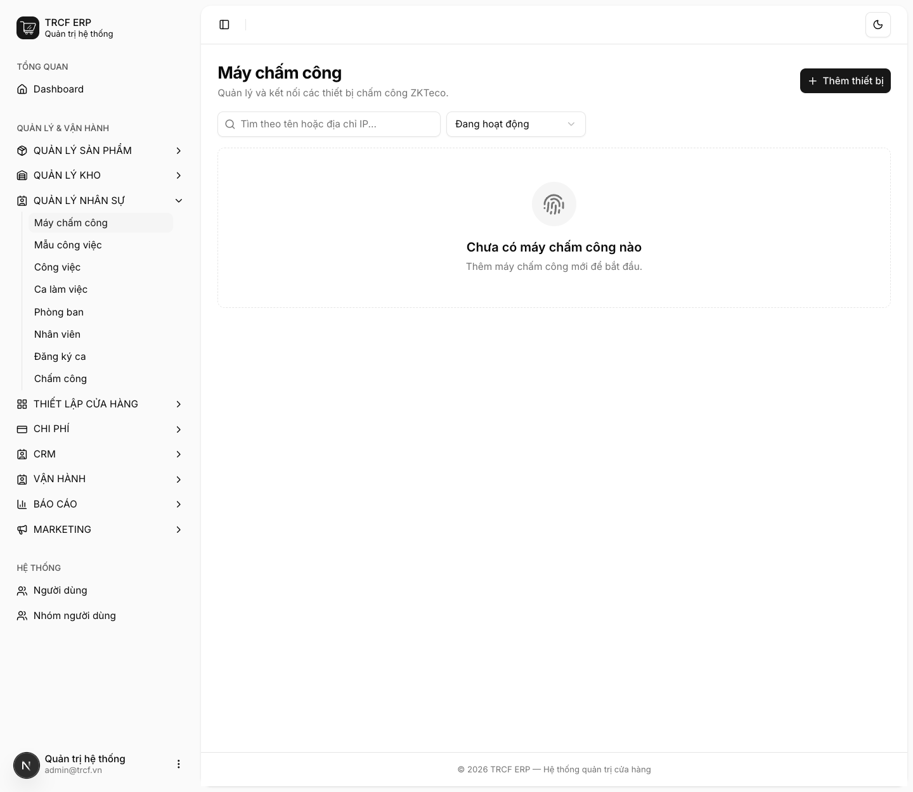
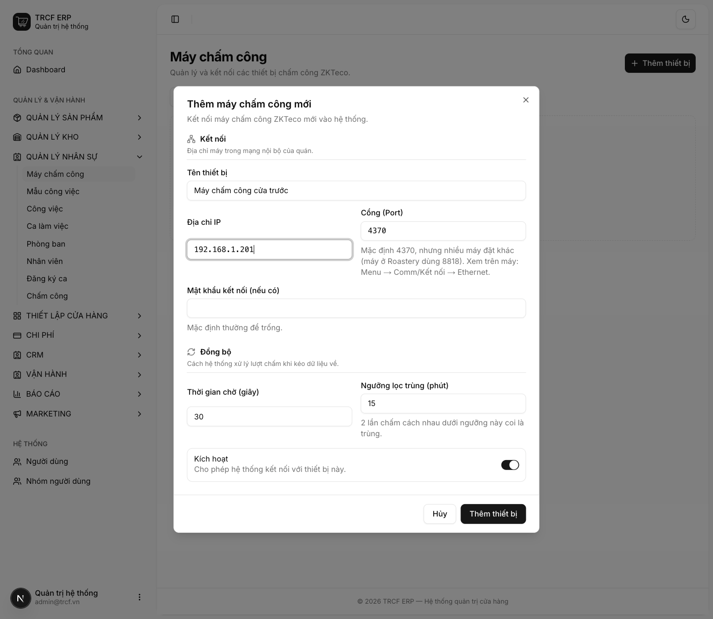

# 8.2 Cài đặt máy chấm công

## 1. Đường dẫn vào chức năng

Menu trái: ==Quản lý nhân sự → Máy chấm công== (địa chỉ `/attendance-devices`).

- Cần có trước: nhân viên có **ID Chấm công** ([bài 8.1](8-1-tao-nhan-vien.md)).

## 2. Ví dụ nền và các bước thực hiện

> **Ví dụ:** máy ZKTeco ở cửa trước quán.
>
> - Máy: tên "Máy chấm công cửa trước", IP "192.168.1.201", cổng "4370".
> - Nhân viên "Nguyễn Văn An" có ID Chấm công "101".

### Bước 1: Mở trang Máy chấm công

- Bấm **Quản lý nhân sự** ở menu trái, chọn **Máy chấm công**.
- Bấm **Thêm thiết bị**.

### Bước 2: Khai máy chấm công

- **Tên thiết bị**: nhập "Máy chấm công cửa trước".
- **Địa chỉ IP**: nhập "192.168.1.201" (IP của máy trong mạng quán).
- **Cổng (Port)**: giữ "4370" nếu đúng; nhiều máy đặt khác, xem trên máy: *Menu → Comm/Kết nối → Ethernet*.
- **Mật khẩu kết nối**: thường để trống.
- **Thời gian chờ (giây)**: giữ "30".
- **Ngưỡng lọc trùng (phút)**: giữ "15".
- **Kích hoạt**: để bật. Bấm nút **Thêm thiết bị**.
- Ở dòng thiết bị, bấm **Kiểm tra kết nối** để xác nhận nói chuyện được với máy.

## 3. Giải thích các trường

### Khai máy chấm công

| Trường | Điền gì | Bắt buộc |
| --- | --- | --- |
| Tên thiết bị | VD "Máy chấm công cửa trước" | ✅ |
| Địa chỉ IP | IP của máy trong mạng nội bộ quán | ✅ |
| Cổng (Port) | Mặc định 4370, **nhiều máy đặt khác** | ✅ |
| Mật khẩu kết nối | Thường để trống | — |
| Thời gian chờ (giây) | Số giây chờ máy trả lời | — |
| Ngưỡng lọc trùng (phút) | Hai lần quẹt cách nhau dưới ngưỡng này coi là một | — |

### Hai nút trong menu thiết bị

| Nút | Làm gì |
| --- | --- |
| Kiểm tra kết nối | Thử nói chuyện với máy, báo model, firmware, số nhân viên, số lượt chấm |
| Đồng bộ giờ máy | Đẩy giờ máy chủ lên máy chấm công |

### Cảnh báo lệch giờ máy

- Mỗi lần kiểm tra kết nối hoặc đồng bộ, hệ thống đối chiếu đồng hồ máy chấm công với máy chủ.
- Lệch từ **1 phút** trở lên: cảnh báo vàng kèm nút **Chỉnh giờ ngay**.
- Thấy cảnh báo: bấm **Chỉnh giờ ngay** luôn, đừng để qua tuần.

## 4. Lưu ý quan trọng

> [!WARNING]
> **Chỉnh giờ chỉ cứu được lượt chấm SAU đó.**
>
> - Lượt đã ghi bằng đồng hồ lệch không sửa ngược được.
> - Giá trị của cảnh báo là **phát hiện sớm**.

> [!WARNING]
> Hệ thống **cố ý không tự chỉnh giờ** khi đồng bộ.
>
> - Đẩy giờ lên máy là thao tác ghi đè.
> - Chỉnh giữa ca làm nửa ngày lệch nửa ngày đúng, khó gỡ hơn cả lệch đều.

> [!TIP]
> Nâng *Ngưỡng lọc trùng* **không** giải quyết được chuyện quên chấm.
>
> - Nâng từ 15 lên 120 phút vẫn không đổi tỷ lệ lượt lẻ.
> - Ngưỡng cao lại nuốt mất lượt thật.

## Kiểm tra đã đúng

- [ ] Máy hiện trong danh sách, trạng thái đang bật
- [ ] Bấm **Kiểm tra kết nối** báo thành công
- [ ] Không có cảnh báo lệch giờ máy
