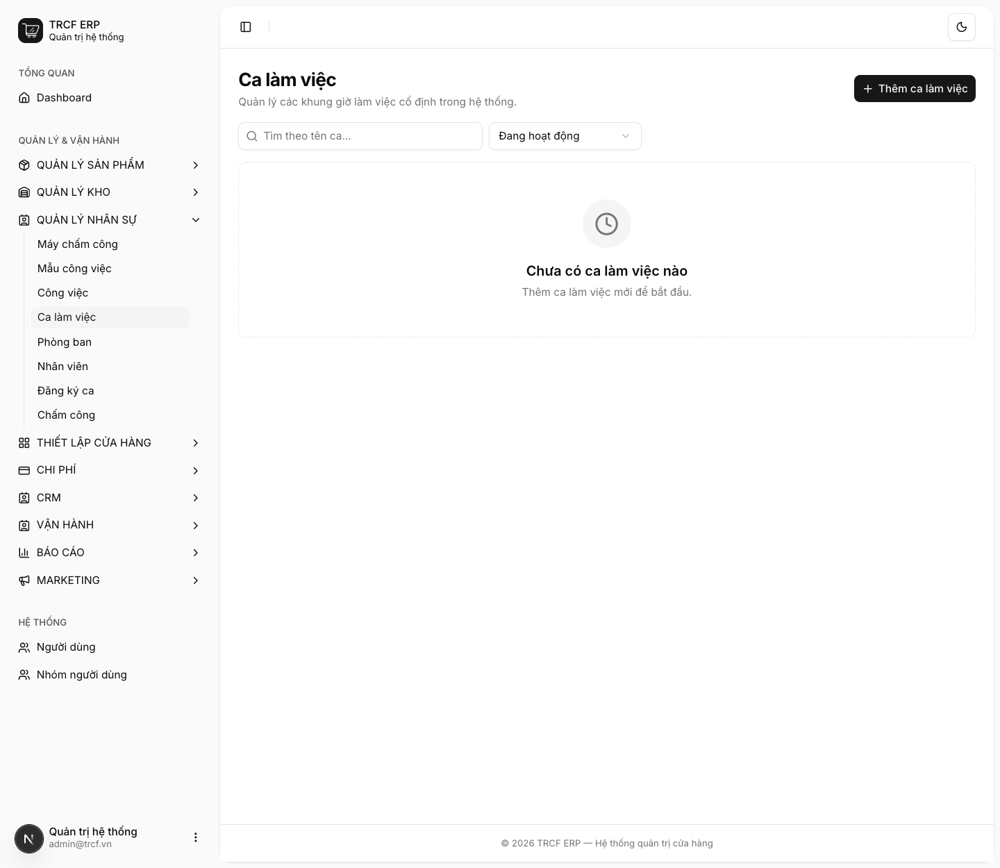
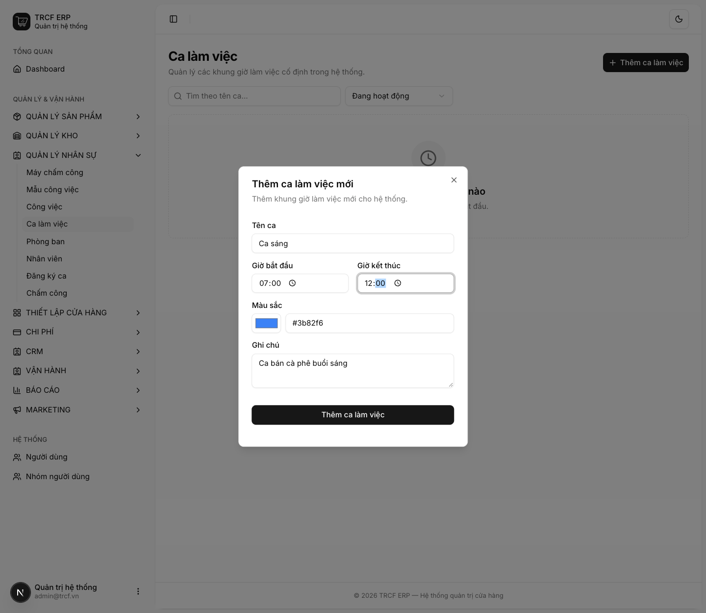
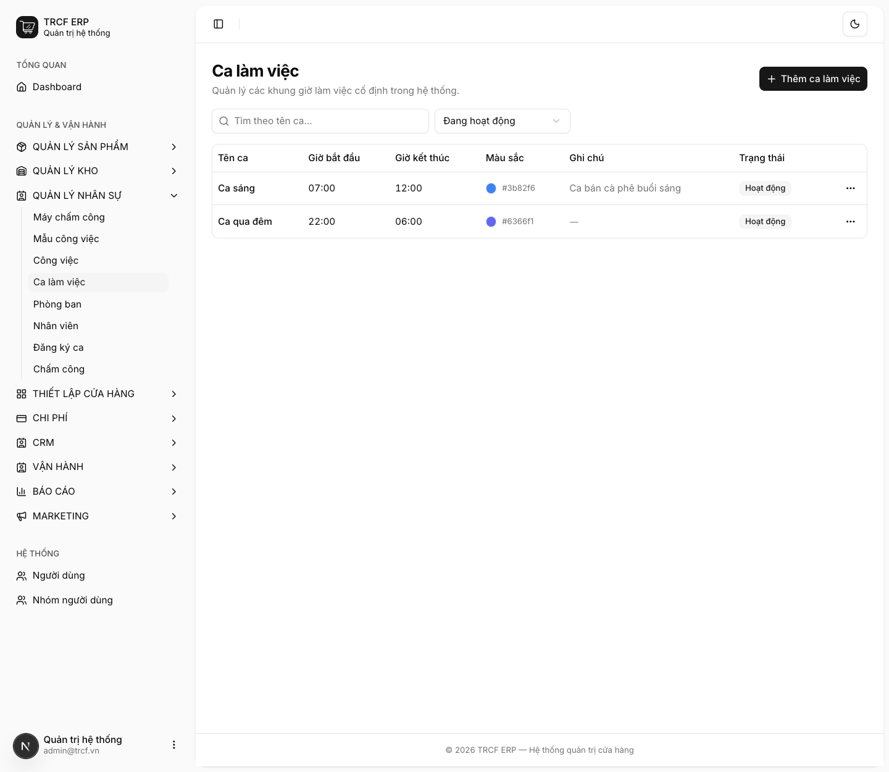

# 9.1 Tạo ca làm việc

## 1. Đường dẫn vào chức năng

Menu trái: ==Quản lý nhân sự → Ca làm việc → Thêm ca làm việc== (địa chỉ `/shifts`).

## 2. Ví dụ nền và các bước thực hiện

> **Ví dụ:** quán có 2 ca.
>
> - "Ca sáng": từ "07:00" đến "12:00".
> - "Ca qua đêm": từ "22:00" đến "06:00" (giờ kết thúc sớm hơn giờ bắt đầu, vẫn hợp lệ).

### Bước 1: Mở trang Ca làm việc

- Bấm **Quản lý nhân sự** ở menu trái, chọn **Ca làm việc**.
- Bấm **Thêm ca làm việc**.

### Bước 2: Khai ca "Ca sáng"

- **Tên ca**: nhập "Ca sáng".
- **Giờ bắt đầu**: chọn "07:00".
- **Giờ kết thúc**: chọn "12:00".
- **Màu sắc**: giữ mặc định hoặc chọn màu (màu hiện trên lịch tuần).
- **Ghi chú**: nhập "Ca bán cà phê buổi sáng" (tuỳ chọn).
- Bấm nút **Thêm ca làm việc**.

### Bước 3: Kiểm tra kết quả

- Ca hiện trong danh sách với đúng khung giờ.
- Ca "Ca qua đêm" (22:00 → 06:00) hiện đúng khung giờ qua đêm.
- Lặp lại bước 2 cho từng ca khác của quán.

## 3. Giải thích các trường

| Trường | Điền gì | Bắt buộc |
| --- | --- | --- |
| Tên ca | VD "Ca sáng", "Ca chiều", "Ca gãy" | ✅ |
| Giờ bắt đầu | Giờ vào ca | ✅ |
| Giờ kết thúc | Giờ tan ca. **Được phép sớm hơn giờ bắt đầu** (ca qua đêm) | ✅ |
| Màu sắc | Màu hiện trên lịch tuần | — |
| Ghi chú | Ghi chú nội bộ | — |

### Ca qua đêm

- Ca 22:00 → 06:00 hợp lệ.
- Phân tích trễ/sớm vẫn tính đúng.

## 4. Lưu ý quan trọng

> [!TIP]
> Đặt tên ca theo cách nhân viên gọi hằng ngày ("Ca sáng", "Ca chiều") thay vì "Ca 1", "Ca 2".
>
> - Lịch tuần dễ đọc hơn nhiều.

> [!TIP]
> Chưa có ca thì không đăng ký ca được ([mục 9.2](9-2-dang-ky-va-duyet-ca.md)).

## Kiểm tra đã đúng

- [ ] Ca hiện trên lịch tuần ở màn **Đăng ký ca**
- [ ] Ca qua đêm (nếu có) hiển thị đúng khung giờ
