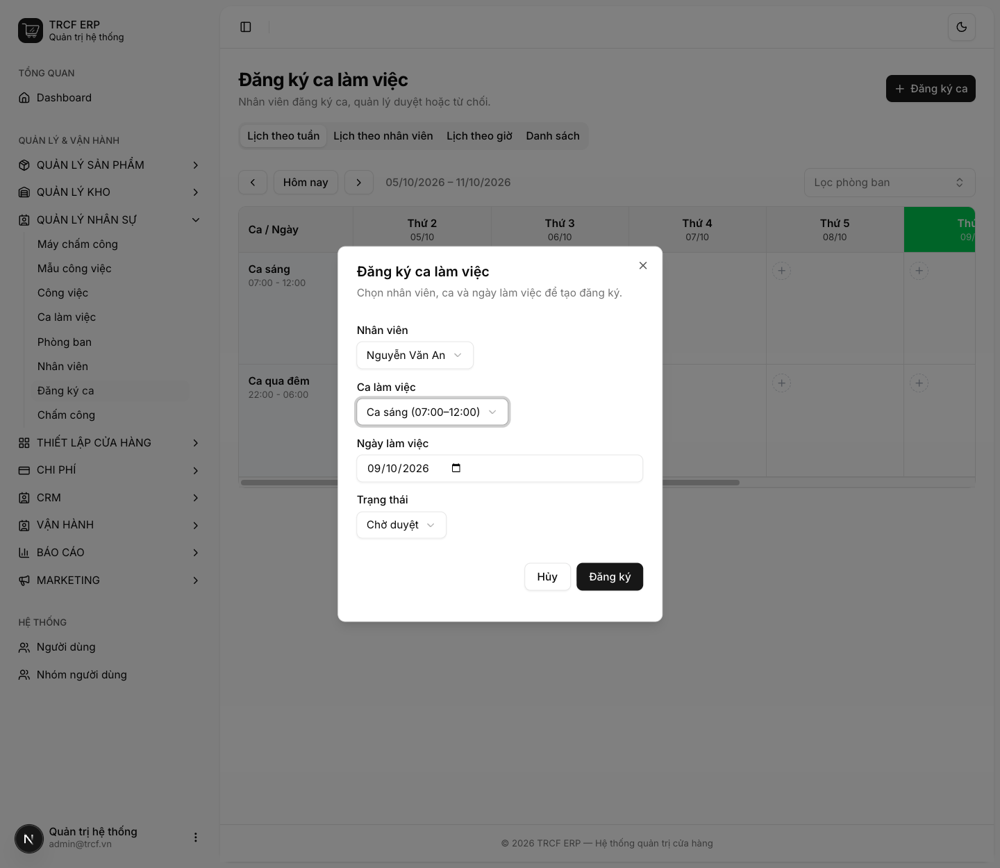
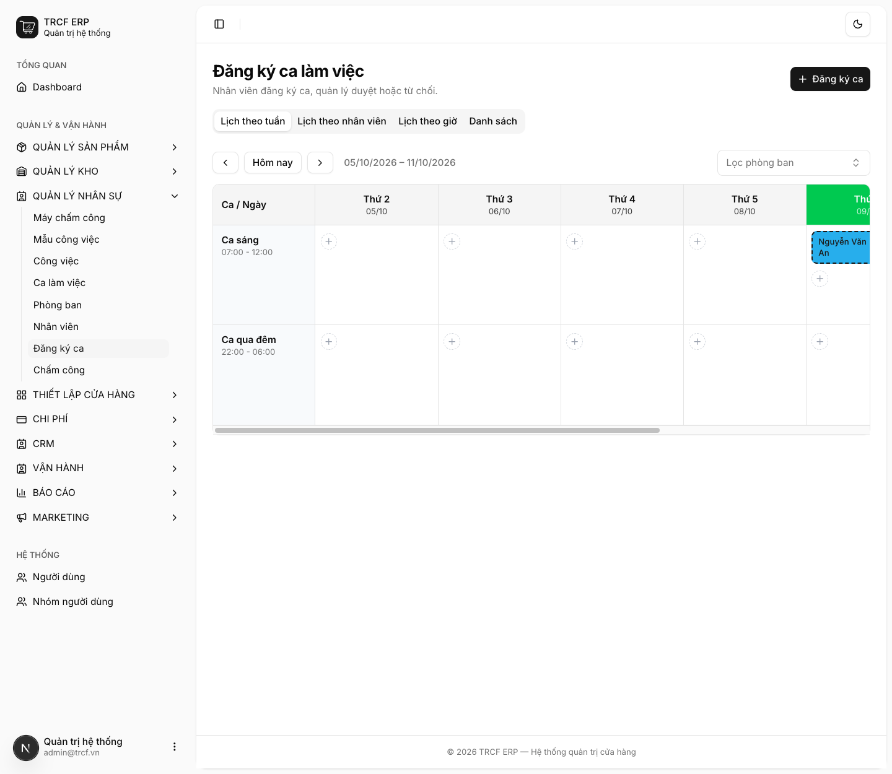
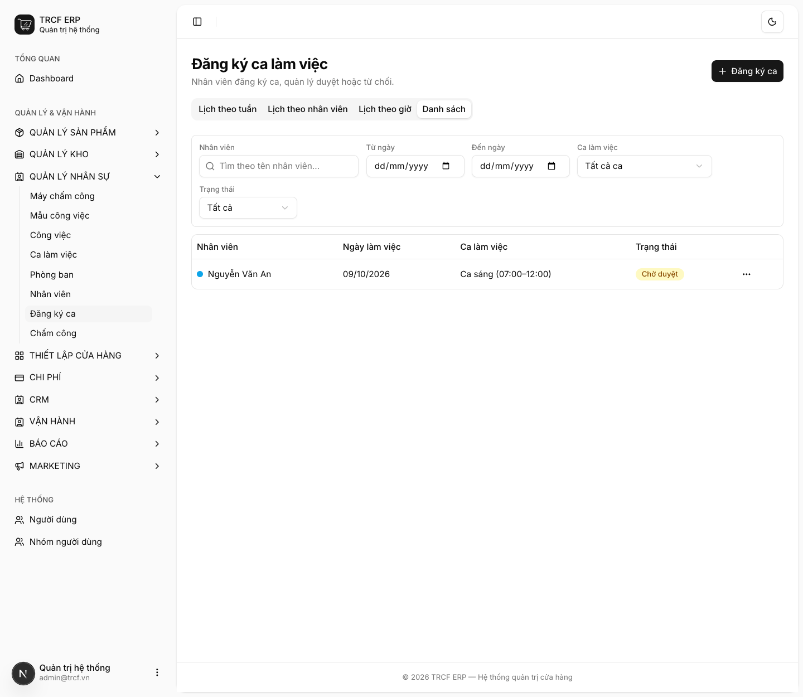
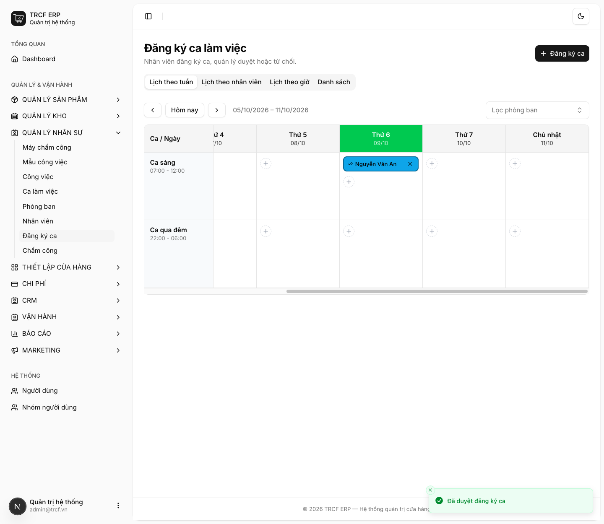

# 9.2 Đăng ký và duyệt ca

## 1. Đường dẫn vào chức năng

Menu trái: ==Quản lý nhân sự → Đăng ký ca== (địa chỉ `/shift-registrations`).

- Hai cách xem: **Lịch theo tuần** (ai làm ca nào) và **Danh sách** (thao tác nhanh). Ngoài ra có *Lịch theo nhân viên*, *Lịch theo giờ*.
- Ba trạng thái: **Chờ duyệt → Đã duyệt / Từ chối**.
- Cần có trước: nhân viên ([mục 8.1](8-1-tao-nhan-vien.md)), ca làm việc ([mục 9.1](9-1-tao-ca-lam-viec.md)).

## 2. Ví dụ nền và các bước thực hiện

> **Ví dụ:** đăng ký "Nguyễn Văn An" làm "Ca sáng" ngày 09/10/2026, quản lý duyệt.
>
> - Đăng ký mới có trạng thái "Chờ duyệt".
> - Quản lý bấm **Duyệt** → "Đã duyệt".

### Bước 1: Bấm Đăng ký ca và khai phiếu

- Vào **Quản lý nhân sự → Đăng ký ca**, bấm **Đăng ký ca**.
- **Nhân viên**: chọn "Nguyễn Văn An".
- **Ca làm việc**: chọn "Ca sáng (07:00–12:00)".
- **Ngày làm việc**: chọn ngày làm (mặc định hôm nay).
- **Trạng thái**: giữ "Chờ duyệt".
- Bấm nút **Đăng ký**.

### Bước 2: Xem trên Lịch theo tuần

- Tab **Lịch theo tuần**: hàng là ca, cột là ngày.
- Ô ngày 09/10 của "Ca sáng" hiện "Chờ duyệt" + tên "Nguyễn Văn An".
- Mỗi ô có nút **Duyệt**, **Từ chối**, **Xóa**, và **Thêm nhân viên** để đăng ký thêm.

### Bước 3: Xem trên Danh sách

- Bấm tab **Danh sách**.
- Lọc theo **Nhân viên**, **Từ ngày / Đến ngày**, **Ca làm việc**, **Trạng thái**.
- Cột **Trạng thái** hiện nhãn "Chờ duyệt".
- Bấm nút **…** cuối dòng để thao tác.

### Bước 4: Quản lý duyệt

- Quay lại **Lịch theo tuần**.
- Bấm **Duyệt** ở ô đăng ký (hoặc **Từ chối** nếu không đồng ý).
- Ô chuyển sang trạng thái **Đã duyệt**.

## 3. Giải thích các trường

| Trường | Điền gì | Bắt buộc |
| --- | --- | --- |
| Nhân viên | Người làm ca | ✅ |
| Ca làm việc | Ca đã khai ở [mục 9.1](9-1-tao-ca-lam-viec.md) | ✅ |
| Ngày làm việc | Ngày làm | ✅ |
| Trạng thái | Mặc định "Chờ duyệt" | — |

### Vì sao bắt buộc phải duyệt

Trạng thái **Đã duyệt** là đầu vào của hai việc khác:

| Việc | Phụ thuộc thế nào |
| --- | --- |
| **Sinh checklist công việc** ([7.1](7-1-mau-cong-viec.md)) | Chỉ chia việc cho người **đã được duyệt ca** hôm đó. Không ai duyệt: báo lỗi |
| **Phân tích trễ/sớm** ([9.3](9-3-dong-bo-cham-cong.md)) | So giờ quẹt thẻ với giờ ca **đã duyệt**. Chưa duyệt: cột trễ/sớm để trống |

## 4. Lưu ý quan trọng

> [!WARNING]
> **Bấm duyệt hai lần cho cùng bản ghi sẽ bị chặn.**
>
> - Trạng thái chỉ đi một chiều từ *Chờ duyệt*.

> [!TIP]
> Đăng ký trùng (cùng người, cùng ca, cùng ngày) **được phép**.
>
> - Để nhân viên bị từ chối rồi đăng ký lại.

## Kiểm tra đã đúng

- [ ] Mọi ngày trong tuần tới đều có người được duyệt ca
- [ ] Lịch tuần hiện đủ người, đúng ca
