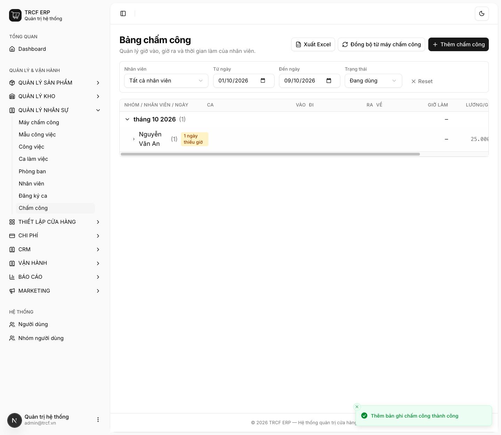
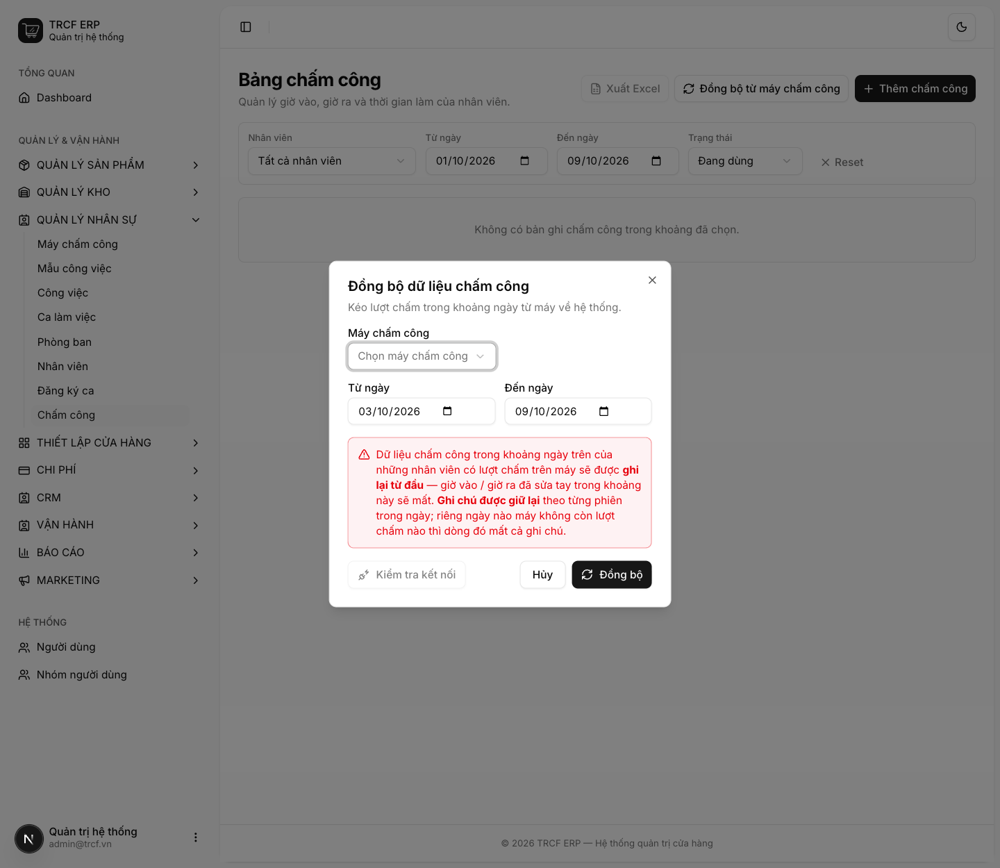
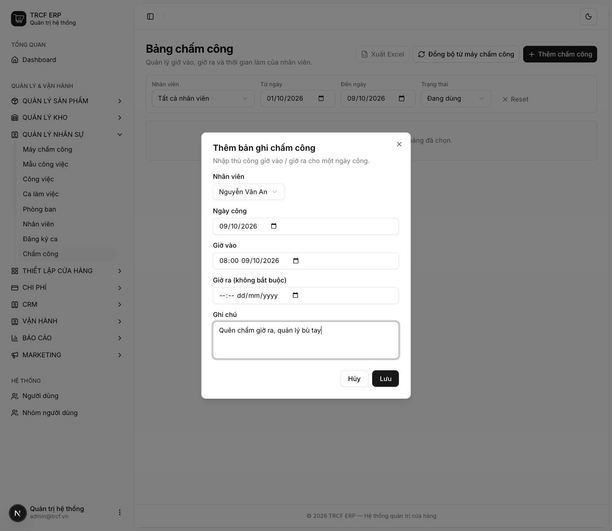

# 9.3 Đồng bộ chấm công

## 1. Đường dẫn vào chức năng

Menu trái: ==Quản lý nhân sự → Chấm công== (địa chỉ `/attendance`).

- Cần có trước: máy chấm công ([bài 8.2](8-2-cai-dat-may-cham-cong.md)) và ca **đã duyệt** ([bài 9.2](9-2-dang-ky-va-duyet-ca.md)).

## 2. Ví dụ nền và các bước thực hiện

> **Ví dụ:** kéo giờ chấm công từ máy, bù tay khi quên chấm.
>
> - Nhân viên "Nguyễn Văn An" có ID Chấm công "101".
> - Quên chấm giờ ra: quản lý bù tay bằng **Thêm chấm công**.

### Bước 1: Mở Bảng chấm công

- Bấm **Quản lý nhân sự → Chấm công**.
- Lọc theo **Nhân viên**, **Từ ngày / Đến ngày**, **Trạng thái**.
- Bảng gom theo tháng, rồi theo nhân viên, rồi theo ngày.
- Dòng nhân viên có nhãn "N ngày thiếu giờ" nếu có ngày quên chấm.

### Bước 2: Đồng bộ từ máy chấm công

- Bấm **Đồng bộ từ máy chấm công**.
- **Máy chấm công**: chọn máy. **Từ ngày / Đến ngày**: chọn khoảng **hẹp**.
- Bấm **Kiểm tra kết nối** trước cho chắc.
- Đọc kỹ cảnh báo, rồi bấm **Đồng bộ**.
- Hệ thống ghép cặp vào–ra theo từng người từng ngày. Lượt lẻ cuối ngày để trống giờ ra.

### Bước 3: Bù tay khi quên chấm

- Bấm **Thêm chấm công**.
- **Nhân viên**: chọn "Nguyễn Văn An".
- **Ngày công**, **Giờ vào**, **Giờ ra** (không bắt buộc): nhập giờ thật.
- **Ghi chú**: nhập "Quên chấm giờ ra, quản lý bù tay".
- Bấm **Lưu**.

## 3. Giải thích các trường

### Đọc bảng công

| Dấu hiệu | Nghĩa |
| --- | --- |
| Dấu **—** màu hổ phách ở cột Đi hoặc Về | Quên chấm. Dòng nhân viên hiện "N ngày thiếu giờ" |
| Badge tím **"2 ca"** | Ngày đó người này có hai lượt ca |
| Badge đỏ ở cột Đi | Đi trễ (hổ phách = đến sớm) |
| Badge xanh ở cột Về | Về muộn = làm thêm (đỏ = về sớm) |

Dung sai trễ/sớm chỉnh ở *Cấu hình hệ thống → Nhân sự*, mặc định 5 phút. Lệch trong khoảng này tính là *Đúng giờ*. Các cột: nhân viên, ngày, ca, vào, đi, ra, về, giờ làm, lương/giờ, thành tiền.

## 4. Lưu ý quan trọng

> [!CAUTION]
> **Đồng bộ là GHI ĐÈ.**
>
> - Dữ liệu chấm công trong khoảng ngày của những người có lượt trên máy được ghi lại từ đầu.
> - **Mọi chỉnh sửa tay của quản lý trong khoảng đó sẽ mất.**
> - Đừng kéo cả tháng nếu chỉ cần bù một ngày.

> [!TIP]
> Khoảng **10% số ngày công chỉ có một lượt chấm** (quên chấm vào hoặc ra).
>
> - Rà cột "thiếu giờ" **hằng tuần**, đừng đợi cuối tháng.

## Kiểm tra đã đúng

- [ ] Không còn mã nhân viên nào "chưa gán" sau khi đồng bộ
- [ ] Đã rà cột **thiếu giờ** và bù tay những ngày quên chấm
- [ ] Cột thành tiền có số (nếu đã khai Lương giờ)
