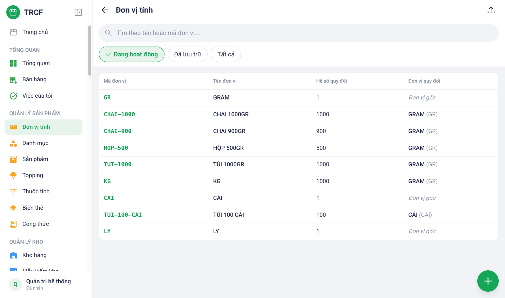

# 1.1 Thiết lập đơn vị tính (UOM)

## 1. Đường dẫn vào chức năng

Menu trái: ==Quản lý sản phẩm → Đơn vị tính== (địa chỉ `/uoms`).

## 2. Ví dụ nền và các bước thực hiện

> **Ví dụ:** cà phê nhập theo KG, pha chế trừ theo G; ly nhập theo thùng, bán theo cái.
>
> - Đơn vị gốc: **G**, **CÁI** (hệ số 1).
> - Đơn vị lớn: **KG** = 1000 G · **THÙNG 30 CÁI** = 30 CÁI.
> - Nhập 5 KG → hệ thống ghi tồn 5000 G.

### Bước 1: Mở trang Đơn vị tính

- Ở menu trái, nhóm **Quản lý sản phẩm**, bấm **Đơn vị tính**.

### Bước 2: Thêm đơn vị gốc trước

- Bấm nút tròn **+** ở góc dưới bên phải.
- Điền như ảnh, bấm **Thêm đơn vị**.

### Bước 3: Thêm đơn vị lớn hơn

- Bấm **+** lần nữa.
- Điền như ảnh, bấm **Thêm đơn vị**.
- Làm tương tự cho **KG**: quy đổi về **G**, hệ số **1000**.

## 3. Giải thích các trường

| Trường         | Điền gì                                                                                                                     | Bắt buộc |
| -------------- | --------------------------------------------------------------------------------------------------------------------------- | -------- |
| Mã đơn vị      | Ngắn, viết hoa. Ví dụ: **LY**, **KG**, **G**, **TUI-1000**, **CHAI-900**, **HOP-500**                                       | ✅        |
| Tên đơn vị     | Ví dụ: **LY**, **KILOGRAM**, **GRAM**, **TÚI 1000G**, **CHAI 900G**, **HỘP 500G**                                           | ✅        |
| Đơn vị quy đổi | Đơn vị gốc mà đơn vị này quy về. **KG** quy về **GRAM**; **THÙNG 30 CÁI** quy về **CÁI**. Đơn vị gốc thì giữ **Đơn vị gốc** | ✅        |
| Hệ số quy đổi  | Bằng bao nhiêu đơn vị gốc. Nếu là đơn vị gốc thì điền **1**                                                                 | ✅        |

## Bộ đơn vị mẫu cho quán

| Mã           | Tên          | Hệ số | Quy đổi về |
| ------------ | ------------ | ----- | ---------- |
| LY           | LY           | 1     | *(gốc)*    |
| G            | GRAM         | 1     | *(gốc)*    |
| KG           | KILOGRAM     | 1000  | GRAM       |
| TUI-1000     | TÚI 1000G    | 1000  | GRAM       |
| CHAI-900     | CHAI 900G    | 900   | GRAM       |
| HOP-500      | HỘP 500G     | 500   | GRAM       |
| CAI          | CÁI          | 1     | *(gốc)*    |
| THUNG-30-CAI | THÙNG 30 CÁI | 30    | CÁI        |

## 4. Lưu ý quan trọng

> - Cần đơn vị khác: tạo mới, lưu trữ cái cũ.
> - **Hệ số phải lớn hơn 0.**
