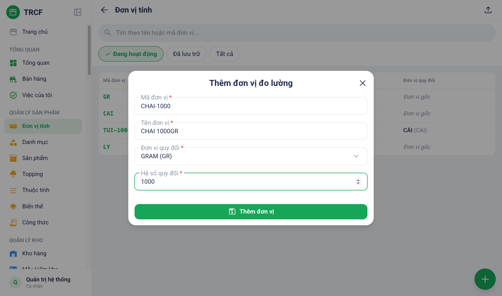

# 1.1 Thiết lập đơn vị tính (UOM)

## 1. Đường dẫn vào chức năng

Menu trái: ==Quản lý sản phẩm → Đơn vị tính== (địa chỉ `/uoms`).

## 2. Ví dụ nền và các bước thực hiện

> **Ví dụ:** siro nhập theo chai 1000GR, pha chế trừ theo gram; ly nhựa nhập theo túi 100 cái, dùng theo cái.
>
> - Đơn vị gốc: **GR** (GRAM), **CAI** (CÁI) — hệ số 1.
> - Đơn vị lớn: **CHAI 1000GR** = 1000 GR · **TÚI 100 CÁI** = 100 CÁI.
> - Nhập 5 CHAI 1000GR → hệ thống ghi tồn 5000 GR.

### Bước 1: Mở trang Đơn vị tính

- Ở menu trái, nhóm **Quản lý sản phẩm**, bấm **Đơn vị tính**.

### Bước 2: Thêm đơn vị gốc trước

- Bấm nút tròn **+** ở góc dưới bên phải.
- Điền như ảnh, bấm **Thêm đơn vị**.

### Bước 3: Thêm đơn vị lớn hơn

- Bấm **+** lần nữa.
- Điền như ảnh, bấm **Thêm đơn vị**.
- Làm tương tự cho **KG**: quy đổi về **GRAM**, hệ số **1000**.

## 3. Giải thích các trường

| Trường         | Điền gì                                                                                                                     | Bắt buộc |
| -------------- | --------------------------------------------------------------------------------------------------------------------------- | -------- |
| Mã đơn vị      | Ngắn, viết hoa. Ví dụ: **GR**, **CHAI-1000**, **HOP-500**, **TUI-1000**, **KG**, **LY**                                   | ✅        |
| Tên đơn vị     | Ví dụ: **GRAM**, **CHAI 1000GR**, **HỘP 500GR**, **TÚI 1000GR**, **KG**, **LY**                                       | ✅        |
| Đơn vị quy đổi | Đơn vị gốc mà đơn vị này quy về. **CHAI 1000GR** quy về **GRAM**; **TÚI 100 CÁI** quy về **CÁI**. Đơn vị gốc thì giữ **Đơn vị gốc** | ✅        |
| Hệ số quy đổi  | Bằng bao nhiêu đơn vị gốc. Nếu là đơn vị gốc thì điền **1**                                                                 | ✅        |

## Bộ đơn vị mẫu cho quán

| Mã          | Tên         | Hệ số | Quy đổi về |
| ----------- | ----------- | ----- | ---------- |
| GR          | GRAM        | 1     | *(gốc)*    |
| CHAI-1000   | CHAI 1000GR | 1000  | GRAM       |
| CHAI-900    | CHAI 900GR  | 900   | GRAM       |
| HOP-500     | HỘP 500GR   | 500   | GRAM       |
| TUI-1000    | TÚI 1000GR  | 1000  | GRAM       |
| KG          | KG          | 1000  | GRAM       |
| CAI         | CÁI         | 1     | *(gốc)*    |
| TUI-100-CAI | TÚI 100 CÁI | 100   | CÁI        |
| LY          | LY          | 1     | *(gốc)*    |

## 4. Lưu ý quan trọng

> - Cần đơn vị khác: tạo mới, lưu trữ cái cũ.
> - **Hệ số phải lớn hơn 0.**
