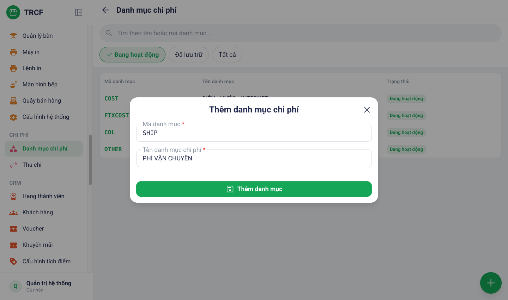

# 10.1 Danh mục chi phí

## 1. Đường dẫn vào chức năng

Menu trái: ==Chi phí → Danh mục chi phí== (địa chỉ `/expense-categories`).

## 2. Ví dụ nền và các bước thực hiện

> **Ví dụ:** quán gom chi phí vào 5 danh mục: **ĐIỆN - NƯỚC - INTERNET**, **MẶT BẰNG**, **LƯƠNG NHÂN VIÊN**, **PHÍ VẬN CHUYỂN**, **CHI PHÍ KHÁC**.
>
> - Bài này khai **PHÍ VẬN CHUYỂN**, mã **SHIP**, cho tiền ship hàng nhà cung cấp giao tới.
> - Danh mục để gom các khoản chi cùng loại khi xem báo cáo lãi lỗ.

### Bước 1: Mở trang Danh mục chi phí

- Ở menu trái, nhóm **Chi phí**, bấm **Danh mục chi phí**.

### Bước 2: Khai danh mục

- Bấm nút tròn **+** ở góc dưới bên phải.
- Điền như ảnh, bấm **Thêm danh mục**. Thấy thông báo *Đã thêm danh mục chi phí*.
- Đổi sau này: bấm vào danh mục, chọn **Sửa**. Có thêm **Lưu trữ** và **Xoá**.

## 3. Giải thích các trường

| Trường | Điền gì | Bắt buộc |
| --- | --- | --- |
| Mã danh mục | Ngắn, viết hoa, **không trùng**. VD **SHIP**, **FIXCOST** | ✅ |
| Tên danh mục chi phí | Tên hiện khi chọn ở phiếu chi và trên báo cáo | ✅ |

## 4. Lưu ý quan trọng

> - Mã danh mục không được trùng.
> - Đã dùng cho phiếu chi thì không xoá được, chọn **Lưu trữ**.
