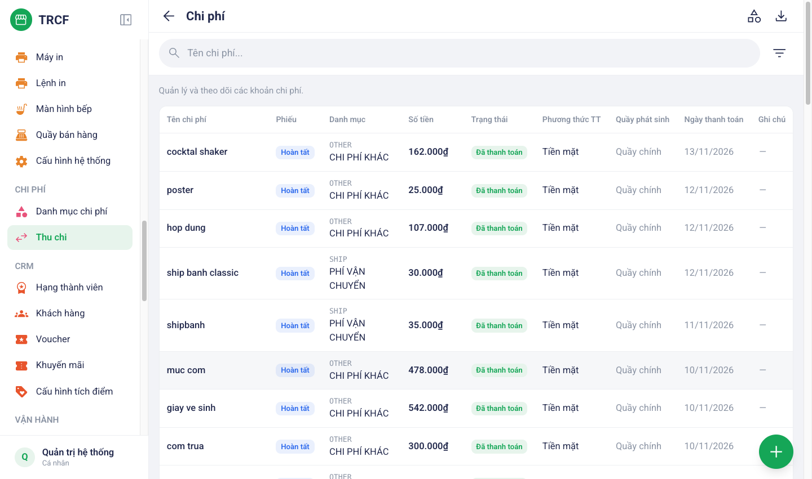
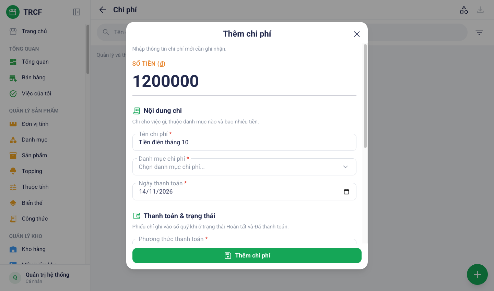
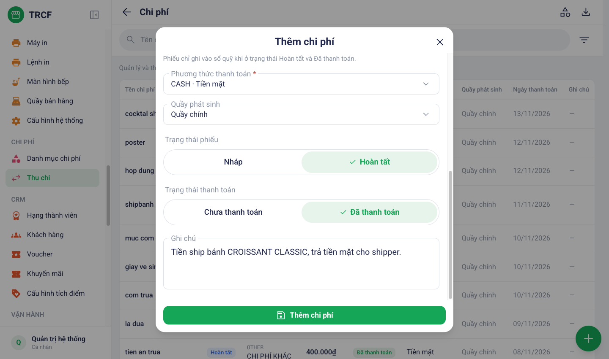

# 10.2 Tạo chi phí

## 1. Đường dẫn vào chức năng

Menu trái: ==Chi phí → Thu chi== (địa chỉ `/expenses`, tiêu đề trang **Chi phí**).

hoặc ở màn ==Bán hàng → VẬN HÀNH → Chi phí==.

- Dùng cho mọi khoản chi **không phải mua hàng hoá**: tiền điện, nước, ship, thuê mặt bằng, mua chổi lau nhà.
- Cần có trước: danh mục chi phí ([bài 10.1 Danh mục chi phí](10-1-danh-muc-chi-phi.md)).

## 2. Ví dụ nền và các bước thực hiện

> **Ví dụ:** trả tiền điện tháng 10 bằng tiền mặt lấy từ két **Quầy chính**.
>
> - Số tiền **1.200.000₫**, danh mục **Tiền điện**.
> - Phiếu **Hoàn tất** và **Đã thanh toán** để trừ vào sổ quỹ.

### Bước 1: Mở trang Chi phí

- Ở menu trái, nhóm **Chi phí**, bấm **Thu chi**.
- Góc trên phải: biểu tượng hình khối mở nhanh **Danh mục chi phí**, biểu tượng tải xuống để **Xuất Excel**.
- Biểu tượng ba gạch cạnh ô tìm kiếm mở **Bộ lọc**: ngày lập, loại chi phí, thanh toán, lưu trữ.

### Bước 2: Khai nội dung chi

- Bấm nút tròn **+** ở góc dưới bên phải.
- Điền **Số tiền**, **Tên chi phí**, **Ngày thanh toán** như ảnh.
- **Danh mục chi phí**: bấm vào ô, chọn **Tiền điện**.

### Bước 3: Khai thanh toán và trạng thái

- Kéo xuống phần **Thanh toán & trạng thái**.
- Điền như ảnh, bấm **Thêm chi phí**.
- Thao tác sau này: bấm vào phiếu. Tuỳ trạng thái sẽ có **Hoàn tất**, **Sửa**, **Lưu trữ**, **Huỷ phiếu**.

## 3. Giải thích các trường

### Nội dung chi

| Trường | Điền gì | Bắt buộc |
| --- | --- | --- |
| Số tiền (₫) | Số tiền chi, nhập ở ô số lớn đầu hộp thoại | ✅ |
| Tên chi phí | Mô tả ngắn: **Tiền điện tháng 10** | ✅ |
| Danh mục chi phí | Nhóm để báo cáo lãi lỗ gom đúng chỗ | ✅ |
| Ngày thanh toán | Ngày trả tiền thật | ✅ |

### Thanh toán & trạng thái

| Trường | Điền gì |
| --- | --- |
| Phương thức thanh toán | Tiền mặt hay chuyển khoản (bắt buộc) |
| Quầy phát sinh | Chọn quầy nếu chi **từ két của quầy**. Để *— Ngoài ca —* nếu chi từ tài khoản công ty |
| Trạng thái phiếu | **Nháp** hay **Hoàn tất** (mặc định Hoàn tất) |
| Trạng thái thanh toán | **Chưa thanh toán** hay **Đã thanh toán** (mặc định Chưa thanh toán) |
| Ghi chú | Ghi thêm (không bắt buộc) |

### Khi nào tiền thật sự vào sổ quỹ

- Chỉ khi phiếu ở **Hoàn tất** **VÀ** **Đã thanh toán**.
- Thiếu một trong hai: phiếu chỉ là ghi nhớ, chưa động vào quỹ.

## 4. Lưu ý quan trọng

> - Chi tiền mặt từ két: **phải chọn đúng quầy**, nếu không cuối ca két lệch.
> - Đã thanh toán thì không gỡ rồi bật lại được, sai thì lập phiếu mới.
> - Phiếu chi không xoá, chỉ **Huỷ phiếu**.
