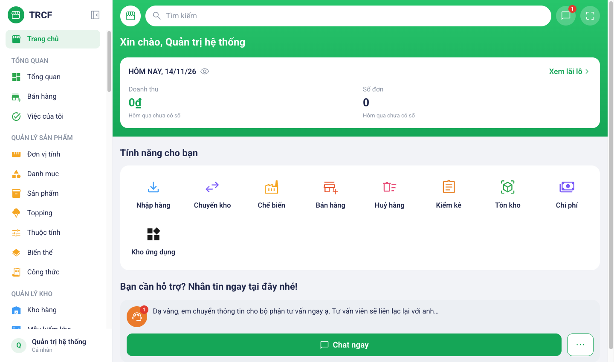

# 11.1 Tổng quan quy trình kho

## 1. Đường dẫn vào chức năng

Trang chủ: khối ==Tính năng cho bạn== (địa chỉ `/`).

hoặc menu trái: nhóm ==Vận hành== (Mua hàng, Chuyển kho, Chế biến, Huỷ hàng, Kiểm kê).

hoặc ở màn ==Bán hàng → Vận hành== (địa chỉ `/pos-operations`).

- Dùng để: tra nhanh xem tình huống đang gặp thì lập phiếu gì.

## 2. Ví dụ nền và các bước thực hiện

> **Ví dụ:** một ngày ở quán, mỗi việc một phiếu.
>
> - Sáng, nhà cung cấp giao 50 CROISSANT CLASSIC → **Nhập hàng** ([11.2](11-2-nhap-hang.md)). Trả 30.000₫ tiền ship → **Chi phí** ([10.2](10-2-tao-chi-phi.md)).
> - Lấy 2 túi cà phê pha phin từ KHO CHINH ra KHO QUẦY → **Chuyển kho** ([11.3](11-3-chuyen-kho.md)).
> - Ủ 1.600 GR trà lài → **Chế biến** ([11.4](11-4-che-bien.md)).
> - Cuối ca đổ 280 GR trà lài thừa → **Huỷ hàng** ([11.5](11-5-huy-hang.md)).
> - Tối đếm 18 món bán thành phẩm ở KHO QUẦY → **Kiểm kê** ([11.6](11-6-kiem-kho.md)).

### Bước 1: Mở Trang chủ

- Bấm **Trang chủ** ở đầu menu trái.
- Ở khối **Tính năng cho bạn**, bấm ô đúng với tình huống (xem bảng tra nhanh bên dưới).

### Bước 2: Hoặc chọn ở menu trái

- Ở menu trái, kéo xuống nhóm **Vận hành**, bấm trang cần dùng.
- **Kiểm soát vận hành** ở nhóm **Báo cáo** ngay dưới: xem [bài 11.7](11-7-de-xuat-nhap-hang.md).

## 3. Giải thích các trường

### Bảng tra nhanh

| Ô / trang | Dùng khi | Kho bị ảnh hưởng | Chi tiết |
| --- | --- | --- | --- |
| **Nhập hàng** (Mua hàng) | Nhà cung cấp giao bánh, sữa, cà phê tới quán | Cộng vào kho | [11.2](11-2-nhap-hang.md) |
| **Chuyển kho** | Lấy hàng từ KHO CHINH ra KHO QUẦY | Trừ kho nguồn, cộng kho đích | [11.3](11-3-chuyen-kho.md) |
| **Chế biến** | Ủ trà lài, coldbrew, nấu syrup | Trừ nguyên liệu, cộng bán thành phẩm | [11.4](11-4-che-bien.md) |
| **Huỷ hàng** | Trà ủ thừa cuối ca, bánh hết hạn, làm rơi | Trừ kho | [11.5](11-5-huy-hang.md) |
| **Kiểm kê** | Đếm bán thành phẩm cuối ngày, chỉnh cho khớp | Điều chỉnh về đúng số đếm | [11.6](11-6-kiem-kho.md) |
| **Chi phí** | Trả tiền ship, tiền điện, mua đồ lặt vặt | Không đụng kho, ghi sổ quỹ | [10.2](10-2-tao-chi-phi.md) |
| **Tồn kho** | Xem nhanh hàng nào sắp hết | Chỉ xem | [11.7](11-7-de-xuat-nhap-hang.md) |

### Sai thì sửa bằng phiếu ngược lại

| Sai gì | Sửa bằng |
| --- | --- |
| Nhập nhầm | Phiếu trả hàng nhà cung cấp |
| Xuất nhầm | Phiếu nhập bù |
| Số lệch không rõ nguyên nhân | Phiếu kiểm kho |

## 4. Lưu ý quan trọng

> - Phiếu **Nháp** chưa đụng tới kho, xoá thoải mái.
> - Kho chỉ đổi khi bấm **Xác nhận** (hoặc **Nhận hàng** / **Hoàn thành**).
> - Đã xác nhận thì không sửa, không xoá: sai thì lập phiếu ngược lại.
