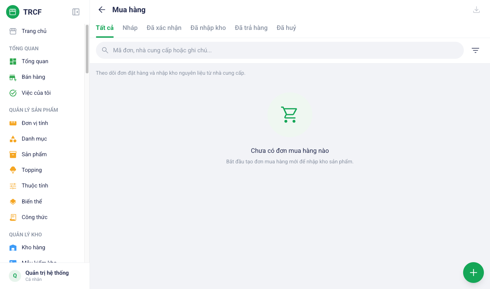
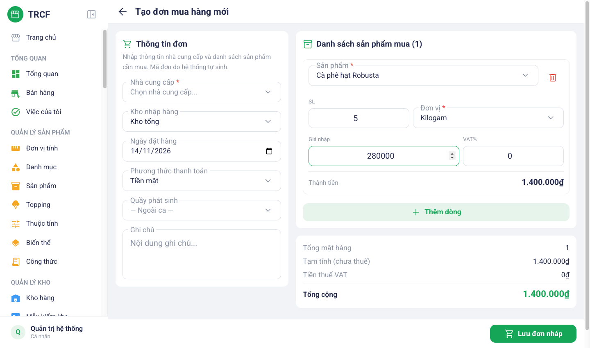
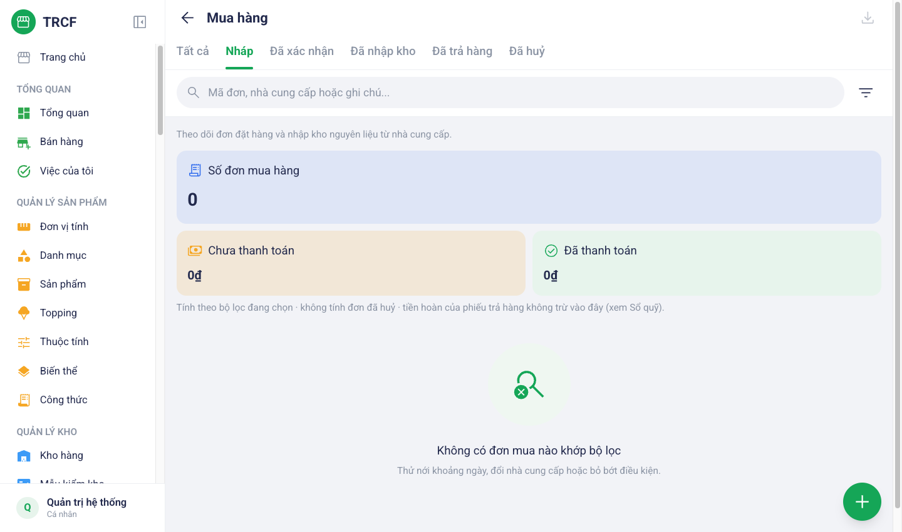

# 11.2 Nhập hàng

## 1. Đường dẫn vào chức năng

Menu trái: ==Vận hành → Mua hàng== (địa chỉ `/purchases`).

hoặc ô **Nhập hàng** ở khối *Tính năng cho bạn* trên Trang chủ.

- Các trạng thái: **Nháp → Đã xác nhận → Đã nhập kho**. Ngoài ra có **Đã trả hàng**, **Đã huỷ**.
- Cần có trước: nhà cung cấp, sản phẩm bật **Có thể mua** ([mục 2.2](2-2-thanh-pham.md)).

## 2. Ví dụ nền và các bước thực hiện

> **Ví dụ:** nhà cung cấp **Công ty Cà phê An Nhiên** giao 5 kg **Cà phê hạt Robusta**, đơn giá 280.000₫/kg.
>
> - Kho nhập: **Kho tổng**. Phương thức thanh toán: **Tiền mặt**.
> - Dòng hàng: **Cà phê hạt Robusta**, SL **5**, đơn vị **Kilogam**, giá nhập **280000**.
> - Tổng cộng: 5 × 280.000 = **1.400.000₫**.

### Bước 1: Mở trang Mua hàng

- Ở menu trái, nhóm **Vận hành**, bấm **Mua hàng**.
- Các tab trên cùng lọc theo trạng thái: **Tất cả**, **Nháp**, **Đã xác nhận**, **Đã nhập kho**, **Đã trả hàng**, **Đã huỷ**.
- Quán chưa có đơn nào thì trang báo *Chưa có đơn mua hàng nào*.
- Biểu tượng ba gạch cạnh ô tìm kiếm mở **Bộ lọc**. Biểu tượng tải xuống góc trên phải để **Xuất Excel**.

### Bước 2: Khai đầu đơn và dòng hàng

- Bấm nút tròn **+** ở góc dưới bên phải. Trang **Tạo đơn mua hàng mới** mở ra.
- **Nhà cung cấp**: bấm vào ô, chọn **Công ty Cà phê An Nhiên**.
- **Kho nhập hàng**: bấm vào ô, chọn **Kho tổng**.
- **Ngày đặt hàng**: giữ ngày hôm nay.
- **Phương thức thanh toán**: bấm vào ô, chọn **Tiền mặt**.
- Bấm **Thêm dòng**.
- **Sản phẩm**: bấm vào ô, chọn **Cà phê hạt Robusta**. **Đơn vị** tự lấy **Kilogam**.
- **SL**: nhập **5**.
- **Giá nhập**: nhập **280000**. **VAT%**: nhập thuế suất trên hoá đơn NCC (nếu có).
- Kiểm tra **Thành tiền** và **Tổng cộng** tự tính, rồi bấm **Lưu đơn nháp** ở góc dưới bên phải.

### Bước 3: Xác nhận rồi nhận hàng

- Đơn mới nằm ở tab **Nháp**, mã dạng **PO261009-001**.
- Bấm vào đơn để mở danh sách thao tác: **Sửa**, **Xác nhận**, **Huỷ đơn**, **Xoá**.
- Kiểm tra lại, chọn **Xác nhận**. Đơn chuyển sang tab **Đã xác nhận**.
- Khi hàng về tới quán, bấm vào đơn, chọn **Nhận hàng**.
- Hộp thoại **Nhập kho hàng** liệt kê các dòng sẽ nhập. Đã trả tiền luôn thì bật **Đã thanh toán**, chọn phương thức và quầy.
- Bấm **Xác nhận nhận hàng**. Đơn chuyển sang tab **Đã nhập kho**.
- Trả tiền sau: bấm vào đơn, chọn **Thanh toán**, rồi **Xác nhận đã trả**.

## 3. Giải thích các trường

### Thông tin đơn

| Trường | Điền gì | Bắt buộc |
| --- | --- | --- |
| Nhà cung cấp | Bên giao hàng | ✅ |
| Kho nhập hàng | Kho nhận hàng về. Để *(Chưa chọn kho)* thì dùng kho nhập mặc định ở *Cấu hình hệ thống* | — |
| Ngày đặt hàng | Ngày đặt | ✅ |
| Phương thức thanh toán | Tiền mặt / chuyển khoản. Cần có khi đánh dấu đã thanh toán | — |
| Quầy phát sinh | Chọn quầy nếu trả bằng tiền két quầy. Để *— Ngoài ca —* nếu không | — |
| Ghi chú | Ghi thêm (không bắt buộc) | — |

### Từng dòng hàng

| Trường | Điền gì |
| --- | --- |
| Sản phẩm | Hàng mua (chỉ hiện hàng đã bật *Có thể mua*) |
| SL, Đơn vị | Nhập theo đơn vị lớn được: mua 5 *Kilogam*, hệ thống quy ra 5000 g. Đơn vị lớn phải khai ở *Đơn vị tính phụ* của sản phẩm |
| Giá nhập, VAT% | Giá và thuế suất trên hoá đơn NCC |
| Thành tiền | Tự tính, không sửa |

### Nhận hàng làm gì

Bấm **Xác nhận nhận hàng**, hệ thống đồng thời:

- **Cộng toàn bộ dòng hàng vào kho** đã chọn.
- **Ghi tiền vào sổ quỹ** nếu bật **Đã thanh toán** (hoặc đơn đã trả trước).
- **Không tự cập nhật giá vốn** sản phẩm. Giá vốn sửa ở màn sản phẩm hoặc do công thức tính ([mục 3.2](3-2-cong-thuc-thanh-pham.md)).

## 4. Lưu ý quan trọng

> [!CAUTION]
> **Nhận hàng chỉ bấm được một lần.**
>
> - Bấm lần hai bị chặn.
> - Nếu không, kho sẽ cộng gấp đôi.

> [!CAUTION]
> **Đơn đã nhập kho thì không sửa dòng hàng, không xoá.**
>
> - Nhập nhầm số lượng: lập **phiếu trả hàng NCC** cho phần dư.
> - Menu trái: nhóm **Vận hành** → **Trả hàng NCC**.

> [!WARNING]
> **Đơn đã thanh toán thì khoá phần tiền.**
>
> - Không sửa được số lượng, giá nhập, VAT%, phương thức, quầy.
> - Bút toán sổ quỹ là bản ghi vĩnh viễn, giống phiếu chi ([mục 10.2](10-2-tao-chi-phi.md)).

> [!TIP]
> Đơn ở trạng thái **Nháp** chưa đụng gì tới kho, xoá thoải mái.

## Kiểm tra đã đúng

- [ ] Đơn ở trạng thái **Đã nhập kho**
- [ ] Tồn kho đã tăng đúng số lượng
- [ ] Đã ghi thanh toán nếu đã trả tiền nhà cung cấp
