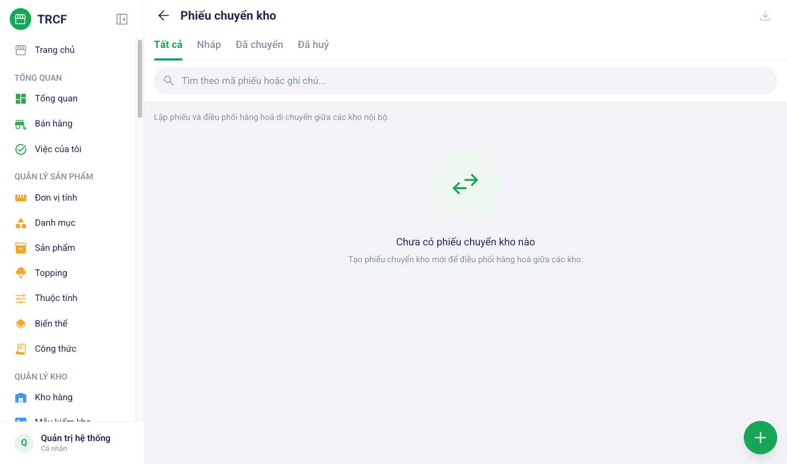
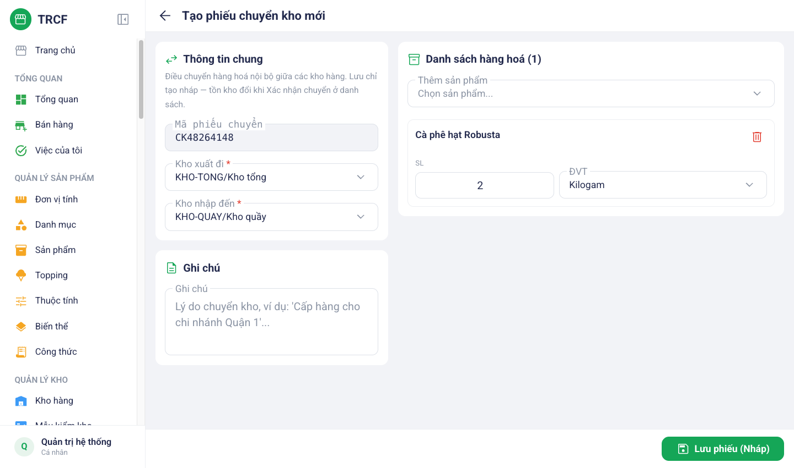
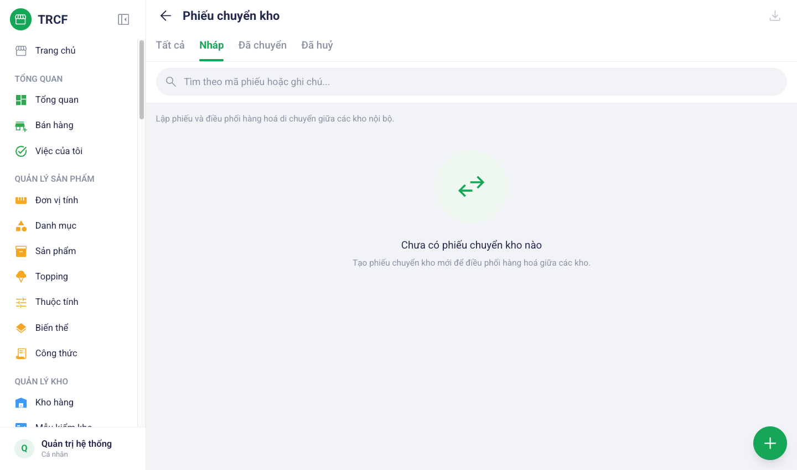

# 11.3 Chuyển kho

## 1. Đường dẫn vào chức năng

Menu trái: ==Vận hành → Chuyển kho== (địa chỉ `/stock-transfers`, tiêu đề trang **Phiếu chuyển kho**).

hoặc ô **Chuyển kho** ở khối *Tính năng cho bạn* trên Trang chủ.

- Dùng khi: lấy hàng từ kho tổng ra kho quầy, hoặc điều hàng giữa hai chi nhánh.
- Cần có trước: hai kho khác nhau (khai ở **Quản lý kho → Kho hàng**).

## 2. Ví dụ nền và các bước thực hiện

> **Ví dụ:** chuyển 2 kg **Cà phê hạt Robusta** từ **Kho tổng** ra **Kho quầy**.
>
> - Kho xuất đi: **Kho tổng**. Kho nhập đến: **Kho quầy**.
> - Dòng hàng: **Cà phê hạt Robusta**, SL **2**, đơn vị **Kilogam**.

### Bước 1: Mở trang Phiếu chuyển kho

- Ở menu trái, nhóm **Vận hành**, bấm **Chuyển kho**.
- Các tab trên cùng lọc theo trạng thái: **Tất cả**, **Nháp**, **Đã chuyển**, **Đã huỷ**.
- Quán chưa có phiếu nào thì trang báo *Chưa có phiếu chuyển kho nào*.

### Bước 2: Khai phiếu và dòng hàng

- Bấm nút tròn **+** ở góc dưới bên phải. Trang **Tạo phiếu chuyển kho mới** mở ra.
- **Mã phiếu chuyển**: hệ thống tự sinh, không sửa.
- **Kho xuất đi**: bấm vào ô, chọn **KHO-TONG/Kho tổng**.
- **Kho nhập đến**: bấm vào ô, chọn **KHO-QUAY/Kho quầy**.
- Ô **Thêm sản phẩm**: bấm vào, chọn **Cà phê hạt Robusta**. Dòng hàng hiện bên dưới.
- **SL**: nhập **2**. **ĐVT** tự lấy **Kilogam**, bấm vào để đổi.
- **Ghi chú**: nhập nếu cần (tuỳ chọn).
- Bấm **Lưu phiếu (Nháp)** ở góc dưới bên phải.

### Bước 3: Kiểm tra rồi xác nhận chuyển

- Phiếu mới nằm ở tab **Nháp**, kèm tuyến chuyển **KHO-TONG → KHO-QUAY**.
- Bấm vào phiếu để mở danh sách thao tác: **Sửa**, **Xác nhận chuyển**, **Huỷ phiếu**, **Xoá**.
- Kiểm tra lại, chọn **Xác nhận chuyển**, rồi xác nhận lần nữa ở hộp thoại hỏi lại.
- Phiếu chuyển sang tab **Đã chuyển**.

## 3. Giải thích các trường

| Trường | Điền gì | Bắt buộc |
| --- | --- | --- |
| Mã phiếu chuyển | Tự sinh, chỉ đọc | — |
| Kho xuất đi | Kho lấy hàng ra | ✅ |
| Kho nhập đến | Kho nhận hàng. **Phải khác kho xuất** | ✅ |
| Sản phẩm / SL / ĐVT | Từng dòng hàng chuyển. Chọn đơn vị lớn được (hệ thống tự quy đổi). Bấm thùng rác để bỏ dòng | ✅ |
| Ghi chú | Ghi thêm (không bắt buộc) | — |

### Xác nhận làm gì

- Ghi **hai bút toán kho cùng lúc**: trừ kho nguồn + cộng kho đích.
- Không có chuyện hàng biến mất giữa đường.

## 4. Lưu ý quan trọng

> [!CAUTION]
> **Phiếu đã xác nhận không sửa, không xoá.**
>
> - Chuyển nhầm: lập phiếu chuyển ngược lại.
> - Chỉ xoá được phiếu **Nháp** hoặc **Đã huỷ**.

> [!WARNING]
> **Chọn cùng một kho cho cả hai ô sẽ bị chặn ngay khi lưu.**

> [!TIP]
> **Bê hàng ra quầy mà không lập phiếu** thì kho tổng trên hệ thống vẫn đầy trong khi kệ đã trống.
>
> - Tới lúc kiểm kho mới lòi ra chênh lệch lớn không truy được.

> [!TIP]
> Phiếu **Nháp** chưa đụng gì tới kho, xoá thoải mái.

## Kiểm tra đã đúng

- [ ] Tồn kho nguồn giảm đúng số
- [ ] Tồn kho đích tăng đúng số
