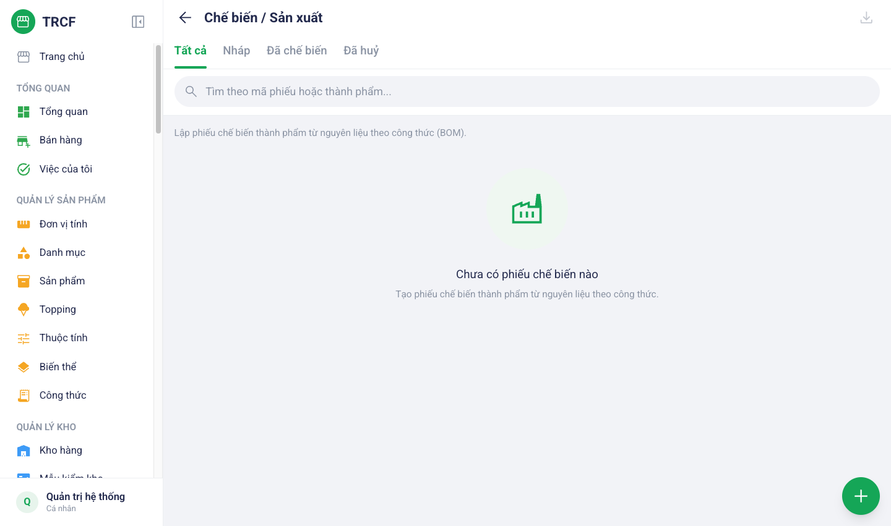

# 11.4 Chế biến

## 1. Đường dẫn vào chức năng

Menu trái: ==Vận hành → Chế biến== (địa chỉ `/manufacturing`, tiêu đề trang **Chế biến / Sản xuất**).

hoặc ô **Chế biến** ở khối *Tính năng cho bạn* trên Trang chủ.

- Dùng khi: quán tự làm ra thứ gì đó (ủ cà phê cốt, nấu syrup, nấu cốt trà sữa).
- Cần có trước: thành phẩm bật *Sản xuất* và có công thức (BOM) ([mục 3.2](3-2-cong-thuc-thanh-pham.md)).

## 2. Ví dụ nền và các bước thực hiện

> **Ví dụ:** nấu cốt trà sữa. Trên máy mẫu, sản phẩm có tên **THỬ — Cốt trà sữa**.
>
> - Công thức: 0,2 kg **Trà đen CTC** + 0,5 kg **Đường mía** làm ra 2 lít cốt.
> - Kho trừ nguyên liệu: **Kho tổng**. Kho nhập thành phẩm: **Kho quầy**.
> - Hôm nay nấu 4 lít → cần dùng **0,4 kg** trà và **1 kg** đường.

### Bước 1: Mở trang Chế biến

- Ở menu trái, nhóm **Vận hành**, bấm **Chế biến**.
- Các tab trên cùng lọc theo trạng thái: **Tất cả**, **Nháp**, **Đã chế biến**, **Đã huỷ**.
- Quán chưa có phiếu nào thì trang báo *Chưa có phiếu chế biến nào*.

### Bước 2: Khai phiếu chế biến

- Bấm nút tròn **+** ở góc dưới bên phải. Trang **Tạo phiếu chế biến mới** mở ra.
- **Sản phẩm thành phẩm**: bấm vào ô, chọn **THỬ — Cốt trà sữa**. Hệ thống **tự nạp nguyên liệu từ công thức**.
- Dưới ô hiện dòng *Công thức: Sản xuất · sản lượng 2 Lít*.
- **Kho trừ nguyên liệu**: chọn **Kho tổng**. **Kho nhập thành phẩm**: chọn **Kho quầy**.
- **Số lượng thành phẩm**: nhập **4**. **Đơn vị tính** tự lấy theo công thức (**Lít**).
- Mục **Nguyên liệu tiêu thụ (từ BOM)**: **tự sửa** cột **SL** cho khớp (ở ví dụ: **Trà đen CTC** = **0.4**, **Đường mía** = **1**).
- Bấm **Lưu phiếu (nháp)** ở góc dưới bên phải.

### Bước 3: Xác nhận chế biến

- Phiếu mới nằm ở tab **Nháp**, mã dạng **MO261009-001**.
- Bấm vào phiếu để mở danh sách thao tác: **Xem**, **Xác nhận chế biến**, **Huỷ phiếu**, **Xoá**.
- Phiếu nháp không sửa được. Khai sai thì xoá rồi lập lại.
- Kiểm tra lại, chọn **Xác nhận chế biến**, rồi xác nhận lần nữa ở hộp thoại hỏi lại.
- Phiếu chuyển sang tab **Đã chế biến**.

## 3. Giải thích các trường

| Trường | Điền gì | Bắt buộc |
| --- | --- | --- |
| Sản phẩm thành phẩm | Thứ làm ra. Chỉ hiện sản phẩm bật *Sản xuất* | ✅ |
| Kho trừ nguyên liệu | Kho lấy nguyên liệu | ✅ |
| Kho nhập thành phẩm | Kho nhận thành phẩm | ✅ |
| Số lượng thành phẩm | Số làm được thật. Đơn vị tự lấy theo công thức | ✅ |
| Nguyên liệu tiêu thụ | Tự nạp từ công thức, **sửa được SL**, bấm thùng rác để bỏ dòng | ✅ |
| Ghi chú | Ghi thêm (không bắt buộc) | — |

## 4. Lưu ý quan trọng

> [!CAUTION]
> **Số lượng trên phiếu là nguồn sự thật, không phải công thức.**
>
> - Công thức chỉ điền sẵn cho nhanh.
> - Đổi *Số lượng thành phẩm* thì danh sách nguyên liệu **không tự đổi theo**: sửa tay.
> - Hôm nay dùng nhiều hơn định mức thì cứ sửa số trên phiếu.
> - Hệ thống trừ đúng số bạn khai.

> [!WARNING]
> **Đã xác nhận thì không xác nhận lại được.**
>
> - Hệ thống khoá để tránh trừ kho hai lần khi hai người cùng bấm.

> [!TIP]
> Chế biến **không đụng tới tiền**: chỉ chuyển giá trị từ nguyên liệu sang bán thành phẩm. Phiếu nhẹ nhất chương này.

> [!TIP]
> Chưa có công thức thì phiếu không tự nạp nguyên liệu được. Tạo công thức trước.

## Kiểm tra đã đúng

- [ ] Tồn nguyên liệu giảm đúng số đã khai
- [ ] Tồn bán thành phẩm tăng đúng số làm được
