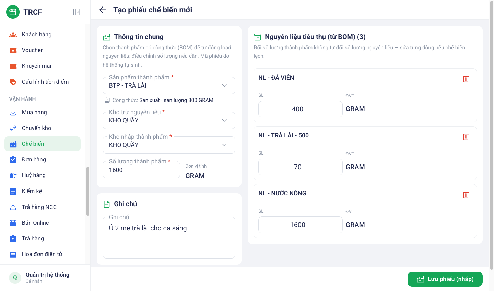
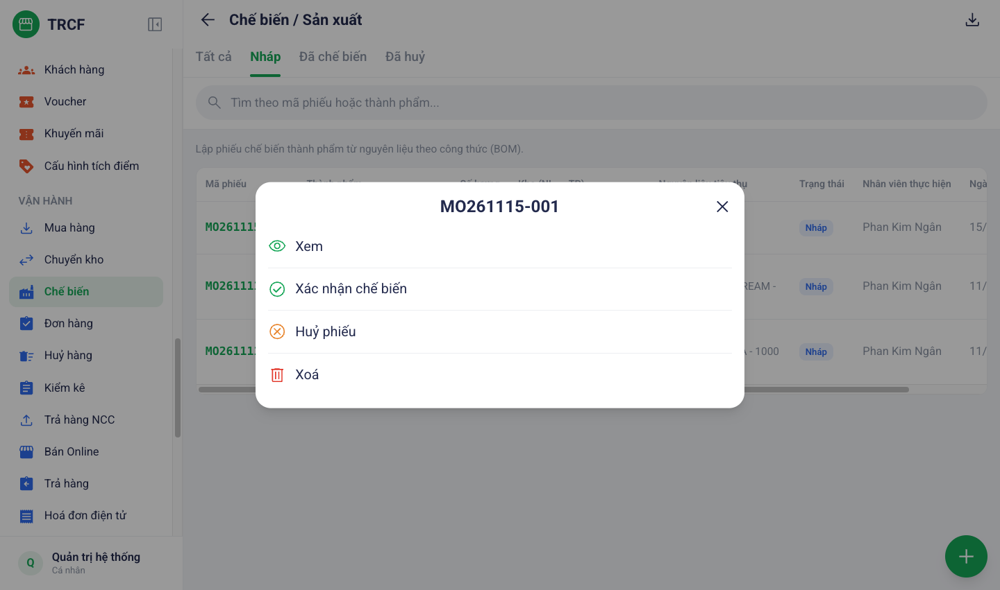

# 11.4 Chế biến

## 1. Đường dẫn vào chức năng

Menu trái: ==Vận hành → Chế biến== (địa chỉ `/manufacturing`, tiêu đề trang **Chế biến / Sản xuất**).

hoặc ô **Chế biến** ở khối *Tính năng cho bạn* trên Trang chủ.

- Dùng khi: quán tự làm ra thứ gì đó (ủ cà phê cốt, nấu syrup, nấu cốt trà sữa).
- Cần có trước: thành phẩm bật *Sản xuất* và có công thức (BOM) ([mục 3.2](3-2-cong-thuc-thanh-pham.md)).

## 2. Ví dụ nền và các bước thực hiện

> **Ví dụ:** đầu ca sáng, ủ 2 mẻ **BTP - TRÀ LÀI** ngay tại quầy.
>
> - Công thức ([mục 3.1](3-1-cong-thuc-ban-thanh-pham.md)): 35 GR **NL - TRÀ LÀI - 500** + 800 GR **NL - NƯỚC NÓNG** + 200 GR **NL - ĐÁ VIÊN** làm ra 800 GR.
> - Kho trừ nguyên liệu và kho nhập thành phẩm đều là **KHO QUẦY**.
> - Ủ 2 mẻ = **1.600 GR** → sửa nguyên liệu thành **70 GR** trà, **1.600 GR** nước nóng, **400 GR** đá.

### Bước 1: Mở trang Chế biến

- Ở menu trái, nhóm **Vận hành**, bấm **Chế biến**.

### Bước 2: Khai phiếu chế biến

- Bấm nút tròn **+** ở góc dưới bên phải.
- Chọn thành phẩm trước: hệ thống tự nạp nguyên liệu từ công thức.
- Điền như ảnh. Nguyên liệu không tự nhân theo số lượng thành phẩm: sửa tay cột **SL**.
- Bấm **Lưu phiếu (nháp)**.

### Bước 3: Xác nhận chế biến

- Mở tab **Nháp**, bấm vào phiếu vừa lưu (mã dạng **MO261115-001**).
- Chọn **Xác nhận chế biến**, rồi xác nhận lần nữa ở hộp thoại hỏi lại.
- Phiếu chuyển sang tab **Đã chế biến**.

## 3. Giải thích các trường

| Trường | Điền gì | Bắt buộc |
| --- | --- | --- |
| Sản phẩm thành phẩm | Thứ làm ra. Chỉ hiện sản phẩm bật *Sản xuất* | ✅ |
| Kho trừ nguyên liệu | Kho lấy nguyên liệu | ✅ |
| Kho nhập thành phẩm | Kho nhận thành phẩm | ✅ |
| Số lượng thành phẩm | Số làm được thật. Đơn vị tự lấy theo công thức | ✅ |
| Nguyên liệu tiêu thụ | Tự nạp từ công thức, **sửa được SL**, bấm thùng rác để bỏ dòng | ✅ |
| Ghi chú | Ghi thêm (không bắt buộc) | — |

## 4. Lưu ý quan trọng

> - Hệ thống trừ đúng số trên phiếu, không theo công thức.
> - Phiếu nháp khai sai thì xoá rồi lập lại.
> - Chưa có công thức thì không tự nạp nguyên liệu.
