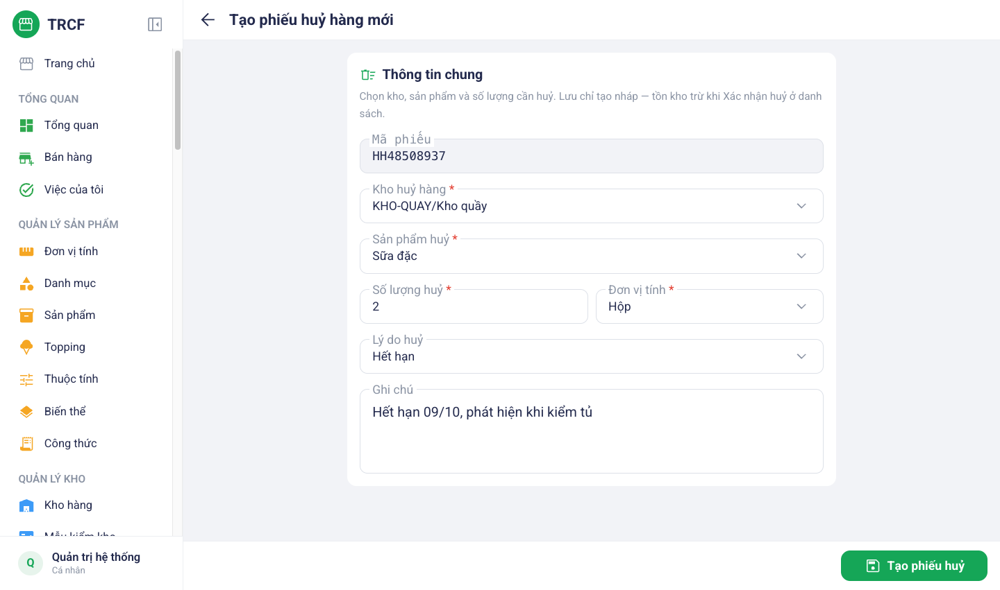

# 11.5 Huỷ hàng

## 1. Đường dẫn vào chức năng

Menu trái: ==Vận hành → Huỷ hàng== (địa chỉ `/scraps`, tiêu đề trang **Phiếu huỷ hàng**).

hoặc ô **Huỷ hàng** ở khối *Tính năng cho bạn* trên Trang chủ.

- Dùng khi: hàng hỏng, hết hạn, rơi vỡ, pha hỏng phải bỏ.
- Mỗi phiếu **một mặt hàng**. Huỷ ba thứ thì lập ba phiếu.

## 2. Ví dụ nền và các bước thực hiện

> **Ví dụ:** phát hiện 2 hộp **Sữa đặc** hết hạn trong tủ ở **Kho quầy**.
>
> - Sản phẩm: **Sữa đặc**. Số lượng: **2** **Hộp**.
> - Lý do: **Hết hạn**. Ghi chú: **Hết hạn 09/10, phát hiện khi kiểm tủ**.

### Bước 1: Mở trang Huỷ hàng

- Ở menu trái, nhóm **Vận hành**, bấm **Huỷ hàng**.
- Các tab trên cùng lọc theo trạng thái: **Tất cả**, **Nháp**, **Đã huỷ** (đã trừ kho), **Huỷ bỏ** (phiếu bị bỏ, không trừ kho).
- Quán chưa có phiếu nào thì trang báo *Chưa có phiếu huỷ hàng nào*.

### Bước 2: Khai phiếu huỷ

- Bấm nút tròn **+** ở góc dưới bên phải. Trang **Tạo phiếu huỷ hàng mới** mở ra.
- **Mã phiếu**: hệ thống tự sinh, không sửa.
- **Kho huỷ hàng**: bấm vào ô, chọn **KHO-QUAY/Kho quầy**.
- **Sản phẩm huỷ**: bấm vào ô, chọn **Sữa đặc**.
- **Số lượng huỷ**: nhập **2**. **Đơn vị tính**: tự lấy **Hộp**, bấm vào để đổi.
- **Lý do huỷ**: bấm vào ô, chọn **Hết hạn** (có 4 lựa chọn: Hỏng / vỡ, Hết hạn, Thất lạc, Khác).
- **Ghi chú**: nhập **Hết hạn 09/10, phát hiện khi kiểm tủ**.
- Bấm **Tạo phiếu huỷ** ở góc dưới bên phải.

### Bước 3: Xác nhận huỷ

- Phiếu mới nằm ở tab **Nháp**.
- Bấm vào phiếu để mở danh sách thao tác: **Sửa**, **Xác nhận huỷ**, **Huỷ bỏ phiếu**, **Xoá**.
- Kiểm tra lại, chọn **Xác nhận huỷ**, rồi xác nhận lần nữa ở hộp thoại hỏi lại.
- Phiếu chuyển sang tab **Đã huỷ**.

## 3. Giải thích các trường

| Trường | Điền gì | Bắt buộc |
| --- | --- | --- |
| Mã phiếu | Tự sinh, chỉ đọc | — |
| Kho huỷ hàng | Kho trừ hàng ra | ✅ |
| Sản phẩm huỷ | Mặt hàng bị huỷ | ✅ |
| Số lượng huỷ | Số bị huỷ | ✅ |
| Đơn vị tính | Đơn vị của số lượng. Mặc định là đơn vị của sản phẩm | ✅ |
| Lý do huỷ | Chọn: Hỏng / vỡ, Hết hạn, Thất lạc, Khác. Không bắt buộc nhưng **nên chọn** | — |
| Ghi chú | **Càng cụ thể càng tốt**: **hết hạn 09/08**, **làm rơi khi bưng** | — |

### Huỷ món pha sẵn

- Huỷ món có công thức dạng *Kit* (VD ly trà đã pha hỏng): hệ thống **trừ nguyên liệu theo công thức**.
- Không trừ *ly trà*, vì trong kho không có mặt hàng *ly trà đã pha*.

## 4. Lưu ý quan trọng

> [!CAUTION]
> **Đã xác nhận thì không sửa, không xoá.**
>
> - Chỉ xoá được phiếu **Nháp** hoặc **Huỷ bỏ**.

> [!TIP]
> **Ghi lý do tử tế là phần có giá trị nhất của phiếu huỷ.**
>
> - Cuối tháng nhìn lại sẽ thấy hao hụt nằm ở đâu.
> - Hết hạn: mua nhiều quá. Rơi vỡ: thao tác. Pha hỏng: đào tạo.

> [!TIP]
> Đừng gộp hao hụt vào phiếu kiểm kho.
>
> - Kiểm kho chỉ nói *thiếu 2 kg*.
> - Phiếu huỷ nói thiếu **vì sao**.

> [!TIP]
> Phiếu **Nháp** chưa đụng gì tới kho, xoá thoải mái.

## Kiểm tra đã đúng

- [ ] Tồn kho giảm đúng số huỷ
- [ ] Lý do ghi đủ rõ để tháng sau đọc vẫn hiểu
