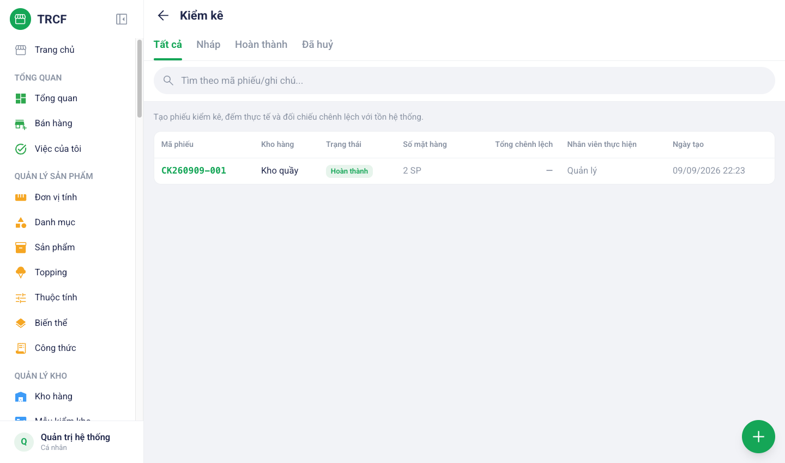
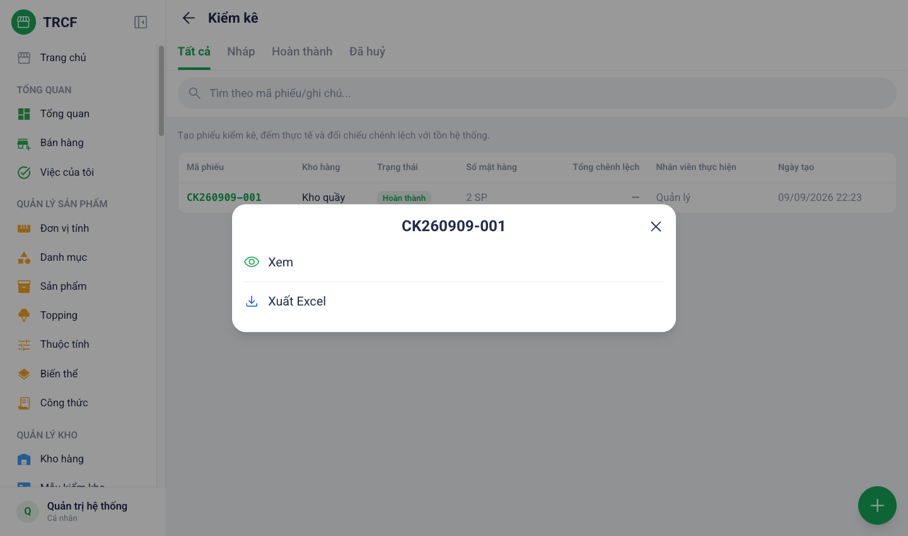

# 11.6 Kiểm kho

## 1. Đường dẫn vào chức năng

Menu trái: ==Vận hành → Kiểm kê== (địa chỉ `/stock-checks`).

hoặc ô **Kiểm kê** ở khối *Tính năng cho bạn* trên Trang chủ.

Dựng mẫu kiểm kho trước ở [bài 6.1 Tạo mẫu kiểm kho](6-1-tao-mau-kiem-kho.md) (không bắt buộc).

## 2. Ví dụ nền và các bước thực hiện

> **Ví dụ:** kiểm **Kho tổng**, đếm 2 mặt hàng.
>
> - **Cà phê hạt Robusta**: hệ thống 1,5 kg, đếm thật **1.2** kg → chênh lệch -0,3.
> - **Sữa đặc**: hệ thống 0 hộp, đếm thật **3** hộp → chênh lệch +3.

### Bước 1: Mở trang Kiểm kê

- Ở menu trái, nhóm **Vận hành**, bấm **Kiểm kê**.
- Danh sách phiếu: mã phiếu, kho hàng, trạng thái, số mặt hàng, tổng chênh lệch, nhân viên thực hiện, ngày tạo.
- Các tab trên cùng lọc theo trạng thái: **Tất cả**, **Nháp**, **Hoàn thành**, **Đã huỷ**.

### Bước 2: Khai phiếu và đếm hàng

- Bấm nút tròn **+** ở góc dưới bên phải. Trang **Tạo phiếu kiểm kê mới** mở ra (mã phiếu tự sinh khi lưu).
- **Kho hàng kiểm kê**: bấm vào ô, chọn **KHO-TONG/Kho tổng**.
- Nạp danh sách hàng cần đếm (xem 2 cách bên dưới).
- Ở đây: bấm ô **Thêm sản phẩm...**, chọn **Cà phê hạt Robusta**, rồi **Sữa đặc**.
- Mỗi dòng hiện tồn **Hệ thống**. Đi đếm thật, nhập vào ô **Thực đếm**: **1.2** và **3**.
- Cột **Chênh lệch** tự tính: đỏ là thiếu, xanh là dư.
- Chưa đếm xong: bấm **Tạo phiếu (nháp)**, quay lại làm tiếp sau.
- Đếm xong ngay: bấm **Xác nhận**, rồi xác nhận lần nữa ở hộp thoại hỏi lại.

### Bước 3: Hoàn thành phiếu nháp

- Phiếu nháp nằm ở tab **Nháp**: số mặt hàng, **Tổng chênh lệch**.
- Bấm vào phiếu để mở danh sách thao tác: **Xem / Sửa**, **Hoàn thành**, **Huỷ phiếu**, **Xoá**.
- Đếm xong hết: **rà lại dòng chênh lệch lớn**, rồi chọn **Hoàn thành**.
- Phiếu đã hoàn thành chỉ còn **Xem** và **Xuất Excel** (như phiếu **CK260909-001** trong ảnh).

## 3. Giải thích các trường

### Hai cách nạp danh sách

| Cách | Khi nào dùng |
| --- | --- |
| **Nạp từ mẫu kiểm kho** | Có mẫu dựng sẵn (==Quản lý kho → Mẫu kiểm kho==). Nhanh, không sót mặt hàng. Nạp mẫu **thay** danh sách hiện tại |
| **Thêm sản phẩm** từng món | Kiểm lẻ vài mặt hàng. Phải chọn kho trước |

### Các ô

| Ô | Nghĩa |
| --- | --- |
| Kho hàng kiểm kê | Kho đem đi đếm (bắt buộc) |
| Ghi chú | Ghi thêm (không bắt buộc) |
| Hệ thống | Tồn hiện tại theo hệ thống, chỉ đọc |
| Thực đếm | Số bạn đếm được. Mặc định bằng số hệ thống |
| Chênh lệch | Tự tính = Thực đếm − Hệ thống |

### Lịch kiểm kê gợi ý

| Loại hàng | Tần suất |
| --- | --- |
| Hàng dễ hỏng | Hằng ngày, cuối ca |
| Hàng khô | Hằng tuần |
| Toàn bộ | Cuối tháng |

## 4. Lưu ý quan trọng

> [!CAUTION]
> **Xác nhận là ghi đè tồn kho.**
>
> - Đếm sai một con số thì tồn kho sai theo.
> - Phải kiểm lại lần nữa mới sửa được.

> [!WARNING]
> **Phiếu đã hoàn thành không sửa, không xoá.**
>
> - Phiếu nháp và phiếu đã huỷ thì xoá được.

> [!TIP]
> **Dựng mẫu kiểm kho theo khu vực**: **Quầy pha chế**, **Kho khô**, **Tủ đông**.
>
> - Đếm theo khu nhanh và ít sót hơn đếm theo danh sách toàn quán.

> [!TIP]
> Chênh lệch lặp lại ở cùng một mặt hàng thường không do đếm sai.
>
> - Mà do **thiếu phiếu huỷ** ([mục 11.5](11-5-huy-hang.md)) hoặc **thiếu phiếu chuyển kho** ([mục 11.3](11-3-chuyen-kho.md)) ở khâu trước.

## Kiểm tra đã đúng

- [ ] Đã rà lại mọi dòng chênh lệch lớn trước khi xác nhận
- [ ] Sau xác nhận, tồn kho bằng đúng số đã đếm
