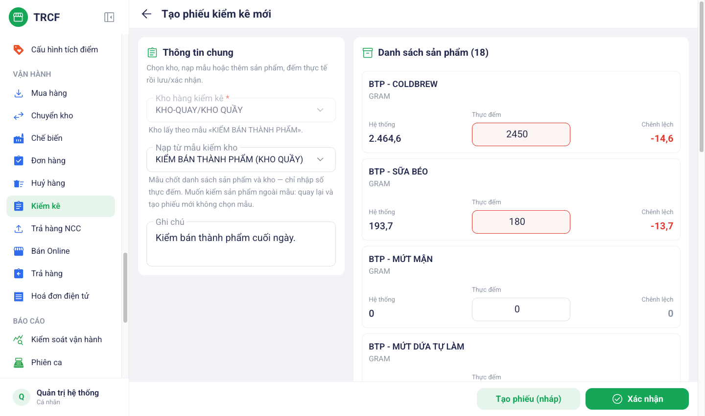

# 11.6 Kiểm kho

## 1. Đường dẫn vào chức năng

Menu trái: ==Vận hành → Kiểm kê== (địa chỉ `/stock-checks`).

hoặc ô **Kiểm kê** ở khối *Tính năng cho bạn* trên Trang chủ.

Dựng mẫu kiểm kho trước ở [bài 6.1 Tạo mẫu kiểm kho](6-1-tao-mau-kiem-kho.md) (không bắt buộc).

## 2. Ví dụ nền và các bước thực hiện

> **Ví dụ:** kiểm **Kho tổng**, đếm 2 mặt hàng.
>
> - **Cà phê hạt Robusta**: hệ thống 1,5 kg, đếm thật **1.2** kg → chênh lệch -0,3.
> - **Sữa đặc**: hệ thống 0 hộp, đếm thật **3** hộp → chênh lệch +3.

### Bước 1: Mở trang Kiểm kê

- Ở menu trái, nhóm **Vận hành**, bấm **Kiểm kê**.

### Bước 2: Khai phiếu và đếm hàng

- Bấm nút tròn **+** ở góc dưới bên phải.
- Chọn kho trước, rồi nạp danh sách hàng (2 cách, xem phần 3).
- Đi đếm thật, nhập vào ô **Thực đếm** như ảnh.
- Chưa đếm xong: bấm **Tạo phiếu (nháp)**, quay lại làm tiếp sau.
- Đếm xong ngay: bấm **Xác nhận**, rồi xác nhận lần nữa ở hộp thoại hỏi lại.

### Bước 3: Hoàn thành phiếu nháp

- Mở tab **Nháp**, bấm vào phiếu để mở danh sách thao tác.
- Chọn **Xem / Sửa** để đếm tiếp. Đếm xong hết: rà lại dòng chênh lệch lớn, rồi chọn **Hoàn thành**.
- Phiếu đã hoàn thành chỉ còn **Xem** và **Xuất Excel**, như ảnh.

## 3. Giải thích các trường

### Hai cách nạp danh sách

| Cách | Khi nào dùng |
| --- | --- |
| **Nạp từ mẫu kiểm kho** | Có mẫu dựng sẵn (==Quản lý kho → Mẫu kiểm kho==). Nhanh, không sót mặt hàng. Nạp mẫu **thay** danh sách hiện tại |
| **Thêm sản phẩm** từng món | Kiểm lẻ vài mặt hàng. Phải chọn kho trước |

### Các ô

| Ô | Nghĩa |
| --- | --- |
| Kho hàng kiểm kê | Kho đem đi đếm (bắt buộc) |
| Ghi chú | Ghi thêm (không bắt buộc) |
| Hệ thống | Tồn hiện tại theo hệ thống, chỉ đọc |
| Thực đếm | Số bạn đếm được. Mặc định bằng số hệ thống |
| Chênh lệch | Tự tính = Thực đếm − Hệ thống. Đỏ là thiếu, xanh là dư |

### Lịch kiểm kê gợi ý

| Loại hàng | Tần suất |
| --- | --- |
| Hàng dễ hỏng | Hằng ngày, cuối ca |
| Hàng khô | Hằng tuần |
| Toàn bộ | Cuối tháng |

## 4. Lưu ý quan trọng

> - **Xác nhận là ghi đè tồn kho**: rà lại số đếm trước khi bấm.
> - Đã hoàn thành thì không sửa, không xoá.
