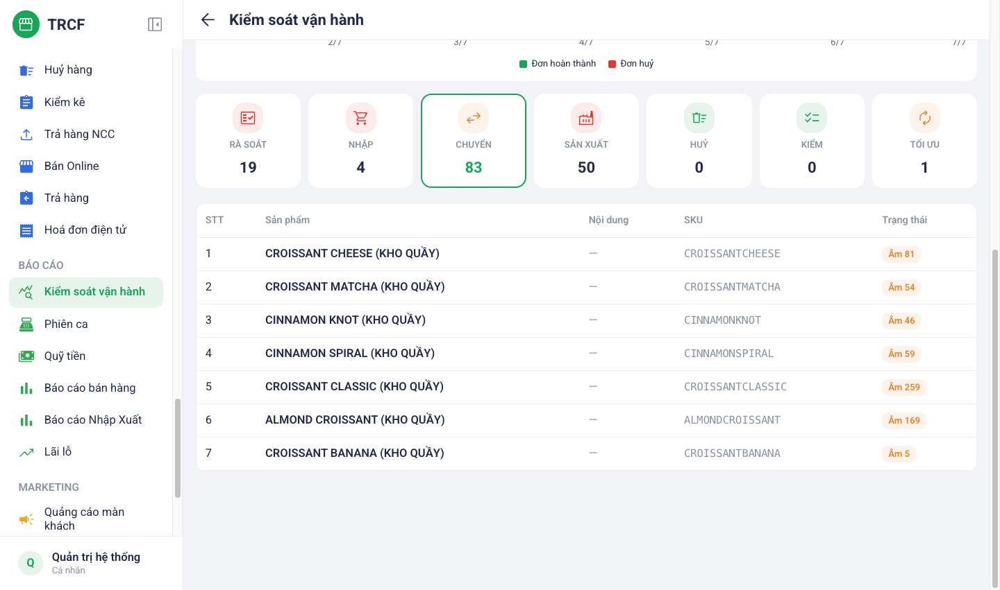
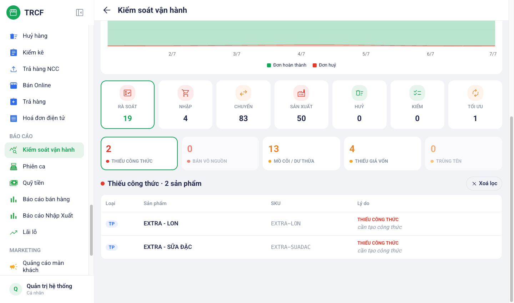

# 11.7 Đề xuất nhập hàng

## 1. Đường dẫn vào chức năng

Ba màn trong mục này:

| Màn | Đường dẫn | Dùng để |
| --- | --- | --- |
| Tồn kho hiện tại | ==Quản lý kho → Tồn kho== (`/stock`) | Khai định mức, xem hàng dưới mức |
| Kiểm soát vận hành | ==Báo cáo → Kiểm soát vận hành== (`/audit_operation`) | Nhắc việc: tồn âm, cần đặt, cần chế biến |
| Rà soát | Cùng màn trên, thẻ **RÀ SOÁT** | Bắt lỗi khai báo sản phẩm |

Màn Tồn kho cũng mở được từ ô **Tồn kho** ở khối *Tính năng cho bạn* trên Trang chủ.

## 2. Ví dụ nền và các bước thực hiện

> **Ví dụ:** chủ quán rà kho cuối tuần.
>
> - **Tồn kho**, lọc **Dưới định mức**: **ALMOND CROISSANT** ở KHO QUẦY còn −169 CÁI, dưới mức tối thiểu 10. KHO CHINH vẫn còn 30 cái.
> - **Kiểm soát vận hành**, thẻ **CHUYỂN**: các loại croissant ở KHO QUẦY đều âm. Bánh nhập về KHO CHINH ([bài 11.2](11-2-nhap-hang.md)) nhưng chưa làm phiếu chuyển ra quầy ([bài 11.3](11-3-chuyen-kho.md)).
> - Thẻ **RÀ SOÁT**: **EXTRA - LON** và **EXTRA - SỮA ĐẶC** khai là sản xuất nhưng chưa có công thức.

### Bước 1: Xem Tồn kho hiện tại

- Ở menu trái, nhóm **Quản lý kho**, bấm **Tồn kho**.
- Bấm **Dưới định mức** để chỉ xem hàng cần đặt. Các nút **Sản phẩm**, **Loại**, **Kho** để lọc thêm.
- Chưa khai định mức: xem [bài 6.2](6-2-dinh-muc-ton-kho.md).

### Bước 2: Mở Kiểm soát vận hành

- Ở menu trái, nhóm **Báo cáo**, bấm **Kiểm soát vận hành**.
- Cuộn xuống dải thẻ. Mỗi thẻ ghi số mục cần xử lý.
- Bấm thẻ **CHUYỂN** để xem hàng đang âm ở kho quầy, như ảnh.
- Nhãn *Số liệu mẫu* trên biểu đồ nghĩa là biểu đồ chưa lấy số thật. Đừng dựa vào nó.

### Bước 3: Rà soát cây sản phẩm

- Bấm thẻ **RÀ SOÁT**.
- Ô lỗi nào lớn hơn 0 thì bấm vào: hiện bảng sản phẩm mắc lỗi đó, như ảnh ô **THIẾU CÔNG THỨC**. Bấm **Xoá lọc** để quay lại.
- Ở khung **Mồ côi / Dư thừa**, bấm **Xem** để mở sản phẩm.
- Sửa lỗi ở màn sản phẩm / công thức rồi mở lại để kiểm tra.

## 3. Giải thích các trường

### Bốn ô nhắc việc

| Ô | Nghĩa |
| --- | --- |
| Việc cần xử lý | Tổng các mục cần chú ý |
| Cần rà soát dữ liệu | Lỗi khai báo sản phẩm: thiếu công thức, sai vai trò, chưa có giá vốn |
| Tồn âm cần bù | Có kho đang âm: cần nhập hoặc chuyển kho gấp |
| Cần chế biến / đặt | Hàng hết hoặc dưới định mức |

Thẻ **TỐI ƯU** có **đề xuất nhập hàng**: mặt hàng nào dưới định mức (cột *Trạng thái*, VD ALMOND CROISSANT *Tồn -169 < 10*) và **Gợi ý đặt** bao nhiêu để về mức tối đa (VD 199 = 30 − (−169)).

### Lỗi mà phần Rà soát bắt

| Lỗi | Nghĩa | Hậu quả |
| --- | --- | --- |
| **Thiếu công thức** | Khai là sản xuất nhưng chưa có công thức | Bán không trừ được nguyên liệu, không tính được giá vốn |
| **Bán vô nguồn** | Đang bán nhưng không mua, không sản xuất, không có công thức | Kho không bao giờ được cộng, chỉ âm dần |
| **Mồ côi / Dư thừa** | Không bán, không món nào dùng tới, không còn tồn | Rác trong danh sách, dễ chọn nhầm |
| **Thiếu giá vốn** | Nguyên liệu hoặc hàng bán thẳng chưa có giá vốn | Giá vốn món tính ra bị thiếu |
| **Trùng tên** | Hai sản phẩm gần giống tên | Dễ chọn nhầm |

### Lịch xem báo cáo gợi ý

| Tần suất | Xem gì | Tìm điều gì |
| --- | --- | --- |
| Cuối mỗi ca | Báo cáo ca | Chênh lệch tiền mặt |
| Hằng ngày | Tổng quan | Doanh thu, số đơn, sản phẩm dưới định mức |
| Hằng tuần | Báo cáo bán hàng ([12.1](12-1-bao-cao-ban-hang.md)), Tồn kho | Giá trị TB/đơn, hàng cần đặt |
| Hằng tháng | P&L ([12.2](12-2-bao-cao-lai-lo.md)), Kiểm soát vận hành | Tỷ lệ chi phí, lỗi khai báo |

## 4. Lưu ý quan trọng

> - Phải khai định mức trước ([bài 6.2](6-2-dinh-muc-ton-kho.md)) thì mới có cảnh báo.
> - Tồn âm là do thiếu phiếu nhập, phiếu chuyển kho hoặc công thức sai, không phải lỗi hệ thống.
