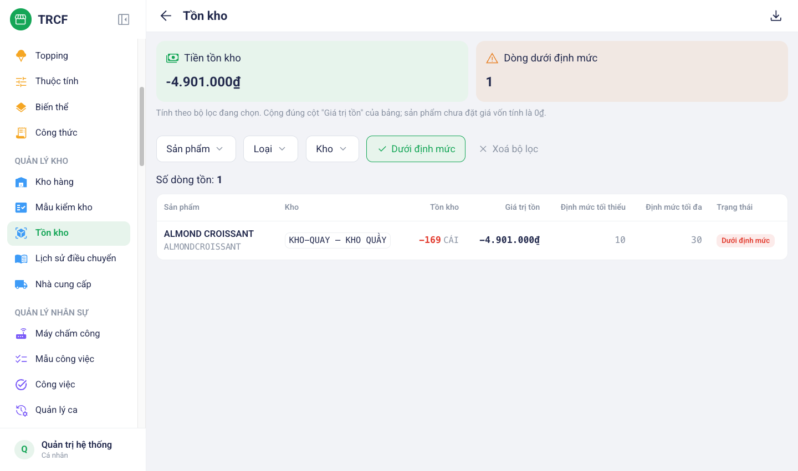

# 11.7 Đề xuất nhập hàng

## 1. Đường dẫn vào chức năng

Ba màn trong mục này:

| Màn | Đường dẫn | Dùng để |
| --- | --- | --- |
| Tồn kho hiện tại | ==Quản lý kho → Tồn kho== (`/stock`) | Khai định mức, xem hàng dưới mức |
| Kiểm soát vận hành | ==Báo cáo → Kiểm soát vận hành== (`/audit_operation`) | Nhắc việc: tồn âm, cần đặt, cần chế biến |
| Rà soát | Cùng màn trên, thẻ **RÀ SOÁT** | Bắt lỗi khai báo sản phẩm |

Màn Tồn kho cũng mở được từ ô **Tồn kho** ở khối *Tính năng cho bạn* trên Trang chủ.

## 2. Ví dụ nền và các bước thực hiện

> **Ví dụ:** chủ quán rà soát cuối tháng: xem tồn kho, rồi xem việc cần xử lý.
>
> - Trên máy này: **Cà phê sữa** bán mà chưa có công thức → bị báo **Bán vô nguồn**.

### Bước 1: Xem Tồn kho hiện tại

- Ở menu trái, nhóm **Quản lý kho**, bấm **Tồn kho**.
- Bấm **Dưới định mức** để chỉ xem hàng cần đặt. Các nút **Sản phẩm**, **Loại**, **Kho** để lọc thêm.
- Chưa khai định mức: xem [bài 6.2](6-2-dinh-muc-ton-kho.md).

### Bước 2: Mở Kiểm soát vận hành

- Ở menu trái, nhóm **Báo cáo**, bấm **Kiểm soát vận hành**.
- Nhãn *Số liệu mẫu* trên biểu đồ nghĩa là biểu đồ chưa lấy số thật. Đừng dựa vào nó.
- Mỗi thẻ ở dải dưới cùng ghi số mục cần xử lý. Bấm thẻ để xem chi tiết.

### Bước 3: Rà soát cây sản phẩm

- Cuộn xuống, bấm thẻ **RÀ SOÁT**.
- Ô lỗi nào lớn hơn 0 thì bấm vào: hiện bảng sản phẩm mắc lỗi đó. Bấm **Xoá lọc** để quay lại.
- Ở khung **Mồ côi / Dư thừa**, bấm **Xem** để mở sản phẩm.
- Sửa lỗi ở màn sản phẩm / công thức rồi mở lại để kiểm tra.

## 3. Giải thích các trường

### Bốn ô nhắc việc

| Ô | Nghĩa |
| --- | --- |
| Việc cần xử lý | Tổng các mục cần chú ý |
| Cần rà soát dữ liệu | Lỗi khai báo sản phẩm: thiếu công thức, sai vai trò, chưa có giá vốn |
| Tồn âm cần bù | Có kho đang âm: cần nhập hoặc chuyển kho gấp |
| Cần chế biến / đặt | Hàng hết hoặc dưới định mức |

Thẻ **TỐI ƯU** có **đề xuất nhập hàng**: mặt hàng nào dưới định mức (cột *Trạng thái*, VD *Tồn 4 < 20*) và **Gợi ý đặt** bao nhiêu để về mức tối đa.

### Lỗi mà phần Rà soát bắt

| Lỗi | Hậu quả |
| --- | --- |
| Món **bán mà không có công thức** (Bán vô nguồn) | Báo cáo lãi lỗ không tính được giá vốn |
| Nguyên liệu **chưa có giá vốn** | Giá vốn món tính ra bị thiếu |
| Nguyên liệu **mồ côi** | Khai vào hệ thống nhưng không món nào dùng tới |
| **Trùng tên** | Hai sản phẩm gần giống tên, dễ chọn nhầm |

### Lịch xem báo cáo gợi ý

| Tần suất | Xem gì | Tìm điều gì |
| --- | --- | --- |
| Cuối mỗi ca | Báo cáo ca | Chênh lệch tiền mặt |
| Hằng ngày | Tổng quan | Doanh thu, số đơn, sản phẩm dưới định mức |
| Hằng tuần | Báo cáo bán hàng ([12.1](12-1-bao-cao-ban-hang.md)), Tồn kho | Giá trị TB/đơn, hàng cần đặt |
| Hằng tháng | P&L ([12.2](12-2-bao-cao-lai-lo.md)), Kiểm soát vận hành | Tỷ lệ chi phí, lỗi khai báo |

## 4. Lưu ý quan trọng

> - Phải khai định mức trước ([bài 6.2](6-2-dinh-muc-ton-kho.md)) thì mới có cảnh báo.
> - Tồn âm là do thiếu phiếu nhập, phiếu chuyển kho hoặc công thức sai, không phải lỗi hệ thống.
