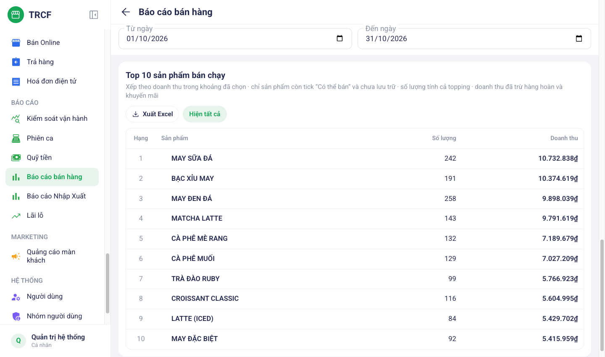

# 12.1 Báo cáo bán hàng

## 1. Đường dẫn vào chức năng

Menu trái: ==Báo cáo → Báo cáo bán hàng== (địa chỉ `/sales-report`).

- Trên điện thoại: thanh dưới cùng, bấm **Báo cáo** → **Báo cáo bán hàng**.
- Dành cho: quản lý và chủ quán.

## 2. Ví dụ nền và các bước thực hiện

> **Ví dụ:** quản lý xem kết quả bán **tháng 10/2026** (**01/10/2026** – **31/10/2026**), so với tháng 9. Số trên ảnh là dữ liệu mẫu, làm theo menu và giá thật của quán.
>
> - **1.671** đơn, **Tổng doanh thu** **192.590.000₫**.
> - Số đơn tăng 8,2% nhưng **Giá trị TB/đơn** giảm 3,6%: khách đông hơn mà mỗi khách mua ít hơn → đẩy bán thêm bánh, topping.
> - Giờ đông nhất: **8h** sáng và **15h** chiều.
> - **MAY SỮA ĐÁ** đứng đầu doanh thu, còn **MAY ĐEN ĐÁ** bán nhiều ly nhất (258 ly).

### Bước 1: Chọn kỳ và đọc các ô tổng

- Ở menu trái, nhóm **Báo cáo**, bấm **Báo cáo bán hàng**.
- Chọn **Từ ngày**, **Đến ngày** ở đầu trang (mặc định: đầu tháng tới hôm nay). Trang tự tải lại số.
- Dòng nhỏ dưới mỗi số so với kỳ liền trước cùng độ dài. Kỳ trước chưa bán gì thì hiện *Không có kỳ trước để so*.

### Bước 2: Đọc doanh thu theo ngày và theo giờ

- Ngay dưới các ô tổng là **Doanh thu theo ngày**. Cuộn tiếp xuống tới **Doanh thu theo giờ**.
- Cột cao là giờ đông: đối chiếu với lịch ca (xem lưu ý cuối bài).

### Bước 3: Đọc theo loại đơn và phương thức thanh toán

- Cuộn xuống dưới biểu đồ theo giờ: hai biểu đồ nằm cạnh nhau.

### Bước 4: Đọc Top 10 sản phẩm bán chạy

- Cuộn xuống cuối trang.
- Món có mũi tên bên trái: bấm vào để xem tách theo cỡ.
- Bấm **Hiện tất cả** để xem mọi món có doanh thu trong kỳ, kể cả món đã tắt bán.
- Bấm **Xuất Excel** để tải danh sách đầy đủ của kỳ.

## 3. Giải thích các trường

### Các ô tổng trên cùng

| Ô | Nghĩa | Dùng để |
| --- | --- | --- |
| Tổng doanh thu | Tiền thực thu từ đơn đã thanh toán, đã trừ chiết khấu | Con số quen thuộc nhất, ít giá trị nhất khi đứng một mình |
| Số đơn | Số đơn đã thanh toán trong kỳ | So sánh giữa các ngày để biết ngày nào đông |
| **Giá trị TB/đơn** | Doanh thu ÷ số đơn | **Con số đáng theo dõi nhất** |
| Số món bán | Tổng số món bán ra, **không tính topping** | Chia cho số đơn ra mỗi khách gọi mấy món |
| Tổng doanh số | Tiền bán ra trước khi trừ chiết khấu | Đối chiếu với doanh thu để thấy khuyến mãi tốn bao nhiêu |
| Chiết khấu voucher / điểm thưởng | Tiền giảm do khách dùng mã / đổi điểm | Đo hiệu quả và chi phí khuyến mãi |
| Lượt dùng voucher | Số đơn đã thanh toán có áp mã | Khác cột *Lượt dùng* ở màn Voucher |

### Đọc Giá trị TB/đơn

| Dấu hiệu | Nghĩa | Việc cần làm |
| --- | --- | --- |
| Số đơn tăng, TB/đơn không đổi | Đông khách hơn | Tăng năng lực phục vụ, chuẩn bị đủ hàng |
| Số đơn không đổi, TB/đơn tăng | Mỗi khách mua nhiều hơn | Kết quả của bán thêm, combo, topping |

### Biểu đồ và bảng bên dưới

| Phần | Nhìn ra gì |
| --- | --- |
| Doanh thu theo ngày | Ngày nào trong tuần yếu: lên khuyến mãi |
| Doanh thu theo giờ | Dùng để xếp ca cho khớp giờ đông |
| Doanh thu theo loại đơn | Tỷ trọng tại chỗ, mang đi, app giao hàng (GRAB…) |
| Doanh thu theo phương thức thanh toán | Tỷ trọng tiền mặt, chuyển khoản |
| Top 10 sản phẩm bán chạy | Món nào kéo doanh thu |

### Bảng Top 10 tính khác các ô tổng

| Điểm | Chi tiết |
| --- | --- |
| Món được xếp hạng | Chỉ món còn tick **Có thể bán** và chưa lưu trữ. **Hiện tất cả** để xem đủ |
| Số lượng | **Tính cả topping**, nên cộng cột này có thể lớn hơn ô *Số món bán* |
| Doanh thu | Đã trừ hàng khách trả lại và khuyến mãi |

### Hai màn cho hai câu hỏi khác nhau

| Câu hỏi | Xem ở đâu |
| --- | --- |
| Hôm nay quầy bán ra bao nhiêu? | Báo cáo bán hàng |
| Kỳ này quán thực lãi bao nhiêu? | Báo cáo P&L ([mục 12.2](12-2-bao-cao-lai-lo.md)) |

## 4. Lưu ý quan trọng

> - Chỉ tính đơn **đã thanh toán**.
> - Chưa trừ hàng khách trả lại từng phần; muốn số đã trừ thì xem [bài 12.2](12-2-bao-cao-lai-lo.md).
