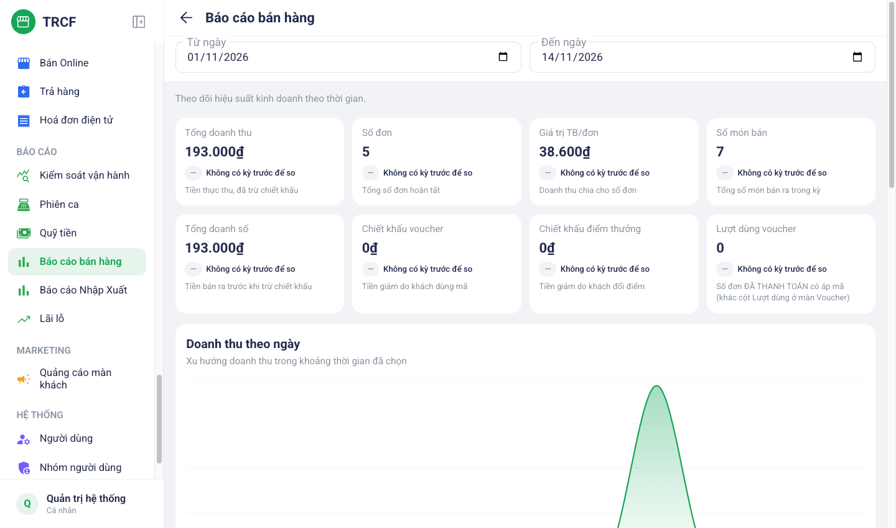
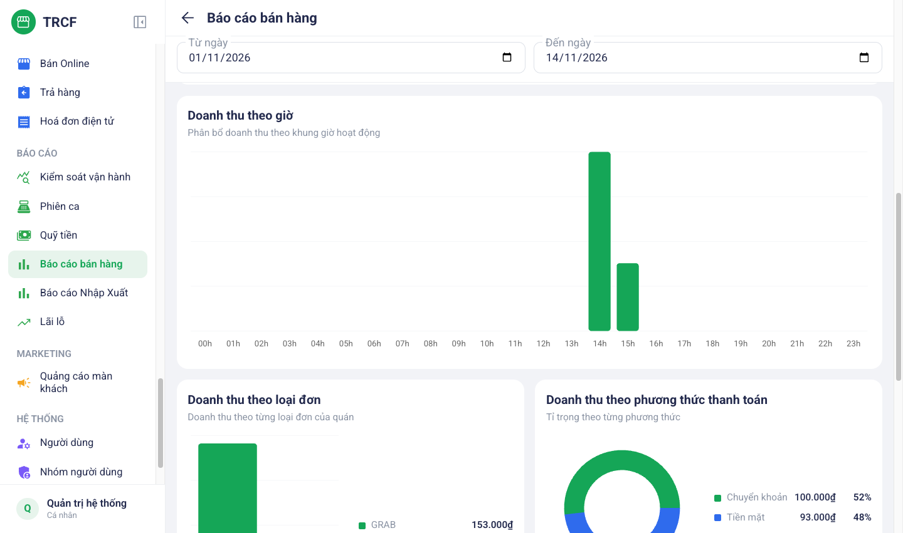
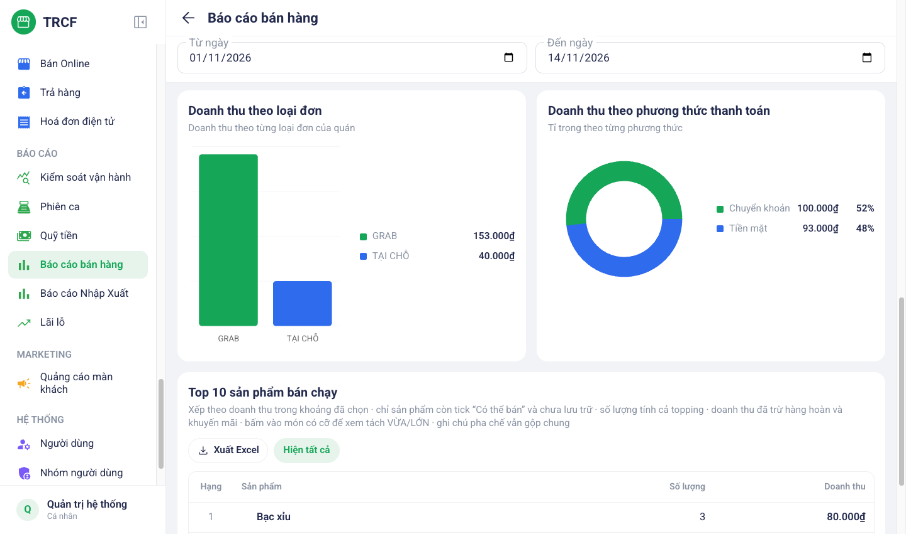

# 12.1 Báo cáo bán hàng

## 1. Đường dẫn vào chức năng

Menu trái: ==Báo cáo → Báo cáo bán hàng== (địa chỉ `/sales-report`).

- Trên điện thoại: thanh dưới cùng, bấm **Báo cáo** → **Báo cáo bán hàng**.
- Dành cho: quản lý và chủ quán.

## 2. Ví dụ nền và các bước thực hiện

> **Ví dụ:** quản lý xem kết quả bán từ đầu tháng tới hôm nay (**01/11/2026** – **14/11/2026**).
>
> - Đây là khoảng ngày mặc định khi mở trang.
> - Trên máy này: **5** đơn đã thanh toán, **Tổng doanh thu** **193.000₫**.

### Bước 1: Chọn kỳ và đọc các ô tổng

- Ở menu trái, nhóm **Báo cáo**, bấm **Báo cáo bán hàng**.
- Chọn **Từ ngày**, **Đến ngày** ở đầu trang. Trang tự tải lại số.
- Hàng ô trên: **Tổng doanh thu** (**193.000₫**), **Số đơn** (**5**), **Giá trị TB/đơn** (**38.600₫**), **Số món bán** (**7**).
- Hàng ô dưới: **Tổng doanh số**, **Chiết khấu voucher**, **Chiết khấu điểm thưởng**, **Lượt dùng voucher**.
- Dòng nhỏ dưới mỗi số: so với kỳ liền trước cùng độ dài. Kỳ trước chưa bán gì thì hiện *Không có kỳ trước để so*.

### Bước 2: Đọc doanh thu theo ngày và theo giờ

- Ngay dưới các ô tổng: biểu đồ **Doanh thu theo ngày** (mỗi ngày trong kỳ một điểm).
- Cuộn xuống: **Doanh thu theo giờ**, từ **00h** đến **23h**.
- Ví dụ trên máy này: tiền vào lúc **14h** và **15h**.

### Bước 3: Đọc theo loại đơn và phương thức thanh toán

- **Doanh thu theo loại đơn**: ví dụ **GRAB** **153.000₫**, **TẠI CHỖ** **40.000₫**.
- **Doanh thu theo phương thức thanh toán**: ví dụ **Chuyển khoản** **100.000₫** (52%), **Tiền mặt** **93.000₫** (48%).

### Bước 4: Đọc Top 10 sản phẩm bán chạy

- Cuộn xuống cuối trang: bảng **Top 10 sản phẩm bán chạy**, cột **Hạng**, **Sản phẩm**, **Số lượng**, **Doanh thu**.
- Ví dụ: hạng 1 là **Bạc xỉu**, số lượng **3**, doanh thu **80.000₫**.
- Món có mũi tên bên trái (VD **DEMO Cà phê sữa**): bấm vào để xem tách theo cỡ (VD **LỚN**).
- Bấm **Hiện tất cả** để xem mọi món có doanh thu trong kỳ, kể cả món đã tắt bán.
- **Xuất Excel** tải về danh sách đầy đủ của kỳ.

## 3. Giải thích các trường

### Các ô tổng trên cùng

| Ô | Nghĩa | Dùng để |
| --- | --- | --- |
| Tổng doanh thu | Tiền thực thu từ đơn đã thanh toán, đã trừ chiết khấu | Con số quen thuộc nhất, ít giá trị nhất khi đứng một mình |
| Số đơn | Số đơn đã thanh toán trong kỳ | So sánh giữa các ngày để biết ngày nào đông |
| **Giá trị TB/đơn** | Doanh thu ÷ số đơn | **Con số đáng theo dõi nhất** |
| Số món bán | Tổng số món bán ra, **không tính topping** | Chia cho số đơn ra mỗi khách gọi mấy món |
| Tổng doanh số | Tiền bán ra trước khi trừ chiết khấu | Đối chiếu với doanh thu để thấy khuyến mãi tốn bao nhiêu |
| Chiết khấu voucher / điểm thưởng | Tiền giảm do khách dùng mã / đổi điểm | Đo hiệu quả và chi phí khuyến mãi |
| Lượt dùng voucher | Số đơn đã thanh toán có áp mã | Khác cột *Lượt dùng* ở màn Voucher |

### Đọc Giá trị TB/đơn

| Dấu hiệu | Nghĩa | Việc cần làm |
| --- | --- | --- |
| Số đơn tăng, TB/đơn không đổi | Đông khách hơn | Tăng năng lực phục vụ, chuẩn bị đủ hàng |
| Số đơn không đổi, TB/đơn tăng | Mỗi khách mua nhiều hơn | Kết quả của bán thêm, combo, topping |

### Biểu đồ và bảng bên dưới

| Phần | Nhìn ra gì |
| --- | --- |
| Doanh thu theo ngày | Ngày nào trong tuần yếu: lên khuyến mãi |
| Doanh thu theo giờ | Dùng để xếp ca cho khớp giờ đông |
| Doanh thu theo loại đơn | Tỷ trọng tại chỗ, mang đi, app giao hàng (GRAB…) |
| Doanh thu theo phương thức thanh toán | Tỷ trọng tiền mặt, chuyển khoản |
| Top 10 sản phẩm bán chạy | Món nào kéo doanh thu |

### Bảng Top 10 tính khác các ô tổng

| Điểm | Chi tiết |
| --- | --- |
| Món được xếp hạng | Chỉ món còn tick **Có thể bán** và chưa lưu trữ. **Hiện tất cả** để xem đủ |
| Số lượng | **Tính cả topping**, nên cộng cột này có thể lớn hơn ô *Số món bán* |
| Doanh thu | Đã trừ hàng khách trả lại và khuyến mãi |

### Hai màn cho hai câu hỏi khác nhau

| Câu hỏi | Xem ở đâu |
| --- | --- |
| Hôm nay quầy bán ra bao nhiêu? | Báo cáo bán hàng |
| Kỳ này quán thực lãi bao nhiêu? | Báo cáo P&L ([mục 12.2](12-2-bao-cao-lai-lo.md)) |

## 4. Lưu ý quan trọng

> [!CAUTION]
> **Chỉ tính đơn ĐÃ THANH TOÁN.**
>
> - Đơn treo trên bàn, đơn đã lưu chưa thu tiền: không nằm trong báo cáo.
> - Thấy doanh thu thấp hơn cảm nhận: kiểm đơn chưa thu tiền trước khi nghi ngờ số liệu.

> [!WARNING]
> **Ô Tổng doanh thu chưa trừ hàng khách trả lại từng phần.**
>
> - Đơn hoàn hết thì tự rời báo cáo. Đơn chỉ trả lại vài món thì vẫn tính đủ tiền.
> - Muốn doanh thu đã trừ hàng hoàn: đọc báo cáo P&L ([mục 12.2](12-2-bao-cao-lai-lo.md)).

> [!TIP]
> Đối chiếu doanh thu theo giờ với lịch ca ([bài 9.2](9-2-dang-ky-va-duyet-ca.md)).
>
> - Giờ cao điểm mà chỉ một người đứng quầy: đó là **doanh thu đang bị bỏ lỡ**, không phải quán vắng.

> [!TIP]
> Doanh thu ở đây lệch nhiều so với **Doanh thu bán** ở P&L: khách trả hàng nhiều.
>
> - Kiểm ==Vận hành → Trả hàng== để biết trả vì lý do gì.

## Kiểm tra đã đúng

- [ ] Đã chọn đúng khoảng ngày cần xem
- [ ] Đã nhìn **Giá trị TB/đơn** và so với kỳ trước
- [ ] Đã đối chiếu doanh thu theo giờ với lịch ca
