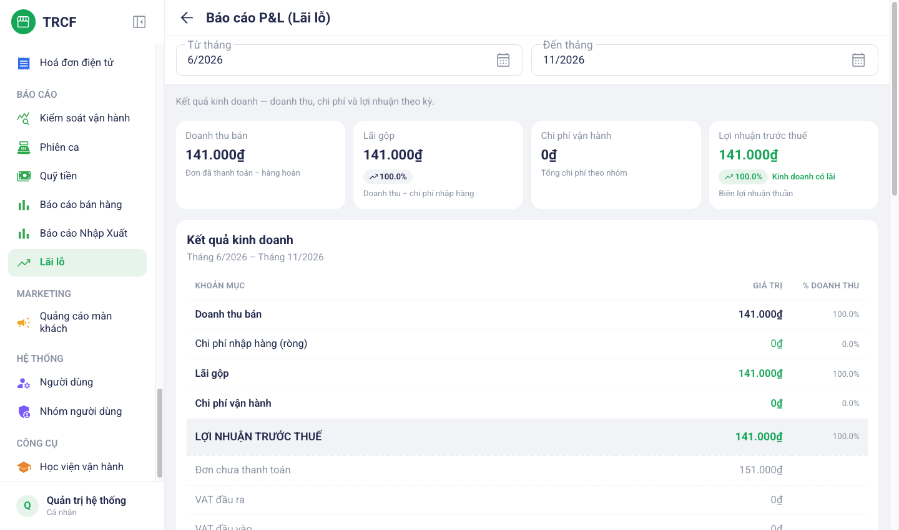
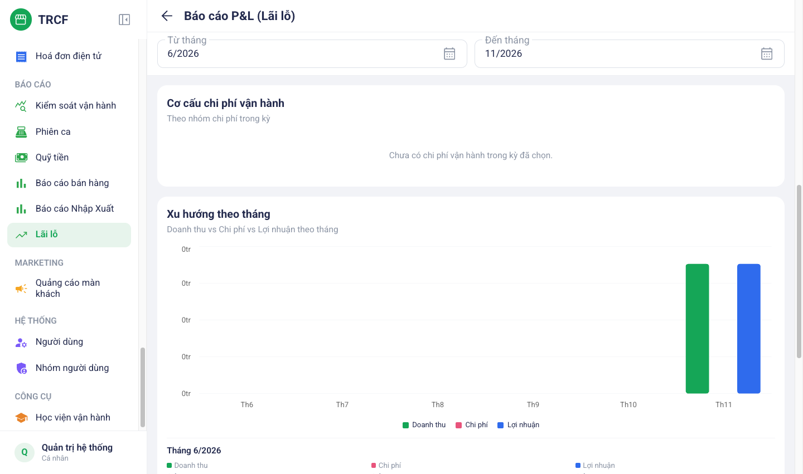

# 12.2 Báo cáo lãi lỗ (P&L)

## 1. Đường dẫn vào chức năng

Menu trái: ==Báo cáo → Lãi lỗ== (địa chỉ `/pnl-report`, tiêu đề trang **Báo cáo P&L (Lãi lỗ)**).

- Hoặc trên Trang chủ: thẻ **HÔM NAY**, bấm **Xem lãi lỗ**.
- Trên điện thoại: thanh dưới cùng, bấm **Báo cáo** → **Lãi lỗ**.
- Dành cho: quản lý và chủ quán.

## 2. Ví dụ nền và các bước thực hiện

> **Ví dụ:** chủ quán xem kết quả kinh doanh 6 tháng gần nhất (**Tháng 6/2026** – **Tháng 11/2026**).
>
> - Đây là kỳ mặc định khi mở trang.
> - Trên máy này: **Doanh thu bán** **141.000₫**. Chưa có đơn mua hàng và phiếu chi nào, nên **Lãi gộp** và **Lợi nhuận trước thuế** cũng là **141.000₫** (100.0%).

### Bước 1: Chọn kỳ, đọc 4 ô tổng và bảng Kết quả kinh doanh

- Ở menu trái, nhóm **Báo cáo**, bấm **Lãi lỗ**.
- Bấm ô **Từ tháng**, chọn tháng trong danh sách. Làm tương tự với **Đến tháng**.
- Kỳ lỗ thì ô **Lợi nhuận trước thuế** ghi *Kinh doanh lỗ*.
- Nhóm dòng dưới **LỢI NHUẬN TRƯỚC THUẾ** chỉ để tham khảo, không tính vào lãi lỗ.



### Bước 2: Đọc biểu đồ

- Cuộn xuống: **Cơ cấu chi phí vận hành** cho thấy nhóm chi phí nào ăn nhiều nhất.
- Cuộn tiếp: dưới **Xu hướng theo tháng** có số cụ thể từng tháng.



## 3. Giải thích các trường

### Bốn ô tổng nối với nhau

```
Doanh thu bán                 (đơn đã thanh toán − hàng hoàn)
  −  Chi phí nhập hàng (ròng) (đơn mua − tiền trả lại NCC)
  =  Lãi gộp
  −  Chi phí vận hành         (tổng phiếu chi theo nhóm)
  =  Lợi nhuận trước thuế
```

> **Ví dụ minh hoạ** (số giả định, không phải số trên ảnh):
>
> - Doanh thu bán 100 triệu − chi phí nhập hàng 40 triệu = lãi gộp 60 triệu (60%).
> - Lãi gộp 60 triệu − chi phí vận hành 35 triệu = lợi nhuận trước thuế 25 triệu (25%).

### Từng ô lấy số từ đâu

| Ô | Nguồn |
| --- | --- |
| Doanh thu bán | Tiền món của đơn bán **đã thanh toán**, **trừ** phiếu trả hàng đã xác nhận (==Vận hành → Trả hàng==) |
| Chi phí nhập hàng (ròng) | Đơn mua **Đã xác nhận**, **Đã nhập kho**, **Đã trả hàng** — **kể cả chưa trả tiền NCC** — tính theo ngày đặt hàng, trừ phiếu trả hàng NCC đã xác nhận (==Vận hành → Trả hàng NCC==). Xem [mục 11.2](11-2-nhap-hang.md) |
| Lãi gộp | Doanh thu bán − chi phí nhập hàng |
| Chi phí vận hành | Mọi phiếu chi **chưa huỷ, chưa lưu trữ** — **kể cả Nháp và Chưa thanh toán** — tính theo **Ngày thanh toán**, gom theo danh mục ([mục 10.2](10-2-tao-chi-phi.md)) |
| Lợi nhuận trước thuế | Lãi gộp − chi phí vận hành, **cộng phí ship** khách trả (nếu có). Bảng chưa có dòng phí ship, nên kỳ có ship thì số này lớn hơn phép trừ trên màn |

### Nhóm chỉ số tham khảo (dưới đường kẻ)

| Dòng | Nghĩa |
| --- | --- |
| Đơn chưa thanh toán | Tổng tiền các đơn trong kỳ chưa thu (khách còn nợ) |
| VAT đầu ra / VAT đầu vào | Thuế trên đơn bán / đơn mua |
| Giá trị tồn kho | Tồn hiện tại × giá vốn sản phẩm |
| COGS nguyên liệu (tham khảo) | Nguyên liệu đã dùng làm món (qua công thức) + nguyên liệu huỷ |

## 4. Lưu ý quan trọng

> - Chi phí nhập hàng là tiền mua trong kỳ, không phải giá vốn hàng đã bán: nên xem theo quý.
> - Chỉ khoản chi có phiếu mới vào báo cáo, kể cả lương.
> - Phiếu chi **Nháp** vẫn bị trừ: lập nhầm thì **Huỷ phiếu**.
