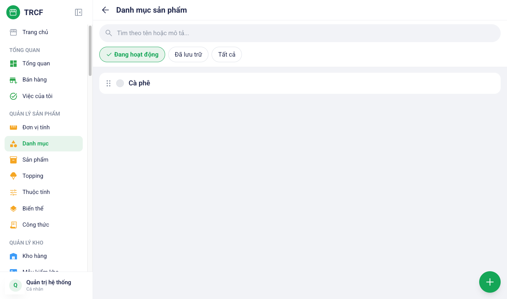
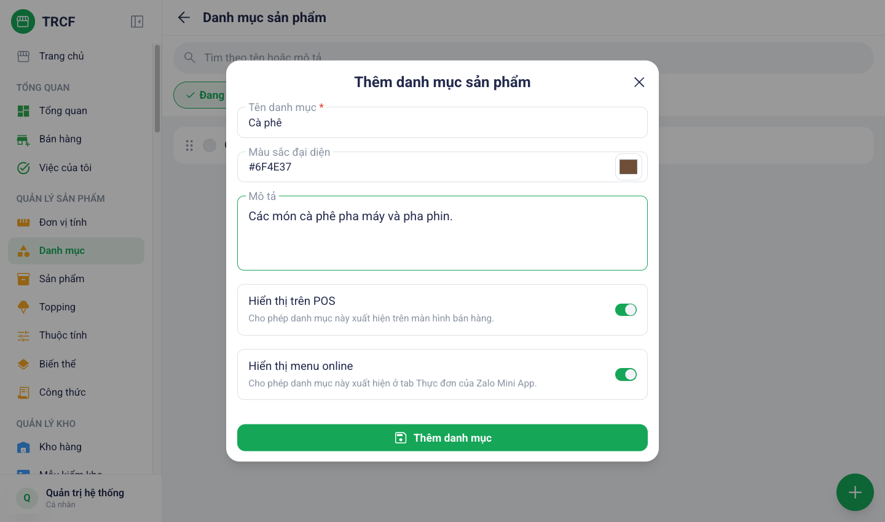
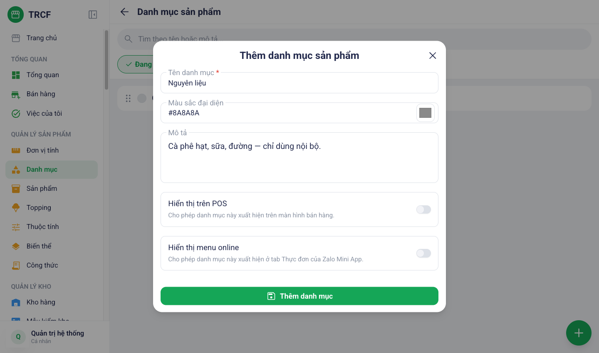
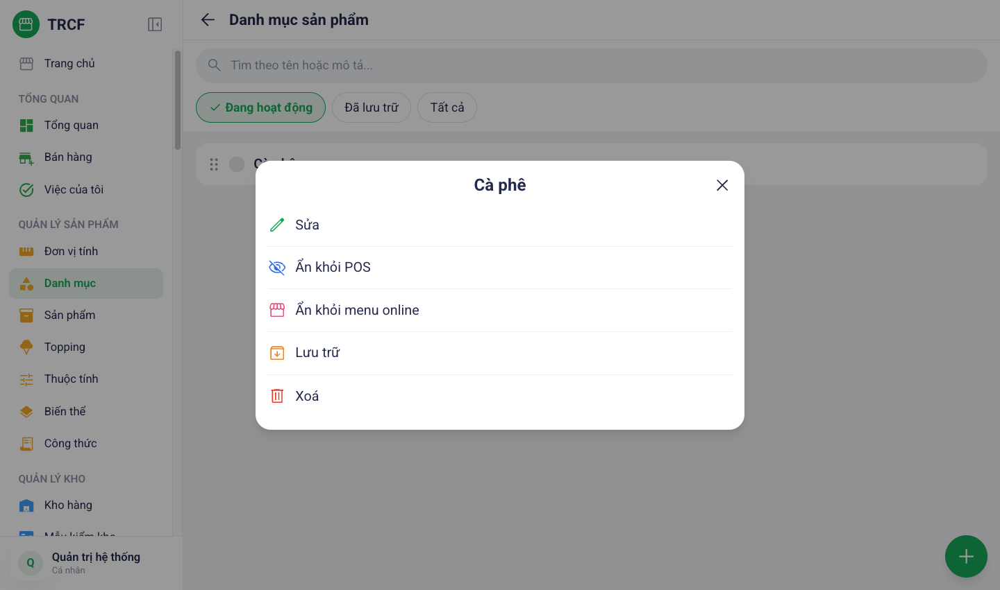

# 2.1 Danh mục sản phẩm

## 1. Đường dẫn vào chức năng

Menu trái: ==Quản lý sản phẩm → Danh mục== (địa chỉ `/product-categories`).

## 2. Ví dụ nền và các bước thực hiện

> **Ví dụ:** quán tạo 2 danh mục.
>
> - **Cà phê**: nhóm món bán, hiện trên màn bán hàng.
> - **Nguyên liệu**: cà phê hạt, sữa, đường — chỉ dùng nội bộ, ẩn khỏi màn bán hàng.

### Bước 1: Mở trang Danh mục

- Ở menu trái, nhóm **Quản lý sản phẩm**, bấm **Danh mục**.
- Xem danh sách danh mục đang hoạt động.
- Bấm **Đã lưu trữ** hoặc **Tất cả** để xem danh mục đã cất đi.

### Bước 2: Thêm danh mục hiện trên POS

- Bấm nút tròn **+** ở góc dưới bên phải.
- **Tên danh mục**: nhập **Cà phê**.
- **Màu sắc đại diện**: nhập **#6F4E37**, hoặc bấm ô màu bên phải để chọn.
- **Mô tả**: nhập **Các món cà phê pha máy và pha phin.**
- **Hiển thị trên POS**: để **bật**.
- **Hiển thị menu online**: để **bật** nếu bán qua Zalo Mini App.
- Bấm **Thêm danh mục**.

### Bước 3: Thêm danh mục chỉ dùng nội bộ

- Bấm nút tròn **+** lần nữa.
- **Tên danh mục**: nhập **Nguyên liệu**.
- **Màu sắc đại diện**: nhập **#8A8A8A**.
- **Mô tả**: nhập **Cà phê hạt, sữa, đường — chỉ dùng nội bộ.**
- **Hiển thị trên POS**: gạt sang **tắt**.
- **Hiển thị menu online**: gạt sang **tắt**.
- Bấm **Thêm danh mục**.

### Bước 4: Kiểm tra và xếp thứ tự

- Thấy thông báo *“Đã thêm danh mục sản phẩm”*.
- Danh mục tắt hiển thị có nhãn **Ẩn POS**, **Ẩn online**.
- Kéo biểu tượng **⠿** bên trái để đổi thứ tự. Xếp nhóm bán chạy lên đầu.
- Đổi ý sau này: bấm vào danh mục, chọn **Ẩn khỏi POS** hoặc **Sửa**.

## 3. Giải thích các trường

| Trường               | Điền gì                                                          | Bắt buộc |
| -------------------- | ---------------------------------------------------------------- | -------- |
| Tên danh mục         | VD **Cà phê**, **Trà trái cây**                                  | ✅        |
| Màu sắc đại diện     | Màu nút trên màn bán hàng, giúp thu ngân nhận diện nhanh         | —        |
| Mô tả                | Ghi chú nội bộ                                                   | —        |
| Hiển thị trên POS    | **Bật**: hiện trên màn bán hàng. **Tắt**: chỉ dùng nội bộ        | —        |
| Hiển thị menu online | **Bật**: hiện ở tab Thực đơn của Zalo Mini App. **Tắt**: ẩn khỏi menu online | —        |

## 4. Lưu ý quan trọng

> [!CAUTION]
> **Danh mục đang gắn sản phẩm thì không xoá được.**
>
> - Muốn ẩn khỏi POS: bấm vào danh mục, chọn **Ẩn khỏi POS**.
> - Ngừng dùng hẳn: chọn **Lưu trữ**, đừng xoá.

> [!TIP]
> **Gom nguyên liệu vào một danh mục riêng và tắt hiển thị.**
>
> - Quản lý vẫn lọc được.
> - Thu ngân không thấy nguyên liệu trên màn bán hàng.

## Kiểm tra đã đúng

- [ ] Danh mục hiện trong danh sách ở bộ lọc **Đang hoạt động**
- [ ] Danh mục nguyên liệu có nhãn **Ẩn POS**
- [ ] Nhóm bán chạy đã kéo lên đầu danh sách
