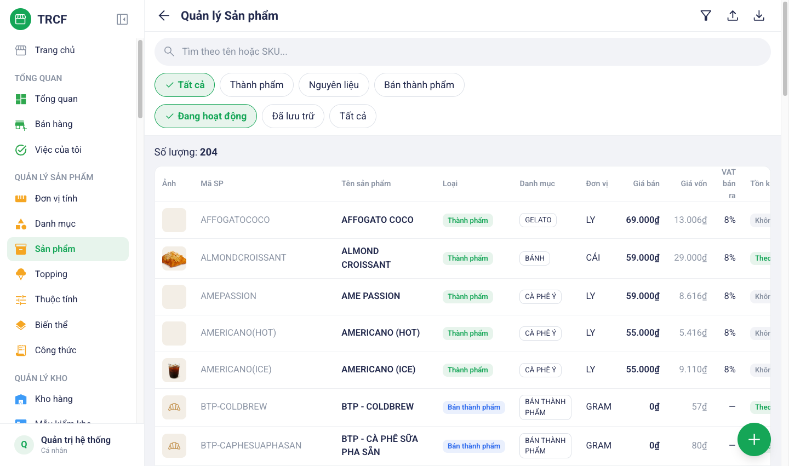
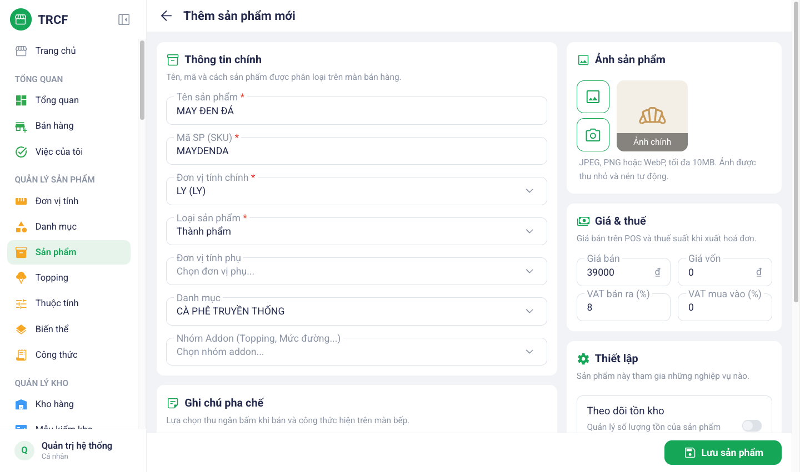
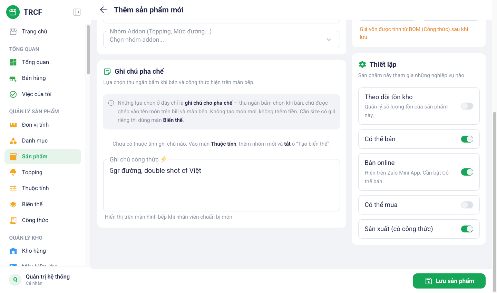

# 2.2 Thành phẩm

## 1. Đường dẫn vào chức năng

Menu trái: ==Quản lý sản phẩm → Sản phẩm== (địa chỉ `/products`), bấm nút tròn **+** để mở form thêm mới (`/products/new`).

- Cần có trước: đơn vị tính ([mục 1.1](1-1-thiet-lap-don-vi-tinh.md)).
- Nên có trước: danh mục ([mục 2.1](2-1-danh-muc-san-pham.md)).

### Công tắc theo loại hàng

| Loại hàng                                          | Tồn kho | Có thể bán | Có thể mua | Sản xuất (Có công thức) |
| -------------------------------------------------- | ------- | ---------- | ---------- | ----------------------- |
| MAY ĐEN ĐÁ (THÀNH PHẨM - ĐƯỢC PHA CHẾ)             | ❌       | ✅          | ❌          | ✅                       |
| NL - CÀ PHÊ VIỆT PHA PHIN - 1000 - 30 (NGUYÊN LIỆU) | ✅       | ❌          | ✅          | ❌                       |
| BTP - TRÀ LÀI (BÁN THÀNH PHẨM)                     | ✅       | ❌          | ❌          | ✅                       |
| CROISSANT CLASSIC (THÀNH PHẨM - MUA SẴN BÁN LẠI)   | ✅       | ✅          | ✅          | ❌                       |

## 2. Ví dụ nền và các bước thực hiện

> **Ví dụ:** thêm món **MAY ĐEN ĐÁ** vào danh mục **CÀ PHÊ TRUYỀN THỐNG**, bán theo ly, giá 39.000₫, VAT bán ra 8%.
>
> - Bán tại quầy và trên Zalo Mini App: bật **Có thể bán**, **Bán online**.
> - Pha từ cà phê phin và đường nước: bật **Sản xuất (có công thức)**. Công thức làm ở [bài 3.2](3-2-cong-thuc-thanh-pham.md).

### Bước 1: Mở trang Sản phẩm

- Ở menu trái, nhóm **Quản lý sản phẩm**, bấm **Sản phẩm**.
- Bấm nút tròn **+** ở góc dưới bên phải.

### Bước 2: Khai thông tin chính và giá

- Điền như ảnh.
- **Danh mục**: bấm vào ô, tích danh mục đã tạo ở mục 2.1, bấm **Xong**.

### Bước 3: Gạt các công tắc và lưu

- Cuộn xuống khung **Thiết lập** (cột phải).
- Gạt công tắc như ảnh. **Ghi chú công thức ⚡** không bắt buộc.
- Bấm **Lưu sản phẩm**.

## 3. Giải thích các trường

### Cột trái — Thông tin chính và Ghi chú pha chế

| Trường                             | Điền gì                                                                                                 | Bắt buộc |
| ---------------------------------- | ------------------------------------------------------------------------------------------------------- | -------- |
| Tên sản phẩm                       | Tên hiện trên bill và màn bếp                                                                           | ✅        |
| Mã SP (SKU)                        | Mã ngắn để tra cứu. VD **MAYDENDA**                                                                     | ✅        |
| Đơn vị tính chính                  | Đơn vị tính tồn. Đồ uống thì chọn **LY**. Nguyên liệu thì chọn **GRAM**                                 | ✅        |
| Loại sản phẩm                      | Thành phẩm / Bán thành phẩm / Nguyên liệu → xem [2.3](2-3-ban-thanh-pham.md), [2.4](2-4-nguyen-lieu.md) | ✅        |
| Đơn vị tính phụ                    | Đơn vị khác dùng cho hàng này (nhập theo KG, trừ theo GRAM)                                             | —        |
| Danh mục                           | Một hoặc nhiều nhóm ở mục 2.1                                                                           | —        |
| Nhóm Addon (Topping, Mức đường...) | Nhóm topping, mức đường hỏi khi bán món này                                                             | —        |
| Ghi chú pha chế                    | Mỗi thuộc tính một ô chọn (VD **ĐÁ**). Thu ngân bấm khi bán, chữ ghép vào tên món. Không thêm tiền      | —        |
| Ghi chú công thức ⚡                | Văn bản tự do hiện trên màn bếp khi làm món                                                             | —        |

### Cột phải

| Trường                             | Điền gì                                                    |
| ---------------------------------- | ---------------------------------------------------------- |
| Ảnh sản phẩm                       | **Chọn ảnh** hoặc **Chụp ảnh**. JPEG, PNG, WebP, tối đa 10MB. Hệ thống tự nén |
| Giá bán                            | Giá trên POS                                               |
| Giá vốn                            | Giá nhập. **Bị khoá** nếu bật công tắc *Sản xuất*          |
| VAT bán ra (%) / VAT mua vào (%)   | Thuế suất áp cho món khi xuất hoá đơn                      |

### Các công tắc — quyết định hành vi hệ thống

| Công tắc                | Bật khi                                      | Hệ quả                                                      |
| ----------------------- | -------------------------------------------- | ----------------------------------------------------------- |
| Theo dõi tồn kho        | Hàng cần đếm tồn: nguyên liệu, bánh đóng gói | Hiện ở màn Tồn kho, bị cộng/trừ khi nhập, bán, huỷ          |
| Có thể bán              | Món bán cho khách                            | Hiện trên màn bán hàng                                      |
| Bán online              | Bán qua Zalo Mini App (cần bật *Có thể bán*) | Hiện trên Zalo Mini App                                     |
| Có thể mua              | Hàng mua từ nhà cung cấp                     | Chọn được trong phiếu nhập hàng                             |
| Sản xuất (có công thức) | Món pha chế từ nguyên liệu                   | Dùng được công thức; **giá vốn bị khoá**, do công thức tính |

## 4. Lưu ý quan trọng

> - Bật **Sản xuất** thì ô Giá vốn bị khoá, giá vốn do công thức tính.
> - Tên và SKU không được trùng.
> - Đã bán, đã nhập hoặc nằm trong công thức thì không xoá được, chọn **Lưu trữ**.
